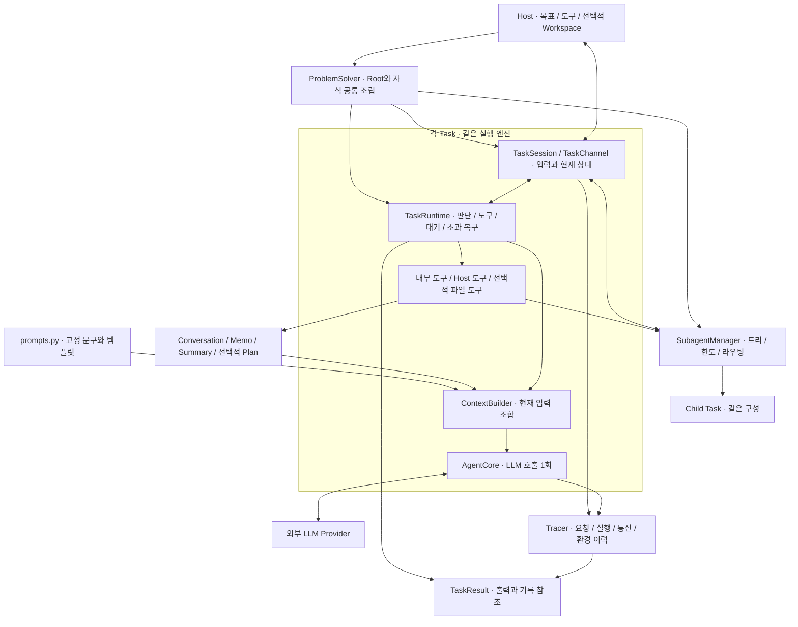
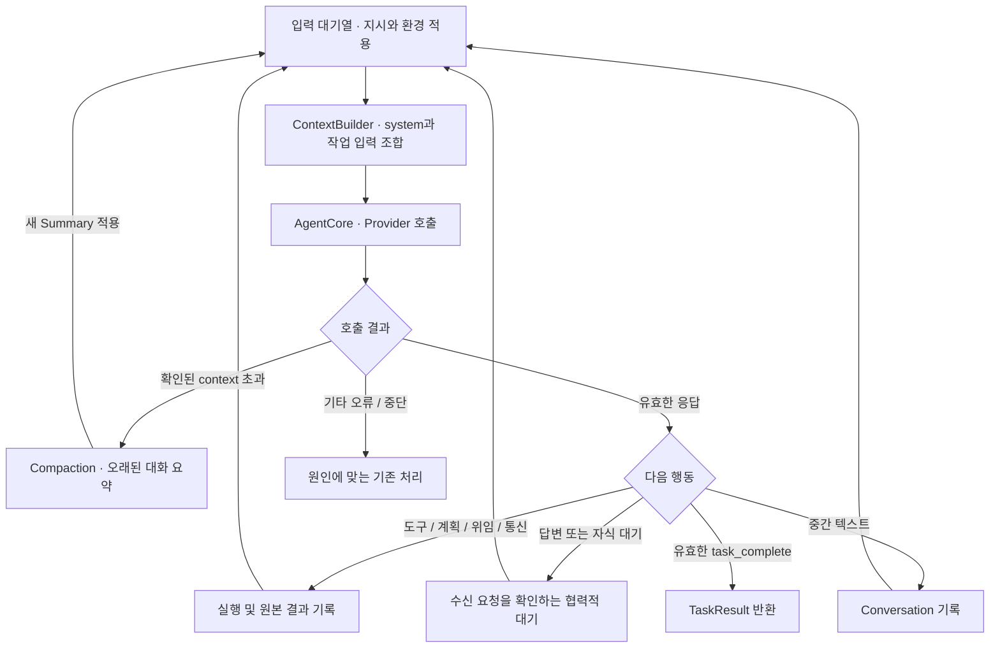
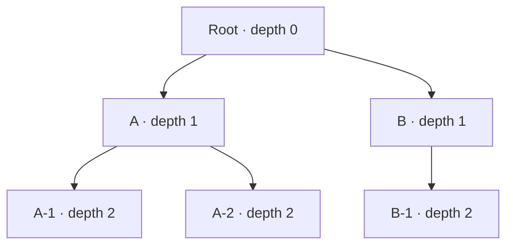
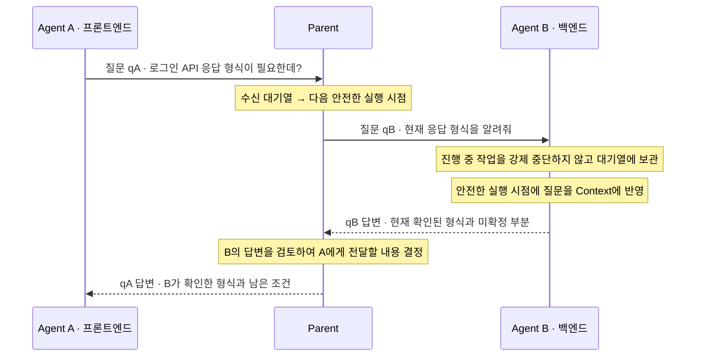
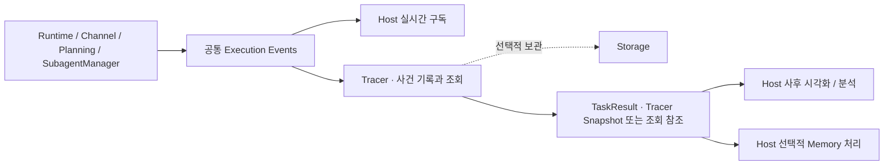
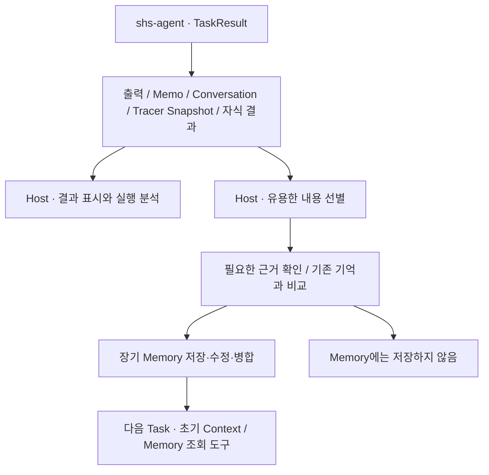

# shs-agent — 최종 목표 아키텍처 및 구현 원칙

> **문서 버전:** v1.1 · 합의된 개발 기준선 (Target Architecture Baseline)  
> **작성일 / 최종 정리일:** 2026-10-17 / 2026-10-20  
> **프로젝트 경로:** `docs/dev/architecture/SHS_AGENT_TARGET_ARCHITECTURE.md`  
> **대상:** shs-agent 개발자, Host 개발자, Codex 등 구현을 수행하는 에이전트
>
> **문서의 의미:** 지금까지 합의한 최종 구조와 요구사항을 하나로 정리한 개발 기준이다. 라이브러리 v1.0 릴리스나 기능 구현 완료를 뜻하지 않는다. 자료로 확인한 구현 기준선과 이번 개정의 미구현 범위는 [15절](#section-15), 아직 결정하지 않은 실행 정책은 [18절](#section-18)에 구분한다.
>
> **적용 방식:** 아키텍처와 책임 경계는 이 문서를 따른다. 예시 클래스명·필드·도구 스키마는 해당 의미를 구현하기 위한 제안이며 정확한 공개 API는 현재 소스와 대조해 확정한다. 이 문서 자체를 모든 기능의 일괄 구현 지시로 해석하지 않는다.

**한 문장 정의:** shs-agent는 Host가 맡긴 Task를 외부 LLM·도구와 선택적 Workspace로 해결하고, 각 Agent가 필요할 때 계획·재귀 위임·부모와의 통신을 사용하며, 실제 입력과 실행 근거를 Host가 관찰·재구성·선택적으로 장기 기억화할 수 있게 제공하는 경량 Python 라이브러리다.

**2026-10-20 개정 기준:** 프롬프트는 Python 상수·템플릿으로 중앙 관리한다. ContextBuilder는 실제 역할·관계·도구·선택적 Workspace를 system 블록으로 조합한다. 자식은 부모가 작성한 작은 작업과 필요한 환경을 받는다. Planning은 Agent별 선택 기능이며 직계 부모의 계획은 필요할 때 읽기 전용으로 조회한다. Context 압축은 확인된 한도 초과를 복구하여 같은 Task를 계속하는 절차로 정의한다. **이 개정은 설계 문서 수정이며 해당 기능의 구현·테스트 완료를 뜻하지 않는다.**

## 문서 안내

| 기본 구조 | 협업·반환·개발 기준 |
|---|---|
| [1. 프로젝트 정의](#section-1) · [2. 비목표](#section-2) | [11. 부모↔자식 통신](#section-11) |
| [3. 용어와 책임](#section-3) · [4. 아키텍처](#section-4) | [12. 실시간 관찰과 Tracer](#section-12) |
| [5. Task 실행 계약](#section-5) | [13. TaskResult와 Host Memory](#section-13) |
| [6. 경량 실행·LLM](#section-6) | [14. 공개 API 사용 예시](#section-14) |
| [7. Tool·Workspace](#section-7) | [15. 현재 구현 기준선](#section-15) |
| [8. Conversation·Memo·프롬프트·ContextBuilder](#section-8) | [16. 단계별 구현](#section-16) · [17. 수용 기준](#section-17) |
| [9. Planning·Replanning](#section-9) · [10. 재귀 Sub-agent](#section-10) | [18. 남은 결정](#section-18) · [19. 근거와 변경 이력](#section-19) |

---

<a id="section-1"></a>

## 1. 프로젝트 정의

**shs-agent는 외부 LLM과 Host가 제공한 실행 환경·도구를 이용하여, 주어진 Task를 해결하는 독립적이고 경량인 Python 라이브러리다.**

- **범용성:** Windows 코딩 에이전트, CLI, 웹/서버, 자율형 에이전트 등 다양한 Host가 동일한 엔진을 재사용한다.
- **경량성:** 모델 가중치를 로드하거나 추론 서버를 운영하지 않는다. GPU·CUDA·PyTorch 등의 AI 실행 환경이 기본 요구사항이 되어서는 안 된다.
- **분리된 책임:** Host는 무엇을 할지 결정하고 환경·권한·사용자 접점을 제공한다. shs-agent는 전달받은 작업을 어떻게 해결할지 판단하고 실행한다.
- **상호작용:** 실행 중에도 Host와 소통하며, Sub-agent가 있으면 부모와 자식도 질문·답변·정보·지시를 주고받는다.
- **관찰 가능성:** 구조화된 이벤트로 전체 실행 트리를 실시간 관찰하고, 반환된 실행 기록으로 종료 후에도 과정을 재구성한다. 표시 방식과 상세 수준은 Host가 선택한다.
- **선택적 협업:** 간단한 Task는 단일 Agent로 해결한다. 필요할 때만 계획을 세우고 작업을 자식에게 위임하며, 상황에 따라 계획을 수정한다.
- **교체 가능성:** Provider, 모델, 도구 집합, 작업 공간, 저장소를 가능한 한 독립적으로 선택·연결한다.

### 1.1 핵심 사용 사례

1. Windows 코딩 에이전트: 프로젝트를 탐색하고 코드를 수정한 후 테스트한다.
2. 서버/CLI: 작업을 비대화식으로 수행하고 결과를 반환한다.
3. 자율형 Life Agent: 상위 에이전트가 필요한 시점에 구체적인 문제를 shs-agent에 위임한다.
4. 병렬 문제해결: 독립적인 영역을 여러 Sub-agent가 조사하고, 부모가 결과를 통합한다.
5. 협력적 문제해결: 자식이 필요한 정보를 부모에게 요청하고, 부모가 다른 자식이나 Host에서 확인하여 답한다.
6. 실행 분석과 경험 축적: Host가 실시간·사후 실행 과정을 표시하고, 결과와 근거에서 유용한 부분만 장기 Memory에 반영한다.

**부모와 자식은 같은 문제해결 엔진을 사용한다.** Sub-agent는 별도의 인격이나 지속적인 삶을 가진 Life Agent가 아니라, 위임받은 Task를 수행하는 실행 단위다.

<a id="section-2"></a>

## 2. 비목표(Non-goals)

다음은 shs-agent Core 자체의 책임이 아니다.

- 모델 학습·파인튜닝·가중치 로딩·GPU 스케줄링·Ollama/vLLM 서버 운영.
- 성격·감정·욕구·자기 목표 생성·24시간 생활 루프와 자율형 에이전트의 사회적 관계.
- Windows 앱, 채팅 화면, 로그인, 사용자 승인 UI, 그래프·타임라인 렌더링 등 Host 고유 화면.
- 영구 플러그인 설치·업데이트·사용자 인증·외부 계정과 권한의 소유.
- Host의 장기 Memory 저장·선별·검색 정책 및 MindMap 자체의 구현.
- 모든 플랫폼의 실행 도구 내장, 필수 Git worktree·컨테이너·별도 프로세스 운영.
- 모든 Task에 계획·Sub-agent·DB·임베딩 모델을 강제하는 구조.
- 시각화 서버·웹 프레임워크·외부 추적 서비스의 필수 설치, 제공되지 않은 모델 내부 추론 과정의 복원.

> 도구를 **등록·호출·결과 처리**하는 것과, 도구의 **실제 구현·권한·인증·실행 환경을 소유**하는 것은 다르다. Sub-agent의 추가 도구 요청이나 Replan으로 이 경계가 사라지지 않는다.

<a id="section-3"></a>

## 3. 용어 및 시스템 책임 경계

### 3.1 용어

| 용어 | 정의 | 범위 / 소유자 |
|---|---|---|
| **Task** | 하나의 목표를 전달받아 해결하는 작업 단위 | shs-agent |
| **Root Task** | Host가 시작한 실행 트리의 최상위 Task | 깊이 0, 상위 역할은 Host. 실제 부모 Agent Task는 없음 |
| **Parent 연결** | Agent가 작업·답변·자원 제공을 요청하는 상위 인터페이스 | Root에는 Host 연결, 자식에는 직접 부모 Agent 연결 |
| **Sub-agent / Child Task** | 부모가 작업 일부를 위임하여 생성한 Task | 직접 부모를 가지며 재귀 생성 가능 |
| **Conversation** | 현재 Task에 기록된 입력·응답·도구 호출과 결과·Agent 간 송수신 내용의 원본 이력 | Task별 독립 |
| **Memo** | 현재 작업에서 활용할 발견·근거·주의사항 등의 명시적 작업 메모 | Task별 독립 |
| **Summary** | 오래된 Conversation에서 파생된 압축 요약 | 원본 이력을 대체하지 않음 |
| **Context** | 특정 LLM 호출에 실제로 전달하는 메시지 묶음 | ContextBuilder가 구성. 실행용 tools schema는 별도 인자 |
| **Prompt 템플릿** | 모델에게 전달할 고정 지시문과 작업 자료 표시 형식 | agent/prompts.py의 Python 상수·템플릿 |
| **Workspace** | 기본 파일 공간·추가 mount·현재 위치·접근 범위를 담는 선택적 작업 환경 | Host가 준비하고 부모가 위임 범위에서 자식에게 배정 |
| **Plan** | 작업 항목·의존성·진행 상태를 구조화한 계획 | 각 Task가 필요할 때 사용 |
| **Replan** | 새로운 정보·실패·제약을 반영해 기존 계획을 수정하는 행위 | 유효한 진행 내용과 결과를 재사용 |
| **Execution Event** | 실제 관찰된 상태 변화·행동·통신 등을 표현하는 구조화된 사건 | 실행 계층이 기록·발행 |
| **Tracer** | 실행 이벤트를 기록·조회하고, 연결된 기록으로 실행 과정을 재구성할 수 있게 하는 모듈 | Root 실행 트리 전체를 포함할 수 있음 |
| **TaskResult** | 출력·상태와 함께 Memo·Conversation·실행 기록 등에 접근하도록 반환하는 결과 | 부모 또는 Host에게 전달 |
| **Memory** | 여러 Task에 걸쳐 유지되는 장기 기억 | Host 또는 독립 모듈 |
| **Storage** | Task 관련 데이터를 보존·조회하는 저장 수단 | 선택적 Backend |

**Agent 내부의 작업 정보는 Conversation과 Memo라고 부른다. Memory는 Host의 장기 기억에만 사용한다.** 정보를 DB에 오래 보존한다고 해서 Conversation이나 Memo가 자동으로 Host Memory가 되는 것은 아니다.

### 3.2 책임 경계

| 관심사 | Host / 상위 Runtime | shs-agent |
|---|---|---|
| 목표 | 작업 생성·위임 시점 결정 | 주어진 목표의 해결 방법 판단 |
| 사용자/앱 | UI·외부 이벤트·질문/승인 표시 | 이벤트·질문 생성, 답변·지시 반영 |
| LLM | Provider·모델·접속 정보 제공 | 공통 계약으로 외부 추론 호출 |
| 외부 도구 | 구현·인증·권한·실행 자원 제공 | 등록·호출·결과 처리, 위임된 범위 사용 |
| 실행 환경 | 선택적 Workspace의 실제 경로·mount·수명, 외부 프로세스·자원 접근 범위 결정 | 전달받은 Workspace 보유·경로 해석·기본 파일 도구 연결, 자식에게 허용된 범위 배정 |
| 프롬프트 | 작업·역할·필요한 배경 제공, 필요하면 템플릿 구성 설정 | Python 상수·템플릿 중앙 관리, 현재 상태에 맞는 system·작업 자료 조합 |
| 작업 정보 | 장기 Memory 선별·저장·검색 | Conversation·Memo·Summary·Plan 관리 |
| 협업 | 허용한 범위와 실행 한도 설정 | 자식 생성, 트리 관리, 부모↔자식 통신 |
| 관찰·시각화 | 텍스트·타임라인·트리·그래프 UI, 사후 분석·리플레이 | 동일한 구조화 이벤트와 Tracer Snapshot 제공 |
| 결과 활용 | 표시·분석·유용한 내용의 장기 Memory 저장 여부 결정 | 출력·Memo·Conversation·실행 근거를 반환 또는 조회 가능하게 제공 |
| 저장 | Backend·위치·보존 정책 선택 | Task 기록의 선택적 저장/조회 연결 |
| 자율행동 | 지속적인 목표·성격·생활 루프 | 구현하지 않음 |

**Adapter**는 연결 인터페이스/계약을 뜻한다. 별도 서버나 무거운 미들웨어가 필수라는 뜻은 아니다.

<a id="section-4"></a>

## 4. 논리적 아키텍처



Host 연결과 부모 Agent 연결은 같은 상위 요청 의미를 구현한다. 외부 Host를 가짜 Agent Task로 만들지는 않는다. 중앙 SubagentManager는 트리 관리 기반이며 Root LLM이 모든 자손의 작업 내용을 직접 소유한다는 뜻이 아니다.

Workspace는 선택적 환경이다. 연결됐을 때 그 실제 구성과 도구 구성이 Builder의 system 블록 및 Executor에 동일하게 반영된다. Host는 반환된 기록으로 UI·Replay·선택적 장기 Memory 처리를 구현하며, 필요하면 별도 Storage에 보관한다.

이 그림은 책임과 데이터 흐름을 표시한다. 클래스 시그니처·import 관계·정확한 공개 API를 고정하는 도면은 아니다.

### 4.1 핵심 모듈

| 구성요소 | 책임 | 소유하지 않는 것 |
|---|---|---|
| **ProblemSolver** | Root/Child의 공통 구성 로직, `start/solve/create_task` 진입점 | 개별 Task의 반복 상태 |
| **AgentCore** | Provider 호출 1회, 응답 검증과 공통 결과·오류 전달 | 전체 루프, 계획, 자식 생성 수, 별도 복구 루프 |
| **TaskRuntime** | 판단·도구·대기·종료·context 초과 시 압축과 재호출, 안전한 적용 경계 조율 | 프롬프트 원문, Conversation 저장 구현, 메시지 라우팅 구현 |
| **TaskSession** | Host가 사용하는 작업 핸들 | 구체 Runtime에 대한 직접 의존 |
| **TaskChannel** | 입력 대기열, 요청·답변 연결, 명령 확인, 현재 TaskState/AgentState 소유, 이벤트 구독 | 질문의 의미에 대한 LLM 판단 |
| **Conversation / Memo** | 현재 Task 기록·조회 및 작업 메모 관리 | Host Memory, LLM 호출 |
| **Compaction** | 요약 대상·경계·요약 결과 반영 | 독립적인 실행 루프 |
| **Prompt 템플릿** | 고정 지시·도구 설명·주입 자료 형식을 Python 상수로 중앙 관리 | 실행 상태와 조건 판단, 실제 사용자·부모 지시 내용 |
| **ContextBuilder** | 템플릿과 읽기용 상태로 system 블록·작업 지시·작업 자료·대화 구성 | 원본 수정, LLM 호출, 환경 생성·권한 적용, Plan 변경, 자식 실행 |
| **Planning** | 계획과 진행 상태·의존성·수정 이력 관리 | 자동 목표 생성, 독립적인 LLM 호출 |
| **SubagentManager** | Root별 트리, 공통 한도, 자식 Session·결과, 메시지 라우팅 | 다른 Root의 상태, Host 권한 생성 |
| **Tool System** | 명세·Registry·Executor와 호출 계약 | 모든 외부 도구의 실제 구현 |
| **Tracer** | 구조화 이벤트 계약, Root 트리 집계, 실행 기록 및 읽기용 스냅샷 제공 | UI 렌더링, 모델의 숨은 추론, Host Memory 저장 판단 |
| **Workspace** | 선택적으로 주입된 기본 공간·mount·cwd·접근 범위와 파일 작업 연결 | 모든 Task의 폴더 자동 생성, Host 프로세스 격리·보관 정책 |
| **Storage** | Task 이력의 선택적 보존·조회 | Workspace의 파일 환경, 장기 Memory 정책, 실행 Resume 보장 |

### 4.2 목표 코드 배치

| 위치 | 책임 |
|---|---|
| `agent/solver.py`, `core.py` | 공통 Task 조립 / LLM 판단 1회 |
| `agent/types.py`, `state.py`, `_async.py` | 공개 계약·읽기용 상태·sync/async 연결 |
| **`agent/prompts.py`** | 공통·역할·관계·Workspace·도구·Planning·완료·요약·자료 표시 문구 |
| `agent/runtime/runner.py` | 실행 반복과 context 한도 초과 복구 |
| `agent/session/handle.py`, `channel.py` | Host 핸들·명령·입력 대기열·단일 현재 상태 |
| `agent/context/state.py`, `conversation.py`, `memo.py` | 작업 정보와 원본 검색·부분 조회 |
| `agent/context/builder.py`, `compaction.py` | 입력 조립 / 압축 범위·요약 상태 관리 |
| `agent/planning/plan.py` | 자기 계획과 변경 이력, 허용된 부모 계획 Snapshot 조회 연결 |
| `agent/subagent/manager.py`, `scope.py`, `models.py` | 트리·Root 공통 한도·직접 자식 범위·구성 |
| `agent/communication/` | 공통 부모 연결·메시지·요청·답변 계약 |
| `agent/tools/schemas.py`, `session_tools.py`, `integration.py` | 기능과 LLM 도구 연결·도구 적용 |
| `agent/tracer/` | Event·Artifact·읽기용 Snapshot·직렬화 |
| **`workspace/`** | 선택적 Workspace·mount·경로 해석·기본 파일 작업 계약 |
| `llm/`, `llm/provider/` | 공통 Provider 계약·SDK Adapter·사용량·한도 초과 정규화 |
| `tool/` | 기존 명세·Registry·Executor 재사용 |
| `storage/` | 선택적 Task 기록 보존 |
| `agent/_deprecated/` 등 기존 보관 위치 | 현재 실행·배포에서 제외되는 이전 코드 |

이는 책임 배치안이며 모든 이름과 새 하위 파일을 확정하지 않는다. 프롬프트는 우선 `agent/prompts.py` 한 파일의 상수·템플릿으로 관리하고, 커졌을 때만 같은 책임의 `agent/prompts/` Python 패키지로 분리할 수 있다. Markdown 템플릿 파일·별도 템플릿 엔진을 필수 도입하지 않는다.

디렉터리를 나누기 위해 빈 클래스나 중복 추상화를 만들지 않는다. 기존 이벤트·Provider·Registry·Executor를 재사용한다. 보관본의 실제 경로는 소스로 확인하고 새 실행 경로에서 import하거나 일괄 수정하지 않는다.

<a id="section-5"></a>

## 5. Task 실행 계약

### 5.1 기본 실행 흐름과 context 초과 복구



**기본 압축 트리거는 Provider가 확인해 준 context 한도 초과다.** 기존 문자 수 임계값을 넘었다는 이유로 정상 판단 직전에 선제 압축하는 동작을 이 목표의 기본 흐름으로 두지 않는다. 사용량은 계속 관측하되, 계측과 압축 정책을 구분한다.

초과 오류로 호출이 거절되거나 context 부족으로 생성이 중단되면 해당 Task를 즉시 최종 실패시키지 않고, Runtime이 오래된 대화를 요약하여 입력을 다시 조립하고 같은 작업의 판단을 재요청한다. 원본·이미 완료한 도구 실행·결과·Plan·Memo는 유지한다. 이는 같은 모델 내부 계산의 연속 실행이나 저장된 Task의 Resume가 아니라 **축약된 입력을 이용한 새 LLM 호출**이다. 세부 복구 계약은 8.3절에 둔다.

일반적인 중간 텍스트·계획 완료·자식 완료는 부모 Task의 정상 완료가 아니다. 명시적인 `task_complete`를 사용한다. 정상 완료·실패·취소·한도·미완료를 구분하고, 기타 오류·출력 제한·빈 응답을 context 초과로 일괄 처리하지 않는다.

실제 상태·도구·계획·통신·압축·재호출을 발생 시점에 기록한다. 실패·취소·한도 도달에서도 확보한 결과와 Tracer를 보존한다. 이미 실행한 도구를 복구 때문에 다시 실행하거나, 최종 자연어 설명으로 실행 이력을 꾸며 만들지 않는다.

### 5.2 Host와의 양방향 상호작용

**Solver → Host:** 상태, 중간 출력, 도구 실행, 질문, 계획 변경, 자식 생성·상태·통신, 최종 결과.  
**Host → Solver:** 질문 답변, 추가 지시, 취소 및 제공 가능한 외부 정보.  
**후속 제어:** 실행 중 모델/Provider 변경, Pause/Resume, 실행 복구.

`start()`는 실행을 시작한 Session을 반환하고, Host는 별도의 비동기 흐름에서 이벤트를 관찰하거나 제어한다. `solve()`는 결과를 기다리는 편의 API다. 사용자 질문이 필요한 작업은 `start()`와 질문 처리 경로를 함께 사용한다.

추가 지시는 기존 Task에 전달한다. 진행 중 추론의 내부에 입력을 끼워 넣지 않는다. 기존 지시 변경에 따른 응답 무효화와 새 Agent 질문의 수신은 서로 다른 사건으로 취급한다. 질문이 도착했다는 이유만으로 작업 목표를 변경하거나 현재 응답을 자동 폐기하지 않는다.

### 5.3 독립성 및 협력적 실행

Task마다 Conversation·Memo·Summary·Plan·Session·실행 상태를 분리한다. 명시적으로 공유한 Provider·도구·외부 파일 자원과 Task 내부 상태의 독립성은 별개의 문제다.

취소 요청의 접수와 실제 외부 호출의 종료는 다를 수 있다. 이미 실행한 도구의 부작용을 자동 rollback한다고 가정하지 않는다. Agent 간 질문 수신은 외부 도구 강제 중단 사유로 사용하지 않는다.

### 5.4 TaskState와 AgentState

현재 자료의 단일 Task 구현은 `ExecutionState` 대신 `TaskState`와 `AgentState`를 사용한다. 향후 환경·프롬프트·context 계측도 이 관찰 계약을 확장하여 제공한다.
두 현재 상태의 단일 소유자는 TaskChannel이며 Runtime은 실제 실행 경계에서 갱신을 요청한다.
`session.status`는 TaskState에 위임하고 Tracer는 변경 이력만 보존한다.

| 상태 | 현재 제공하는 정보 |
|---|---|
| TaskState | Task ID·최초 목표·입력 Artifact, 기존 TaskStatus, 생성·시작·종료 시각, 종료 사유, 취소 접수 여부 |
| AgentState | 준비·LLM 호출·도구 실행·Host 답변 대기·Context 압축·종료 활동, 실제 operation ID/종류/입력 Artifact, 모델·Provider 클래스 식별, 판단·실행·오류 카운터, 대기 대상·질문 ID |

`cancel_requested=True`와 진행 중 `tool_execution`은 동시에 존재할 수 있다.
카운터는 완료율이 아니며 활동은 LLM의 내부 사고를 추정하지 않는다. State에는 Conversation·Memo·상세 입출력을 복사하지 않는다.
Root의 실제 부모 Agent Task는 없으므로 `parent_task_id=None`을 유지할 수 있다. 다만 논리적인 상위 역할은 Host이며 공통 부모 연결로 표현한다. Host를 나타내려고 가짜 사용자 Task를 만들거나 Root의 깊이·자손 한도를 바꾸지 않는다. Workspace·Prompt·Context 사용량은 소유 모듈의 Snapshot 또는 참조로 노출하고, Channel 안에 별도의 가변 복제본을 만들지 않는다.

<a id="section-6"></a>

## 6. 경량 실행 및 LLM Provider

### 6.1 필수 조건

- 엔진 설치·실행에 GPU, CUDA, PyTorch, Transformers, 모델 가중치를 요구하지 않는다.
- Ollama/vLLM이 엔진과 다른 장치에서 실행되어도 주소와 설정으로 연결할 수 있어야 한다.
- Solver 생성 시 Provider나 모델을 영구 고정하지 않는다. 작업별 선택을 지원한다.
- LLM I/O는 비동기 처리와 가벼운 인터페이스를 우선하고, 기존 sync/async 호출 계약을 재사용한다.
- Core 의존성을 가능하면 없애고, SDK·DB Driver·무거운 Host 도구는 선택적으로 설치·사용한다. DB를 쓰지 않는 실행에 SQLAlchemy 등을 필수로 묶지 않는 방향으로 정리한다. 목표와 현재 패키징 상태는 별도로 확인한다.
- `.env` 읽기, 키 발급·로그인과 설정 UI는 Host 책임이다. `python-dotenv`를 Core 기본 요구사항으로 두지 않는다.
- 실행 이벤트를 만들기 위해 UI·그래프 라이브러리나 외부 수집 서버를 요구하지 않는다.
- Sub-agent 생성은 기본적으로 동일 프로세스의 Task 실행을 재사용한다. Agent마다 별도 모델·GPU·서버·OS 프로세스를 띄우도록 요구하지 않는다.

### 6.2 Provider 선택

| Provider | 연결 개념 |
|---|---|
| Ollama | 같은 PC 또는 원격 Ollama 서버 주소 |
| vLLM | Host가 제공한 OpenAI 호환 API 서버 주소 |
| OpenAI | Host가 제공한 API 접속 설정 |
| 기타 | 계약을 구현한 추가 Adapter |

모델 목록과 호출 옵션은 Provider의 지원 범위에 맞게 전달한다. 자식의 모델·도구 설정도 Host가 허용한 범위에서 선택한다.

동일 Task 중 모델을 변경할 수 있는 방향은 유지한다. 이미 진행 중인 추론을 중간에 다른 모델로 바꾸는 것이 아니라 다음 LLM 호출부터 새 설정을 적용한다. 같은 Provider 내 모델 선택과 Provider/URL/인증까지 바꾸는 기능을 구분한다. 상세 제어 API, 설정 상속과 적용 확인 이벤트는 후속 설계 대상으로 남긴다.

병렬 Agent 실행은 여러 Task가 동시에 진행 가능하다는 뜻이다. 외부 추론 서버가 모든 요청을 동시에 처리하거나 실행 시간이 반드시 줄어든다는 보장은 아니다.

### 6.3 Context 한도·사용량·초과 신호

| 정보 | 의미와 출처 |
|---|---|
| 모델 명목상 최대 context | 모델 정보상의 지원 길이. 현재 실행 예산과 구분 |
| 실행에 적용된 context 한도 | Provider·서버 설정 또는 Host가 제공한 값. 출처와 확인 시점 기록 |
| 호출 전 입력 토큰 | 최종 messages·tools와 템플릿 처리에 대한 계산 또는 추정. 정확도·방법 표시 |
| 호출 후 입력·출력 토큰 | Provider가 해당 호출에 보고한 값. 다음 호출의 사용량과 구분 |
| 출력 예산 | 이번 호출의 출력 제한·Host 설정. 입력 점유량과 구분 |
| 한도 초과 원인 | Provider의 명시적 오류·종료 신호를 공통 원인으로 정규화 |

현재 context는 **매번 조립한 해당 입력** 기준이다. 이전 호출들의 누적 사용량을 현재 점유량으로 합산하지 않는다. 실제 실행 한도를 모르면 unknown/미확인으로 표시하며 모델의 명목상 한도를 대신 확정값으로 넣지 않는다. 모델·Provider·관련 옵션이 바뀌면 해당 호출 기준으로 갱신한다.

Provider Adapter는 가능한 경우 context 초과를 일반 예외·출력 길이 제한과 구분하여 Runtime에 전달한다. 자동 절단·context shift로 과거 내용이 밀려나는데 정상 응답처럼 보이는 연결에서는 중단 기반 복구 트리거를 신뢰할 수 없다. 해당 서버·SDK 버전에서 초과를 명시적으로 보고하는 동작을 연결·검증한다. 미지원 상황을 임의의 빈 응답 판정으로 대체하지 않는다.

LLM 입력과 tools를 같은 모델의 tokenizer 및 실제 prompt 구성에 맞춰 계산할 수 있을 때 계산값을 제공한다. 그렇지 않으면 추정값으로 구분하며, 기존 JSON 문자 수를 실제 토큰 수나 모델 한도라고 표현하지 않는다.

<a id="section-7"></a>

## 7. Tool과 Workspace

### 7.1 Tool 계약

**Definition / Registry / Executor / Implementation**을 구분한다. `agent/tools/`는 작업 내부 기능을 LLM 도구로 연결하고, `shs_agent/tool/`의 범용 등록·실행 계약을 재사용한다.

Workspace가 연결된 경우 그 환경을 사용하는 기본 파일 도구를 제공할 수 있다. PowerShell, ADB, 브라우저, 외부 API, 프로젝트 전용 플러그인은 Host가 제공한다. Workspace가 없는 Task도 Host가 제공한 독립 도구로 실행할 수 있다. 도구 명세 등록이나 LLM의 요청 자체가 권한 승인을 뜻하지 않는다.

모델에게 보여 줄 도구 설명·사용 지침은 `agent/prompts.py`에서 관리한다. 도구명·인자·타입·검증·실행 연결은 Tool System의 구조적 계약이다. 실제 적용된 도구 구성에서 system의 도구 안내와 API의 별도 `tools` schema를 함께 만들어 일치시킨다. 도구 결과 원문을 system 지시로 옮기지는 않는다.

`memo_write`, 계획 변경, 자식 생성, 메시지 전송 도구는 각각 담당 모듈의 기능을 연결한다. SessionTools 안에 모든 기능을 다시 구현하지 않는다. `plan_create/update/revise` 등은 의미를 구분하되, 같은 갱신 계약으로 충분하면 도구 수를 불필요하게 늘리지 않는다.

### 7.2 Sub-agent의 추가 도구 요청

자식은 부모에게 필요한 도구, 필요한 이유, 현재 작업이 막힌 지점을 설명할 수 있어야 한다.

| 부모의 확인 결과 | 다음 행동 |
|---|---|
| 이미 위임 가능한 도구를 보유 | 허용된 범위에서 자식에게 실제 연결 |
| 필요한 도구·권한이 부족 | 자신의 부모에게 요청. Root의 부모 역할은 Host |
| 제공 불가 | 이유와 가능한 대안을 자식에게 전달 |

요청·판단·실제 적용 여부와 제약을 각각 식별하여 요청자에게 응답한다.

부모가 도구를 사용할 수 있다는 사실만으로 자식에게 무제한 재위임할 권한까지 생기는 것은 아니다. Host가 허용한 위임 범위 안에서 연결한다. 자연어로 “사용해도 된다”고 답하는 것과 실제 Registry/Executor·권한을 적용하는 것도 구분한다.

도구 집합 변경은 실행 경계에서 스키마·실행 연결의 일관성을 유지해야 한다. 기존 등록 버전 검사 등을 활용하되, 구체적인 갱신 API는 별도로 확정한다. 도구 요청이 거절되면 그 결과를 근거로 Replan하거나 목표 조정을 상의한다.

### 7.3 선택적 Workspace 계약

**Workspace는 기본 파일 공간·추가 mount·현재 위치·접근 범위를 보유하는 작업 환경이다. 라이브러리 사용에 필수인 전역 폴더가 아니다.** API·DB 도구만 쓰는 Task는 Workspace 없이 실행할 수 있다. import·Solver 생성·모든 Task 시작에서 폴더를 자동 생성하지 않는다.

최종 사용자가 공간을 지정하지 않아도 Host는 세션용 임시 공간을 준비해 전달할 수 있다. 임시 공간 생성 편의 기능을 라이브러리에 제공할 수 있지만, 생성 시점·실제 위치·보관·삭제는 Host의 선택이며 자동 정리 기본값을 여기서 새로 고정하지 않는다.

| Workspace 구성 | 의미 |
|---|---|
| 기본 공간 | 임시 코드·조사 자료·작업 메모 파일·결과물을 작성하는 공간 |
| mounts | Agent에게 보이는 논리 경로와 실제 폴더/자료의 연결, 각 접근 범위 |
| cwd | 상대 경로와 Workspace-aware 명령 실행의 기준 위치 |
| 식별자·revision | 어떤 환경 구성이 해당 호출에 적용됐는지 추적 |

논리 경로 예시는 `/workspace`(세션 작업 공간), `/project`(실제 프로젝트, 읽기·쓰기), `/reference`(참고 자료, 읽기 전용)다. 이름과 실제 경로는 고정하지 않는다. 여기서 mount는 경로 매핑을 뜻하며 OS mount 명령·컨테이너를 필수로 요구하지 않는다.

### 7.4 Workspace·기본 도구·수명

Workspace에 연결된 기본 파일 기능은 목록·읽기·검색·생성/쓰기·부분 수정·삭제다. 경로 해석과 부여된 읽기/쓰기 범위 확인은 Workspace의 공통 기능으로 구현하여 각 handler마다 중복 작성하지 않는다. 구체 클래스·도구명은 소스와 대조해 정한다.

Host가 제공하는 명령 도구는 해당 Workspace의 실행 위치와 연결될 수 있어야 한다. 커스텀 handler와 외부 프로세스의 실제 접근 통제는 Host 계약이며, cwd 지정만으로 OS 보안 격리나 샌드박스를 제공한다고 주장하지 않는다.

공유 작업의 기본 공간을 Host의 세션 단위로 준비하고 여러 Task에 전달할 수 있다. 기존 `TaskSession`은 Task별 핸들이므로 그것마다 새 물리 폴더가 생긴다고 가정하지 않는다. 부모는 공유 공간·하위 공간·별도 공간을 작업에 맞춰 배정한다. 실제 자원 공유와 Task별 Conversation·Memo·Plan의 독립성을 구분한다.

Context 압축·LLM 호출·Task 내부 대기로 Workspace 파일이 사라지지 않는다. 세션 종료 후 결과 파일의 이용 가능 조건은 Host가 정한다. Workspace 파일은 Storage나 Host Memory가 아니며, Workspace가 없어도 Task Memo를 쓸 수 있다. 긴 작업 자료를 파일에 남겼다면 경로로 다시 조회하고 파일 전체를 매 호출에 자동 삽입하지 않는다.

### 7.5 부모의 Workspace 배정과 실행 중 요청

부모는 위임 가능한 범위에서 자식에게 작은 작업·역할·필요한 배경·실제 도구·Workspace를 함께 제공한다. 실제 프로젝트를 공유하거나 특정 하위 경로를 연결할 수 있으며, 부모 Workspace 전체를 무조건 상속하거나 프로젝트를 자동 복사하지 않는다.

| 단계 | 동작 |
|---|---|
| 요청 | Agent가 필요한 공간·용도를 자신의 부모에게 설명 |
| 판단 | 부모가 자신에게 제공된 자원·위임 범위에서 제공 가능 여부 판단 |
| 상위 요청 | 부족하면 부모가 자신의 부모에게 요청. Root의 상위는 Host |
| 적용 | 실제 Workspace 연결과 관련 도구 구성을 실행 경계에서 반영 |
| 확인 | 적용된 환경·revision을 요청자와 다음 LLM 입력에 반영하고 기록 |

자연어 허용과 실제 mount/도구 적용은 구분한다. 도구 요청과 Workspace 요청은 같은 부모 관계를 따르되 서로 다른 자원과 적용 결과를 식별한다. 정확한 요청·부여 API는 후속 구현에서 정하며, 모든 요청을 외부 Host만 직접 승인하도록 목표 구조를 고정하지 않는다.

공유 파일의 동시 수정은 부모가 담당 범위를 조율한다. 필요하면 Host가 별도 경로·worktree·실행 환경을 제공할 수 있다. Core가 특정 Git·격리 기술이나 새로운 충돌·자동 삭제 정책을 임의로 강제하지 않는다.

<a id="section-8"></a>

## 8. Conversation, Memo, 프롬프트, ContextBuilder 및 Host Memory

### 8.1 Conversation과 Memo

Conversation은 현재 Task의 원본 이력을 보존한다. 요약이나 LLM 입력 길이 제한을 적용하더라도 원본과 LLM에 보여 주는 사본을 구분한다. `conversation_search/read`는 현재 Task에 기록된 내용을 검색·부분 조회하는 도구다. 형제의 Conversation 전체나 Host Memory를 암묵적으로 검색하지 않는다.

Memo는 발견·근거·주의사항을 명시적으로 기록하는 작업 메모다. Plan의 작업 목록·진행 상태와 구분한다. 원본 기록에서 모든 메모가 자동 추출되는 것을 전제하지 않으며, 메모의 추측을 검증된 사실로 취급하지 않는다. 짧은 핵심 사실은 Memo에, 긴 조사 자료·중간 코드·결과물은 제공된 Workspace 파일에 남길 수 있다. 파일 메모가 기존 Memo를 대체하거나 그 전체가 자동으로 context에 들어가는 것은 아니다.

| 기존 명칭 | 목표 명칭 |
|---|---|
| `memory_write` | `memo_write` |
| `TaskMemory` | `TaskMemo` |
| `TaskResult.memory` | `TaskResult.memos` |
| Agent 내부의 memory 관련 이벤트·설정·문서 용어 | 의미에 맞는 memo/conversation 명칭 |

실행 코드·테스트·공개 문서의 용어를 함께 정리한다. 과거 보관본은 변경하지 않는다. 구 API 별칭과 전환 기간은 구현 시 명시하며, 별도 Memory 시스템이 있는 것처럼 중복 기능을 만들지 않는다.

### 8.2 ContextBuilder와 메시지 역할

**ContextBuilder는 중앙 프롬프트 템플릿과 각 모듈의 읽기용 상태를 조합하는 역할이다.** 프롬프트 문구를 여러 실행 파일에 흩어 두지 않고, 조합 조건과 실제 데이터 전달을 담당한다.

| 입력 위치 | 포함할 내용 |
|---|---|
| system 블록 | 공통 원칙, 명시적으로 부여된 역할, 부모 관계·통신 방법, 실제 도구 안내, 연결된 경우 Workspace, 선택적 Planning 사용 안내, 완료 방법 |
| user 작업 입력 | 해당 Agent의 부모가 작성한 구체적인 작업과 필요한 배경. Root에는 Host의 작업 |
| 작업 자료 | 필요한 Summary·Memo·현재 자기 Plan |
| 대화 기록 | 처리할 추가 지시·통신, 최근 응답·tool call/result 등 원래 출처와 역할 |
| 별도 tools 인자 | 해당 호출에 실제 제공된 도구 schema |

`user` 역할이 언제나 최종 사용자의 직접 입력을 뜻하지는 않는다. 자식의 작업 입력은 부모가 작성한 작은 위임 작업이다. 전체 사용자 목표·부모 Conversation·중계 책임을 모든 자식에게 자동 복사하지 않는다.

역할·관계·도구·Workspace는 실제 위임과 적용된 런타임 상태를 기준으로 system 블록에 넣는다. 도구 출력·검색된 문서·Summary·Memo·Plan·인용된 통신을 임의로 system 지시로 승격하지 않는다. 프롬프트에 경로나 도구 이름을 적는 것만으로 권한·실행 연결이 생기지는 않는다.

Workspace가 없으면 해당 환경 블록을 생략할 수 있다. Planning 기능이 제공돼도 사용 안내는 선택적 사용을 명시하며 계획 생성을 강제하지 않는다. 역할·도구·Workspace·부모의 지시가 바뀌면 다음 안전한 호출 경계에서 최신 구성으로 조합한다. 원본 Conversation의 최초 system 메시지를 덮어쓰는 대신 실제 요청 Artifact에 해당 시점의 최종 입력을 기록한다.

Builder는 Conversation·Memo·Plan·Workspace를 변경하거나 LLM·도구·DB를 호출하거나 자식을 생성하지 않는다. 필요한 읽기용 Snapshot은 소유 모듈에서 받는다. Builder의 반환 사본을 수정해도 원본은 바뀌지 않아야 한다.

큰 TaskState/AgentState와 UUID·시각 등 실행 메타데이터를 모든 도구 결과에 반복해 넣기보다, 모델의 다음 판단에 필요한 상태·결과·근거 참조를 제공하는 방향으로 정리한다. 전체 원본·상세 Snapshot은 Tracer에서 조회할 수 있게 유지한다. 부모 계획과 자식 원본 대화는 매 호출에 자동 삽입하지 않는다.

### 8.3 Context 한도 초과 후 Compaction과 재호출

Compaction은 원본 이력에서 요약할 범위·tool 묶음 경계·현재 Summary를 관리한다. 실제 요약 LLM 호출과 같은 Task의 복구 흐름은 기존 TaskRuntime이 수행한다. ContextBuilder 안에 요약 모델 호출이나 독립적인 실행 루프를 넣지 않는다.

| 순서 | Runtime 동작 |
|---|---|
| 1 | 조립한 context로 정상 판단을 요청하고 해당 호출을 기록 |
| 2 | Provider가 보고한 context 초과를 공통 원인으로 확인 |
| 3 | 원본·완료된 실행 결과를 유지하고 과거 대화의 압축 가능한 구간 선택 |
| 4 | 기존 Summary와 새 대상 구간을 들어갈 수 있는 크기로 나눠 요약 |
| 5 | 검증한 Summary와 경계를 반영하고 대기 중인 새 입력·환경 변경 처리 |
| 6 | 최신 system·작업 지시·작업 자료·최근 대화·tools로 재조립 후 판단 재요청 |

**기본 트리거는 확인된 context 초과이며 문자 수 임계값의 선제 압축이 아니다.** 최대/현재 사용량 계측은 유지하되 자동 압축 정책과 분리한다. 출력 토큰 제한·빈 응답·네트워크 오류·사용자 취소를 초과로 일괄 분류하지 않는다. Provider가 초과를 명시적으로 알려주는 동작을 연결·검증해야 하며, 자동 절단으로 신호가 사라지는 지원 상태도 식별한다.

이미 한도를 넘은 전체 요청을 요약 모델에 다시 보내지 않는다. 요약 요청의 system과 입력도 해당 모델의 한도 안에 들어가도록 나누고, tool call/result를 불완전한 묶음으로 만들지 않는다. 초기 작업 지시·현재 Memo·Plan·미해결 통신 등 다시 필요한 자료는 각각의 입력 계약에 맞게 보존한다.

Summary는 기존 요약과 새로 접을 구간을 반영한 최신 요약으로 유지한다. 이전 요약들을 무조건 나열하지 않는다. 원본 Conversation은 삭제하지 않고 안정적인 원본 참조와 `conversation_search/read`로 다시 확인할 수 있게 한다. 도구 출력의 표시용 길이 제한과 요약 압축은 별도 기능이며, 요약 모델이 실제로 받은 범위도 기록한다.

중단된 부분 응답은 Tracer에 보존하되 미완성 tool call을 실행 가능한 확정 결과로 취급하지 않는다. 이미 실행 완료한 도구는 재호출 때문에 자동으로 다시 실행하지 않는다. 각 LLM 시도·요약 호출의 사용량은 보존하고 논리적 작업 단계와 실제 호출 횟수를 구분한다. 정확한 step·예산 카운트 API는 구현 시 정한다.

이 흐름은 같은 Task를 계속하는 새 요청이다. 모델 내부 계산의 재개나 프로세스 종료 후 Checkpoint/Resume를 보장하지 않는다. 고정 system·작업 지시·도구 schema만으로 한도를 넘거나 더 접을 안전한 구간이 없다면 복구 불가 사유를 드러낸다. 재요약·재호출이 입력을 줄이지 못한 상태에서 동일 요청을 무한 반복하지 않는다. 요약 실패·고정 입력 초과의 정확한 반환·상위 요청 방식은 18절의 후속 결정이다.

Context 압축은 LLM 입력을 줄이는 기능이며 원본 RAM 보관량이나 Workspace 파일을 자동 정리하는 기능이 아니다. 필요하면 선택적 Storage에 원본을 보관한다.

### 8.4 결과 반환과 Host Memory

TaskResult는 최종 출력과 Memo뿐 아니라 Conversation·Plan·Sub-agent 결과·Tracer Snapshot에도 접근할 수 있도록 제공한다. 부모와 자식의 기록은 출처 Task를 유지한다. 반환 형식과 Host의 선택적 장기 기억 처리는 [13절](#section-13)에서 정의한다.

Host Memory는 초기 Context 또는 Host가 제공한 검색·읽기 도구로 접근한다. `conversation_search/read`는 현재 Task 기록, Host의 `memory_search/read` 같은 도구는 장기 Memory를 조회한다. 검색 범위를 명칭과 설명에서 구분하고, 서로 다른 저장소를 암묵적으로 합치지 않는다.

자식은 기본적으로 부모에게 필요한 외부 정보나 도구를 요청한다. Host가 조회 도구를 명시적으로 위임한 경우에만 해당 범위에서 직접 사용할 수 있다. 기본 위임·권한 정책을 Core가 임의로 확대하지 않는다.

**MindMap은 Core에 통합하지 않는다.** 별도의 모듈형 장기 기억 시스템으로 두고 Host가 선택적으로 연결한다. Life Agent도 별도의 상위 Runtime으로 유지한다.

### 8.5 Storage

Storage는 Conversation·Memo·Summary·Plan 변경·Agent 메시지·Task 관계·상태·Tracer Snapshot 등의 선택적 보존 수단이다. DB 없이도 단일 Task와 재귀 Sub-agent를 실행할 수 있어야 한다.

SQLite를 경량 기본 Backend 선택지로 지향하고 PostgreSQL/MySQL 등은 교체 가능한 구현으로 둔다. 같은 DB 서버를 사용하더라도 Host Memory와 Task 기록의 책임·범위를 혼합하지 않는다.

기록을 읽어 시각화하는 Replay와 LLM·도구를 다시 실행하는 Resume는 다르다. Replay는 기록 조회로 수행하며 도구를 재실행하지 않는다. 기록 저장과 실행 복구도 별개다. Plan과 Conversation을 저장했다는 이유만으로 진행 중 도구, 질문 대기, 자식 트리의 실행 위치까지 복원된다고 보장하지 않는다. 자동 저장, 스키마, 체크포인트, 보존 및 복구 정책은 별도로 설계한다.

### 8.6 모든 모델용 고정 문구의 Python 중앙 관리

우선 `agent/prompts.py`에 문자열 상수와 Python 문자열 템플릿을 모은다. 필요한 곳에서 import하여 사용하며 별도 Markdown 로더·템플릿 엔진을 기본 요구사항으로 도입하지 않는다. 커졌을 때만 같은 책임의 Python 패키지로 분리할 수 있다.

| 프롬프트 종류 | 관리할 문구와 동적 값 |
|---|---|
| 공통 실행·완료 | 사실/추측 구분, 작업 수행과 명시적 완료 방법 |
| 역할 | 역할 템플릿 + 부모/Host가 부여한 실제 역할 |
| 관계·통신 | 부모·자식 연결과 실제 사용 가능한 통신 방법 |
| Workspace | 표시 템플릿 + 실제 cwd·mount·접근 범위 |
| 도구 | 적용된 도구 안내, 도구·인자의 자연어 설명과 사용 지침 |
| Planning | 필요할 때 생성·수정, 직계 부모 계획 조회·변경 제안 방법 |
| 자료 표시 | Summary·Memo·Plan·수신 자료의 출처와 의미를 알리는 고정 문구 |
| Compaction | 요약용 system 지시와 압축 대상의 표시 형식 |
| 내부 안내 | 도구 오류 등에 붙이는 고정된 모델용 안내 문구 |

구조적 schema·검증 코드·예외 원문·사용자/부모의 실제 작업 지시·외부 도구 결과는 고정 프롬프트와 구분한다. JSON 예시의 중괄호 등은 선택한 Python 템플릿 방식에 맞게 처리한다. 프롬프트 문구 수정과 조합 로직 수정을 분리하고, 도구 설명을 코드와 상수 양쪽에 따로 중복 관리하지 않는다.

ContextBuilder는 어떤 블록을 넣을지와 변수 전달을 결정한다. 동적 사실·요약·계획을 근거 없이 상위 지시로 바꾸지 않는다. 각 요청에는 실제 사용한 블록 식별·버전 또는 내용 식별값·변수 Snapshot과 최종 문자열을 연결한다. 구체 필드·설치 패키지의 사용자별 교체 API·실행 중 재로딩 방식은 구현 시 정하며, 파일 편집만으로 진행 중 호출이 자동 변경된다고 가정하지 않는다.

<a id="section-9"></a>

## 9. Planning과 Replanning

### 9.1 Planning의 범위

Planning은 각 Agent의 선택 기능이다. 간단한 작업은 계획 없이 바로 처리한다. 계획 없이 Sub-agent를 생성할 수 있고 Sub-agent 없이 계획을 순차 실행할 수도 있다. Root가 한 번에 모든 세부 계획을 만들고 자식이 그것만 따르는 구조로 고정하지 않는다. 각 자식도 필요에 따라 자기 계획을 생성·수정한다.

계획은 작업 설명, 식별 가능한 항목, 진행 상태, 필요한 선행 항목과 담당 자식 참조를 관리한다. 의존성을 기록할 수 있지만, 초기에는 **계획을 만들면 엔진이 자동으로 모든 항목을 스케줄링하는 워크플로 시스템**으로 만들지 않는다. LLM이 계획을 보고 직접 수행하거나 도구로 위임한다.

계획 항목 하나가 반드시 Sub-agent 하나는 아니다. 자식의 실행 완료와 계획 목표 충족도 구분한다. 자식이 완료되면 부모가 결과를 확인하고 해당 계획 항목을 갱신한다.

### 9.2 Replan의 의미

도구 부족, 권한 거절, 환경 제약, 실패한 검증, 새 정보로 인해 기존 방법을 사용할 수 없으면 계획을 수정할 수 있어야 한다.

실패·제약·새 정보를 Conversation에 기록하고 현재 Plan과 함께 다음 판단에 전달한다. Agent는 근거에 따라 다음 행동을 선택한다.

- 기존 단계에서 수정·재시도한다.
- 부모·자식에게 질문하거나 필요한 자원을 요청한다.
- 계획을 부분 수정하거나 대체 접근으로 Replan한다.
- 목표 변경을 상의하거나 실패·미완료를 보고한다.

Planning 모듈은 직접 LLM을 호출하지 않는다. LLM이 도구로 계획 변경을 요청하고 Planning이 유효한 변경과 이력을 관리한다. 도구 오류 하나마다 무조건 Replan하거나, 새로운 무한 재시도 루프를 만들지 않는다.

### 9.3 변경 시 보존할 것

계획 변경에는 이유와 식별 가능한 변경 버전을 남긴다. 이전 계획과 변경 내용을 Tracer에서 연결하여 Plan v1 → v2의 전환을 사후에도 재구성할 수 있게 한다. 이미 완료한 유효한 조사·결과·Memo·Conversation은 재사용한다. 새 정보 때문에 기존 완료 결과가 무효해졌다면 그 이유를 남기고 해당 항목만 다시 다룬다.

**Plan 변경은 실행 중인 자식의 자동 취소·재시작·추가 지시 전파를 의미하지 않는다.** 부모가 영향을 판단하여 해당 자식에게 질문·지시를 보내거나 취소·신규 생성을 명시적으로 요청한다. 이미 발생한 파일 변경도 자동으로 되돌리지 않는다.

이전 Plan에서 시작한 자식의 늦은 결과는 출처와 당시 작업을 식별할 수 있게 보존한다. 최신 Plan을 자동으로 덮어쓰거나 무조건 폐기하지 않고 부모가 활용 여부를 판단한다.

각 자식은 맡은 목표 안에서 방법을 바꾸고 Replan할 수 있다. 위임된 목표·범위·권한을 바꿔야 한다면 부모와 상의한다. Root의 목표 변경이나 추가 권한은 Host와 조율한다.

### 9.4 환경 제약 예시

빌드 실행이 불가능한 환경이라면, Agent는 이미 끝낸 구조 조사를 버리지 않고 원인을 확인한다. 필요한 실행 도구나 환경을 요청하거나, 허용된 대체 방법을 검토할 수 있다. 다만 정적 분석만 수행하고도 빌드·테스트를 통과했다고 보고해서는 안 된다. 원래 목표를 충족하지 못한 부분은 부모 또는 Host에 구분하여 전달한다.

### 9.5 자기 계획 소유와 직계 부모 계획 조회

각 Agent는 자기 계획을 생성·읽기·갱신한다. 전체 작업에서 자신의 위치와 의존성을 확인할 필요가 있을 때 **직계 부모의 계획을 읽기 전용 Snapshot으로 조회**할 수 있다. 형제·조상 계획을 직접 순회하거나 전체 트리 계획을 기본 context에 넣지 않는다. 더 넓은 조율은 부모에게 요청한다.

부모 계획 변경이 필요하면 자식이 이유·근거를 전달하고 부모가 판단하여 수정한다. 자식이 부모 계획을 직접 덮어쓰거나, 자식 완료가 부모 계획 상태를 자동 완료로 만들지 않는다. 조회할 때 Task ID·Plan ID·revision으로 출처를 확인하고, 필요하면 위임 시 관련 항목 참조를 전달할 수 있다. 계획이 없는 부모의 조회는 계획 없음으로 반환하며 생성·대기를 강제하지 않는다. Root의 외부 Host에 Agent Plan이 있다고 가정하지 않는다.

현재 자기 Plan은 필요할 때 context에 포함하되 부모 계획은 명시적 조회 중심으로 사용한다. 계획은 Agent의 현재 판단이며 검증된 실행 사실이나 새로운 system 권한이 아니다. 정확한 조회 API·기존 plan 도구와의 결합 방식은 소스 확인 후 정한다.

<a id="section-10"></a>

## 10. 재귀 Sub-agent와 실행 트리

### 10.1 동일 엔진의 재사용

자식도 TaskSession·TaskRuntime·AgentCore·Conversation·Memo·Summary·ContextBuilder를 독립적으로 가진다. Plan은 필요할 때 사용하고, 한도 내에서 다시 자식을 생성한다.



직접 부모를 기준으로 통신·위임한다. A는 Root의 자식인 동시에 A-1/A-2의 부모다. Root의 상위는 Host이며 자식의 상위는 직접 부모 Agent다. 같은 부모 인터페이스를 통해 정보·조율·자원을 요청한다. 각 Agent의 역할에 맞는 system 블록을 조합하며 고정된 Root 전용/축소판 자식 엔진을 만들지 않는다.

### 10.2 Root별 공통 관리자

SubagentManager는 **Root Task마다 하나의 실행 트리 범위**로 둔다. 같은 Solver로 시작한 서로 다른 Root는 트리·생성 한도·메시지 경로를 공유하지 않는다.

트리에는 `task_id`, `parent_task_id`, `root_task_id`, `depth`에 해당하는 관계 정보를 유지한다. 구체 필드명은 계약 정리 시 확정한다.

Solver의 공통 구성 로직으로 자식을 만들되, 기존 Root의 관리자와 한도를 전달한다. 자식 생성 때 새로운 Root 관리자와 예산을 만드는 방식은 사용하지 않는다. 관리자에는 자식 구성 기능을 연결하여 Runtime이 Solver를 직접 재귀 import하는 구조를 피한다.

### 10.3 생성·실행·대기의 분리

`subagent_spawn`은 생성과 실행을 예약한 뒤 자식 식별자를 반환한다. 자식의 작업 완료까지 기다리지 않는다. 여러 spawn 도구가 순차 호출되어도 각각 즉시 반환하면 자식 Task들은 병렬로 진행할 수 있다.

부모는 자기 작업을 계속하거나 필요한 자식의 상태·결과를 조회하고 대기할 수 있다. 대기는 부모만 비동기로 양보하며 다른 Task와 Host 통신을 막지 않는다. 답변·자식 결과 대기는 11절의 수신 요청 처리 계약을 따른다.

### 10.4 AgentLimits

다음은 설정의 의미이며 필드 이름은 목표 예시다. 새 기본값을 이 문서에서 고정하지 않는다.

| 설정 예시 | 범위 | 의미 |
|---|---|---|
| `max_steps` | 개별 Task | 해당 Agent의 판단 반복 한도 |
| `max_tool_calls` | 개별 Task | 해당 Agent의 실제 도구 실행 한도 |
| `max_total_subagents` | Root 전체 트리 | Root를 제외한 모든 자식·자손의 누적 생성 수 |
| `max_subagent_depth` | Root 기준 | Root=0에서 허용하는 최대 자식 깊이 |
| `max_concurrent_subagents` | 후속 검토 | 동시 실행 수. 누적 생성 수와 별도 개념 |

Root가 2개, 그중 한 자식이 3개를 생성하면 누적 수는 5개다. 자식이 완료되었다고 누적 생성 수가 줄어들지는 않는다. 깊이 한도에 도달한 Agent는 자신의 작업을 계속할 수 있지만 더 깊은 자식을 만들 수 없다. 예를 들어 최대 깊이 2는 Root=0, 자식=1, 손자=2까지 허용한다. 이 예시는 기본값을 뜻하지 않는다.

전체 한도는 공통 관리자가 확인하며 자식별로 초기화하지 않는다. 동시에 들어온 생성 요청도 확인과 생성 수 반영이 일관되게 처리되어야 한다. LLM이 전달한 값으로 Root 한도를 높이거나 자식에서 한도를 초기화할 수 없다. 등록 전 생성 실패의 카운트 처리 등 세부 경계는 구현 시 명시한다.

한도 초과의 생성 요청은 이유를 호출자에게 전달하여 직접 해결하거나 Replan할 수 있게 하는 방향으로 한다. 전체 Task를 어떤 상태로 종료할지는 별개의 판단이다.

동시 실행 제한을 추가한다면 부모가 자식을 기다리며 슬롯을 모두 차지하여 자식이 시작하지 못하는 구조를 피해야 한다. 대기 중인 Agent를 활성 실행 수에 어떻게 포함할지 등은 아직 확정하지 않는다. 이 제한들의 관리는 AgentCore가 아닌 실행 관리 계층의 책임이다.

### 10.5 생성 시 위임 묶음과 결과 전달

| 부모가 제공할 항목 | 의미 |
|---|---|
| 작은 작업 | 자식이 해결할 구체적인 목표와 완료 조건 |
| 역할 | 담당 관점·책임. 역할 블록의 입력 |
| 배경 | 작업에 필요한 정보·근거·관련 부모 계획 항목 참조 |
| 도구 | 실제 호출 가능한 도구와 위임 범위 |
| Workspace | 필요한 경우 사용할 공유·하위·별도 공간과 mount |
| 모델·실행 설정 | 허용된 Provider·모델·옵션과 실행 한도 |
| 결과 요구 | 부모가 회수할 결과·근거·미확인 항목 |

현재 config_id 방식은 미리 등록된 설정을 고르는 연결로 재사용할 수 있다. 목표는 프로필 선택에만 묶이지 않고 실제 위임 작업·역할·도구·공간을 일관되게 연결하는 것이다. 역할별 Agent 클래스를 Host가 미리 만들도록 요구하지 않는다. 정확한 spawn 인자는 현재 API와 대조해 정한다.

부모의 전체 사용자 목표·Conversation·다른 자식의 책임·상태를 자식 context에 자동 복사하지 않는다. 자식은 자기 작업에 필요한 배경을 받고 부족하면 부모에게 요청한다. 부모도 자식 결과를 상태·출력·필요한 Memo·근거 참조 중심으로 받고 전체 자식 Conversation·TaskState·AgentState를 매 호출에 반복 삽입하지 않는다.

상세 기록은 명시적으로 조회하며 결과와 Memo는 생성 Task의 출처를 유지한다. 다른 Agent의 판단을 독립적으로 검증된 사실처럼 표시하지 않는다. 전체 TaskTree의 구조·한도·이력 관리는 중앙 기반으로 유지할 수 있다.

<a id="section-11"></a>

## 11. Agent Communication — 부모↔자식 양방향 대화

### 11.1 통신 관계와 메시지 의미

직접 부모와 자식은 양방향으로 질문하고 답할 수 있다. 형제 사이 정보 교환은 기본적으로 부모가 중재한다. 형제 간 직접 채널이나 모든 Agent의 전체 Conversation 공유를 기본 구조에 넣지 않는다.

| 메시지 의미 | 동작 |
|---|---|
| **Request / Question** | 상대의 답변을 기대하는 질문·정보·도구 요청 |
| **Reply** | 특정 요청에 대한 답변. 요청과 연결됨 |
| **Notify / Information** | 진행 상황·발견·제약 전달. 반드시 응답을 요구하지 않음 |
| **Instruction** | 상대가 맡은 작업의 수행 방법·범위에 관한 추가 지시 |

질문과 지시는 다르다. “현재 API 형식은 무엇인가?”라는 질문을 작업 목표 변경으로 처리하지 않는다. 정보 답변과 도구·Workspace의 실제 제공도 구분한다. 부모가 보유한 위임 가능한 자원을 제공하거나, 부족한 부분을 자신의 부모에게 요청할 수 있어야 한다.

실행 상태 같은 구조적 정보는 관리자가 조회할 수 있다. 분석 내용이나 아직 판단 중인 사항처럼 의미 있는 답변이 필요하면 해당 Agent에 질문한다. 부모는 알고 있는 답을 바로 전달하거나 도구·다른 자식·자신의 부모·Host를 통해 확인한다.

### 11.2 공통 부모 연결과 질문·대기의 분리

Root에는 Host를 구현한 부모 연결, 자식에는 부모 Agent를 구현한 연결을 주입한다. 두 연결은 같은 상위 요청·답변·추가 지시 의미를 제공한다. 내부 Host UI/API와 Agent 라우팅의 차이는 Adapter가 처리하며, Root와 자식의 프롬프트가 실제 도구와 모순되지 않게 한다. 기존 host_ask 등 API의 호환·전환 방식은 별도로 명시한다.

질문 전송은 접수 후 요청 식별자를 반환하고, 응답이 필요한 시점에 별도로 기다릴 수 있어야 한다. 자식→부모, Root→Host, 부모→자식이 같은 의미를 사용한다.

| 도구 이름 예시 | 의미 |
|---|---|
| `parent_ask` | 상위 연결에 질문하고 request_id 반환. Root는 Host, 자식은 직접 부모 Agent |
| `subagent_ask` | 직접 자식에 질문을 보내고 request_id 반환 |
| `agent_reply` | 수신한 요청 ID를 지정해 답변 |
| `agent_wait_reply` | 답변 또는 처리할 수신 요청을 기다림 |
| `parent_notify` / `subagent_send` | 부모 알림 / 자식 정보·지시 전달 |
| `subagent_status` / `subagent_wait` | 자식 상태 조회 / 결과 또는 수신 요청 대기 |
| `subagent_spawn` / `subagent_cancel` | 자식 실행 예약 / 취소 요청 |

도구명과 인자 스키마는 예시다. 별도의 전송 시스템을 도구마다 구현하지 않고 공통 Channel과 라우팅을 재사용한다. 이름에 `ask`가 있더라도 완료까지 블로킹하는 도구로 정의하지 않는다.

### 11.3 부모가 형제의 정보를 중재하는 예시



`qA`와 `qB`는 서로 다른 요청이다. 부모는 두 요청의 관계를 추적하여 B의 답변을 A의 원래 질문에 연결한다. 단순히 동일 요청 ID를 재사용해 답변 수신자를 혼동하지 않는다. B의 미확정 정보를 부모가 확정 사실로 바꾸어 전달하지 않는다.

### 11.4 합의된 처리 방식: 대기열 → 안전한 실행 시점

**B가 작업 중 질문을 받으면 B의 입력 대기열에 넣고, 다음 안전한 실행 시점에 확인한다. 진행 중인 LLM 요청이나 외부 도구를 질문 수신만으로 강제 중단하지 않는다.**

1. 라우팅 계층이 송신자·수신 Task와 관계를 확인하고 수신 Channel에 메시지를 접수한다.
2. Runtime은 진행 중 호출의 결과와 tool call/result 관계를 정상적으로 정리한다.
3. 다음 안전한 경계에서 수신 메시지를 Conversation에 기록하고 다음 판단에 사용할 상태로 반영한다.
4. ContextBuilder가 출처와 요청 ID를 유지한 메시지를 다음 LLM 입력에 포함한다.
5. Agent는 답변하거나, 추가 조사·질문 후 해당 요청에 응답한다.

여기서 안전한 경계는 **기록과 실행 상태가 일관된 채 다음 판단을 시작할 수 있는 지점**이다. 완료되지 않은 tool 묶음 중간에 질문을 삽입하지 않는다. 구체적인 체크 지점은 현재 Runtime 계약에 맞춰 구현한다.

질문 접수는 즉시 답변이나 즉시 확인을 보장하지 않는다. 긴 외부 호출 중에는 확인이 늦어질 수 있다. 질문 때문에 그 호출을 강제 취소하는 대신, Host 또는 부모가 별도의 명시적 취소·조율 기능을 사용할 수 있게 한다.

### 11.5 대기 중 수신 요청 처리

다음 상태를 방지해야 한다.

부모가 A의 완료를 기다리는 동시에 A가 부모의 답변을 기다릴 수 있다. 부모가 대기 중 새 질문을 처리하지 못하면 서로 계속 기다리게 되므로, 대기 도구가 처리할 요청의 도착을 알려야 한다.

`subagent_wait`와 `agent_wait_reply`는 완료/답변뿐 아니라 **자신이 처리해야 할 새 요청과 취소·제어 신호**도 확인하는 협력적 대기로 만든다. 새 요청이 있으면 대기 도구가 그 이유를 반환하고, Runtime이 메시지 경계를 정리한 뒤 LLM 판단을 재개할 수 있어야 한다.

대기에서 나왔다는 이유로 원래 요청을 취소하거나, 자식이 완료된 것처럼 처리하지 않는다. 요청 ID와 미해결 상태를 유지하고 새 질문에 답한 뒤 다시 기다릴 수 있게 한다. 대기 중 들어온 요청을 하나의 외부 호출처럼 끝없이 기다리는 구조는 사용하지 않는다.

이는 실행 대기 때문에 질문을 처리하지 못하는 교착을 방지하기 위한 계약이다. 서로 모두 모르는 정보의 답변만 기다리는 등 의미적인 순환 의존까지 자동 해결한다는 보장은 아니다. 그런 상황은 부모가 조율하거나 Replan해야 한다.

Host 질문 대기를 유지하면서 Agent 질문도 처리하는 세부 API, 동시 요청의 공정성·우선순위·timeout은 후속 설계에서 정한다. 질문 도착만으로 기존 Host 질문을 자동 취소하는 정책은 도입하지 않는다.

### 11.6 공통 메시지 계약과 책임

구체 타입은 미확정이지만, 전송에는 메시지 ID, 송신 Task, 수신 Task, 종류, 내용, 답변 연결용 요청 ID가 필요하다. 수신자가 보낸 요청으로 위장하거나 다른 Task의 답변에 임의 연결되지 않도록 라우팅이 실제 호출 Task를 기준으로 연결한다.

| 계층 | 역할 |
|---|---|
| SubagentManager | 부모-자식 관계 확인, 대상 라우팅, 구조적 상태 조회 |
| TaskChannel | 접수·입력 대기열·요청/답변 연결·이벤트 |
| TaskRuntime | 적용 경계, 대기 해제 후 판단 재개, 명령과 질문 구분 |
| Conversation | 실제 송수신된 내용과 출처 기록 |
| ContextBuilder | 처리에 필요한 수신 내용의 LLM 입력 구성 |

질문 접수, Agent가 문맥으로 확인한 시점, 실제 답변을 구분한다. 상대 Conversation 전체를 공유하지 않는다. 종료된 Task, 닫힌 요청, 중복·늦은 답변도 기존 ID/명령 계약과 일관되게 다룰 필요가 있으나 구체 상태·오류 스키마는 아직 고정하지 않는다.

### 11.7 Host 관찰

Host는 Root와 자식의 관계, 계획 변경, 질문·응답, 실행 상태를 식별할 수 있어야 한다. 특정 자식의 Session에 답변·지시·취소를 전달하는 기존 제어 개념을 재사용한다.

Task별 이벤트 식별을 유지하면서 Root 아래 전체 자손을 관찰하는 트리 통합 구독 경로를 제공한다. 자식 질문을 부모 질문으로 위장하거나 서로 다른 Session의 sequence를 하나의 순서로 오해하게 만들지 않는다. 전체 이벤트·Tracer Snapshot 계약은 [12절](#section-12)에 따른다. UI는 이벤트 소비와 사용자 답변 입력을 분리한다.

<a id="section-12"></a>

## 12. Tracer — 실시간 관찰과 사후 재구성

### 12.1 목표: 같은 실행 데이터, 서로 다른 Host 표현

Host는 필요에 따라 작업 진행을 간단한 텍스트, 상세 실행 로그, Agent 트리, Plan 그래프, 타임라인 또는 메시지 흐름으로 표현할 수 있어야 한다. shs-agent는 화면을 그리지 않고 이를 가능하게 하는 구조화 데이터를 제공한다.

| Host의 표현 수준 | 필요한 표시 예 |
|---|---|
| 간단한 텍스트 | “분석 중”, “자식 2개 실행 중”, “검증 실패 후 계획 수정” |
| 상세 코딩 UI | Agent별 상태, 도구 입력·결과, 진행 중 질문, 계획 변화 |
| 시각화 UI | 재귀 Task 트리, Plan 의존성, 병렬 실행 구간, 요청·응답 연결 |
| 종료 후 분석 | 실행 순서 재생, 실패와 Replan 원인 확인, 결과의 근거 탐색 |

**표시 상세도와 기록 상세도는 구분한다.** Host가 화면에서 일부 이벤트를 숨겨도 기록이 자동으로 삭제되는 것은 아니다. 반대로 기록하지 않은 상세 내용은 나중에 복원할 수 있다고 주장하지 않는다.

실시간 관찰은 토큰 스트리밍과도 다르다. 토큰 단위 응답이 없어도 Task 상태·도구·질문·계획·자식 실행은 발생 시점에 이벤트로 제공할 수 있다. 토큰 스트리밍은 별도의 선택적 확장이다.

### 12.2 Live와 Replay는 하나의 이벤트 계약을 사용한다



Task 실행 중에 만든 이벤트가 실시간 화면과 최종 Tracer Snapshot의 공통 근거다. 작업 종료 후 LLM이 서술한 설명을 실제 실행 이벤트처럼 변환하여 이력을 재작성하지 않는다.

실행 상태를 소유한 모듈이 사건을 발생시키고, 공통 기록·전달 경로가 식별자와 순서를 부여한다. 같은 사건을 각 모듈이 서로 다른 내용으로 중복 생성하지 않는다. TaskChannel의 기존 구독 기능을 재사용하고 Root 수준의 집계를 연결한다.

**Host가 실시간 이벤트를 구독하지 않아도 최종 반환 자료로 실행 과정을 볼 수 있어야 한다.** 따라서 구독자가 받은 로그만이 유일한 기록이 되는 설계는 사용하지 않는다.

### 12.3 이벤트가 표현해야 하는 의미

다음은 필요한 의미이며 이벤트 이름 자체는 확정된 스키마가 아니다. 기존 이벤트 이름을 유지할 수 있으면 불필요하게 변경하지 않는다.

| 영역 | 기록해야 하는 사건과 연결 |
|---|---|
| Task | 생성·시작·상태 변화·대기 대상·종료 상태와 이유 |
| LLM 호출 | 호출 식별, Task/step, Provider·모델, 시작·종료·실패·응답 폐기 여부 |
| 도구 | 호출 식별, 도구명, 입력·결과 또는 참조, 성공·실패·미실행, 연결된 LLM 호출 |
| Plan / Replan | 초기 계획, 항목 변경, 이전/다음 revision, 변경 이유와 관련 관찰 |
| Sub-agent | 생성·부모/Root 관계·깊이·위임 작업·상태·결과·한도 거부 |
| Agent 통신 | 발신·수신·Context 반영·질문·답변·대기·요청 종료와 관련 ID |
| Host 통신 | 질문, 답변, 추가 지시, 접수와 적용/거부, 취소 요청 및 적용 |
| 도구 제공 변경 | 요청 내용·판단 결과·실제 적용된 도구 범위 및 변경 확인 |
| Context | 실제 한도와 입력 사용량의 출처·정확도, 초과한 호출·압축 대상·요약·재조립·재호출 관계, Memo·Plan 연결 |
| 프롬프트 | 사용한 블록·버전/내용 식별값·변수·최종 조립된 messages와 tools |
| Workspace | 최초 주입·부모 배정·추가 요청·결정·실제 적용·환경 revision과 해당 호출 |
| 결과 | TaskResult 식별, 최종 상태, 자식 결과 관계, Tracer Snapshot의 기록 범위 |

LLM 사용량·비용·세부 응답 통계는 제공되고 해석할 수 있는 값만 기록한다. 값이 없으면 미제공임을 구분하며 0이나 추정값을 실제 측정값처럼 넣지 않는다. Provider가 실제 공개한 thinking/reasoning, content, tool calls는 한 응답에 함께 있어도 각각 보존한다. 공개하지 않은 내부 추론을 복원하거나 만들어내지 않는다. 실제 행동, 도구 결과, 명시적인 계획·변경 이유와 전달된 메시지가 관찰의 대상이다.

### 12.4 식별자, 순서, 인과관계

| 데이터 | 목적 |
|---|---|
| `event_id` | 사건의 안정적인 식별. 재구독·중복 표시 방지 및 다른 기록에서 참조 |
| `task_id`, `root_task_id` | 사건의 소유 Task와 실행 트리 구분 |
| Task별 `sequence` | 한 Session 안의 순서·재조회 위치 |
| 트리 집계 순서 | Root 전체 이벤트를 일관되게 재생할 수 있는 수집 순서 |
| 시간 정보 | 발생 시점과 병렬 구간 표시. 실행 시간 계산에는 적합한 경과 시간 정보 사용 |
| `type`, 내용 또는 참조 | 사건의 의미와 표시할 데이터 |
| 종류별 연결 ID | 도구 호출, LLM 호출, 질문, 답변, Plan revision, 원인 이벤트 등 연결 |

Root 트리의 부모 관계는 Task 목록으로 유지할 수 있으므로 모든 이벤트에 큰 관계 구조를 반복해서 넣을 필요는 없다. 모든 이벤트에 모든 종류의 ID를 요구하지도 않는다. 직렬화 형식의 버전을 식별할 수 있어야 한다.

Task별 sequence를 합쳐서 전체 실행 순서라고 해석하지 않는다. Root 집계 순서는 기록된 순서이며, 독립적인 병렬 작업 사이에 실제로 없던 선후 의존을 뜻하지 않는다. 질문→답변, LLM→도구→결과, Plan 변경→위임 같은 관계는 별도의 ID 참조로 표시한다. 시간값만 비교해서 인과관계를 추정하지 않는다.

A→부모의 질문 `qA`와 부모→B의 질문 `qB`는 서로 다른 요청 ID를 갖고, 부모의 중재 관계를 연결할 수 있어야 한다. 이것이 메시지 흐름 시각화와 결과 출처 추적의 근거가 된다.

### 12.5 원본 기록과 표시용 데이터

Conversation은 실행용 LLM 대화·도구·송수신 내용의 원본을 관리하고, Tracer Snapshot은 상태·시간·관계·행동의 Event와 관찰된 상세 입출력 Artifact를 제공한다. 같은 대용량 본문을 모든 이벤트에 복제하지 않는다. 단일 Task Snapshot은 별도의 result.messages/memos 없이도 내부 원본 참조를 해결할 수 있어야 한다.

예를 들어 파일 읽기 결과는 원본 기록에 한 번 저장하고, `tool_finished` 이벤트는 호출 ID·요약·원본 참조를 담을 수 있다. UI는 목록에서는 요약을 표시하고 상세 화면에서 원본을 조회한다.

LLM 입력용 요약·절단과 원본 보존을 구분한다. 원본이 제공 범위 밖이거나 기록되지 않았다면 그 사실을 표시한다. API Key·Authorization 등 연결 인증정보는 수집하지 않고 해당 제외 경로를 명시한다. 본문에 임의의 마스킹·삭제·절단·유효시간 정책을 추가하지 않는다.

현재 단일 Task의 상세 기록 경계는 다음과 같다.

- Core가 Provider에 실제 전달한 모델·전체 messages·전체 도구 스키마·옵션을 호출 시점에 복사한다. `context_built`는 이 요청 Artifact를 재사용한다. 목표에서는 프롬프트 블록·변수·환경 revision·한도/사용량 계측도 연결해 해당 입력이 조합된 이유를 재구성한다.
- 기존 OpenAI/Ollama Adapter는 SDK 호출 직전 kwargs와 반환 직후의 명시적인 응답 필드를 기록한다. SDK 인자 기록은 HTTP 전송 원문이나 SDK 내부 객체 전체 dump가 아니다. 사용자 Provider의 Adapter 내부는 hook이 있을 때만 관찰한다.
- 수신한 원응답과 Core가 검증·정규화한 실행용 응답을 구분한다. 검증 실패·폐기·취소·빈 응답·미완료에서도 이미 수신한 자료를 보존하며 응답 수신·호출 성공·실행 반영을 구분한다.
- 도구 요청·실제 dispatch 인자·executor 반환 원본·LLM용 결과 표현을 연결한다. 미실행 도구에는 실제 시작이나 원본 결과를 만들지 않는다.
- 최초 입력, Host 통신, Memo 출처, 각 요약의 전체 요청·응답과 실제 적용한 중간 Summary를 남긴다. 종료 시 `final_context` Artifact에 Conversation·Memo·최종 Summary를 포함해 기존 message_index 참조도 해결한다.
- Event의 `artifact_ids`, Artifact의 `references`는 같은 Task의 자료를 가리킨다. Artifact를 먼저 보관한 뒤 이를 참조하는 Event를 발행한다.

### 12.6 실시간 구독과 실행의 분리

단일 Task 구독과 Root 아래 전체 자손의 통합 구독을 구분하여 제공한다. 예를 들어 `session.events(scope="tree")` 같은 형태를 사용할 수 있으나 정확한 API는 제안 단계다.

여러 구독자가 독립적으로 이벤트를 볼 수 있어야 한다. 그래프 UI와 텍스트 로그가 동시에 구독해도 서로의 이벤트를 소비해 없애지 않는다. 실행 도중 연결한 Host는 현재 상태와 이후 이벤트를 일관되게 이어 볼 수 있는 조회 경로가 필요하다. 이벤트 재조회 또는 스냅샷+cursor 등 구체 구현은 선택할 수 있다.

현재 단일 Task의 공개 계약은 `await session.state()` → `SessionState(task, agent, last_event_sequence)`다.
상태 갱신과 Event 기록은 같은 이벤트 루프에서 양보 없이 수행하고, 상태와 cursor도 함께 읽는다.
Host는 `session.events(after_sequence=state.last_event_sequence)`로 누락 없이 이어 보고,
`await session.artifact(artifact_id)`로 실행 중 상세 자료의 독립 사본을 조회한다.
상태 조회는 전체 Conversation/Tracer를 복사하지 않는다. 다중 구독·재조회·소비자 간 수정 격리를 유지한다.

Host의 화면 렌더링이나 사용자 입력 대기를 Agent 실행 루프 안에서 동기적으로 수행하지 않는다. 느린 구독자로 인한 실행 지연·기록 증가의 처리는 Storage 및 버퍼 계약과 함께 정하며, 무제한 RAM 보관이나 조용한 이벤트 유실을 기본 보장처럼 두지 않는다.

### 12.7 완료 후 재구성과 기록 완전성

Tracer Snapshot에는 해당 범위의 Task 트리, 관찰 이벤트와 필요한 참조가 포함되어야 한다. Plan과 통신의 중간 상태를 재구성하려면 최종 상태만 저장해서는 안 된다. 초기 상태와 갱신 이력 또는 충분한 버전별 스냅샷을 남긴다.

**Replay는 기록 재생이지 작업 재실행이 아니다.** 과거 Tracer Snapshot을 열 때 LLM을 다시 호출하거나 파일 수정 도구를 다시 실행하지 않는다. 화면에 표시할 상태를 기록에서 재구성하는 것이다. 특정 시점으로 이동하는 UI는 이 기록을 활용해 Host가 구현한다.

| 반환·조회 시점 | 구분해야 하는 내용 |
|---|---|
| 실행 중 | 그 시점까지의 스냅샷, 아직 진행·대기 중인 Task와 요청 |
| 개별 자식 완료 | 해당 자식의 종료와 당시 자손 상태. Root 전체 완료와 구분 |
| Root 실행 트리 종료 | 최종 상태·종료 사건을 포함한 해당 실행의 확정 기록 |
| 일부 기록만 제공 | 조회 범위, 생략·미기록 상세, 남은 외부 참조를 명시 |

Task의 완료와 실행 트리 전체의 종료는 동일하다고 가정하지 않는다. 부모가 자식보다 먼저 종료하는 정책은 [18절](#section-18)의 미확정 사항이다. 그 정책을 정하기 전까지 살아 있는 자식이 있는 자료를 “전체 완료 Tracer Snapshot”이라고 표현하지 않는다.

종료 이벤트를 포함할 기록 범위와 반환 스냅샷의 경계를 맞춘다. 실패·취소 때도 확보된 사건과 종료 이유를 남기고, 대기 중인 요청을 실제 답변된 것으로 꾸미지 않는다. 보관·내보내기 형식과 기록 완전성의 구체 필드는 구현 시 정한다.

현재 단일 Task의 `TracerSnapshot` schema 2는 `events`, `artifacts`, `recording_scope`를 포함한다.
`complete`는 종료까지 로그가 닫혔다는 기존 의미이며 성공이나 상세 원본 무손실을 뜻하지 않는다.
`details_complete`는 명시한 관찰 범위 안에서 상세 자료의 수집 실패가 없는지를 나타낸다.
각 Artifact의 `issues`는 경로·사유와 `excluded`(인증정보 제외), `unavailable`(지원하지 않는 값·순환 참조 등)을 구분한다.
미수신 응답·미실행 도구는 사건 상태로 구분하며 존재하지 않는 결과를 생성하지 않는다.
기록 범위 밖인 HTTP wire bytes·비공개 추론·임의 SDK 내부는 이 완전성 지표의 대상이 아니다.

`snapshot.to_dict()/to_json()`과 `TracerSnapshot.from_dict()/from_json()`으로 Session·Provider 없이 내보내고 다시 읽는다.
`snapshot.artifact(id)`와 `snapshot.state(at_sequence=...)`로 상세 자료와 과거 상태를 조회한다.
재읽기는 Task/sequence와 명시적 Artifact 참조의 무결성을 확인한다. schema 1의 이벤트 전용 자료를 읽을 수 있지만 상세 완전성을 주장하지 않는다.
인메모리 기록과 반환 사본은 상세 요청·응답 크기에 따라 메모리를 사용하며 자동 영속화·원본 삭제·실행 Resume를 수행하지 않는다.

<a id="section-13"></a>

## 13. TaskResult와 Host의 장기 Memory 연계

### 13.1 최종 답변만 반환하지 않는다

TaskResult는 Host가 다음 세 가지를 독립적으로 할 수 있게 해야 한다.

**결과 사용:** 최종 답변과 작업 상태를 확인한다.  
**과정 분석:** 실시간 구독 여부와 관계없이 실행 과정·자식·Plan·도구·통신을 재구성한다.  
**경험 축적:** 필요한 정보만 검토하여 Host 장기 Memory에 반영한다.

| 목표 반환 정보 | 의미 |
|---|---|
| Task 식별·관계 | `task_id`, Root/부모 관계 등 |
| 최종 상태·종료 이유 | 성공·실패·취소·한도·미완료의 구분 |
| `output` | 최종 답변 또는 확보한 부분 결과 |
| `memos` | 해당 Task의 작업 메모. 자식 메모와 출처 구분 |
| `conversation` | 해당 Task의 원본 기록 또는 조회 가능한 참조 |
| Plan 정보 | 최종 계획과 변경 이력에 접근할 수 있는 정보 |
| 자식 결과 | 자식의 상태·출력·상세 결과 참조, 재귀 관계 |
| `tracer` | 해당 범위 실행 이력의 Tracer Snapshot 또는 접근 가능한 기록 참조 |
| 진단 정보 | 경고·오류·실제 입력/출력 사용량·context 초과와 복구 통계 등 확보된 값 |
| Workspace 결과 참조 | 실제 파일 결과의 경로·이용 가능 조건. Workspace를 사용한 경우에만 제공 |

필드명·직렬화 스키마는 목표 예시다. 과거 memory 계열 명칭에서 memos로의 전환과 현재 messages·tracer·tree 등의 계약을 구분한다. 이름만 바꾸고 다른 의미의 데이터를 반환하지 않는다. Workspace의 실제 파일을 모두 TaskResult에 중첩 복사하지 않으며, 파일 참조의 수명은 Host의 Workspace 보관 정책에 따른다.

Root 결과에서 하위 전체 실행을 탐색할 수 있어야 하지만 모든 자손의 Conversation을 중첩 복사할 필요는 없다. 자식 결과 인덱스와 Task ID·조회 참조로 연결할 수 있다. 부모의 `memos`를 모든 자손 메모의 무조건적인 합본으로 만들지 않는다.

### 13.2 반환 데이터와 조회 참조의 수명

짧은 작업은 기록을 결과에 직접 포함할 수 있다. 긴 작업은 선택적 Storage에 기록하고 참조를 반환할 수 있다. 어느 형태든 Host가 실제로 사용할 수 있는 데이터 접근 계약이 필요하다.

- 직접 반환한 스냅샷은 Session을 종료해도 읽을 수 있어야 하며, Host의 수정이 실행 상태를 바꾸지 않아야 한다.
- 참조를 반환한다면 식별자뿐 아니라 조회 경로·필요한 저장소 연결·범위·이용 가능 조건을 설명한다.
- 살아 있는 Python 객체에만 연결된 포인터를 영속적인 실행 기록 참조라고 표현하지 않는다.
- 프로세스 종료 후에도 재생하려면 내보낸 자료나 유지되는 Storage가 필요하다. DB 없는 실행도 결과를 Host가 저장할 수 있도록 직렬화 가능한 형태로 내보낼 수 있어야 한다.

export에는 실행 중인 Future·Task·Provider 클라이언트·잠금 같은 객체가 아니라 데이터와 참조가 들어간다. 인라인/참조 방식과 상세 보존 정책의 정확한 API는 후속으로 정하되, Session 밖에서 사후 분석이 가능해야 한다는 목표는 유지한다.

### 13.3 Host가 선택적으로 장기 Memory를 만든다



Host는 `memos`만이 아니라 도구 결과, 검증 결과, Plan 변경, Agent 간 대화에서도 유용한 정보를 추출할 수 있다. 반대로 Memo에 적혔어도 일시적인 가설이나 확인되지 않은 정보는 저장하지 않을 수 있다.

예를 들어 코딩 Task에서 확인한 “이 프로젝트의 테스트 실행 방법”을 Host가 장기 Memory에 남길 수 있다. “처음에는 DB 문제라고 추정했으나 나중에 다른 원인으로 확인됨”이라는 초기 가설을 그대로 확정 사실로 저장해서는 안 된다. 실패한 접근도 맥락이 있으면 경험으로 남길 수 있지만 그 판단은 Host가 한다.

장기 Memory에는 가능하면 원래 Task·도구 결과·이벤트 등 근거 참조를 연결한다. 저장 여부, 내용 정리, 사실 확인 수준, 중복·충돌 처리, 보존은 Host 책임이다. shs-agent가 특정 Memory DB나 추출 모델을 요구하지 않는다.

**모든 결과를 자동 저장하지 않고, 별도의 Memory 처리용 LLM을 반드시 실행하지도 않는다.** Host가 장기 Memory 기능이 없는 CLI라면 결과를 출력하는 것으로 끝낼 수 있다. 별도 `memory_proposals` 필드는 필수 계약으로 확정하지 않는다.

### 13.4 세 종류의 기록을 혼동하지 않는다

| 구분 | 핵심 질문 |
|---|---|
| Conversation / Memo | 현재 Task에서 어떤 정보가 오갔고 무엇을 메모했는가? |
| Tracer Snapshot | 어떤 실행·계획·통신·상태 변화로 이 결과에 도달했는가? |
| Host Memory | 이후 작업에도 활용할 어떤 지식·경험을 남길 것인가? |

같은 DB 서버를 쓰더라도 세 의미는 다르다. 결과와 Tracer Snapshot을 장기간 보관했다고 그것이 자동으로 Host Memory가 되지 않는다. Host의 Memory 검색 도구로 얻은 내용 역시 그 출처를 유지한 외부 정보로 현재 Conversation/Context에 반영한다.

<a id="section-14"></a>

## 14. 목표 공개 API와 Host 사용 예시

> 아래 코드는 사용 흐름을 설명하는 **목표 예시**다. 기존 start/solve·Provider·Registry/Executor·Session과 아직 구현되지 않은 workspace 인자·Workspace 타입 등을 함께 표현한다. 그대로 실행 가능한 현재 API나 이번 문서 편집에서 검증한 코드로 읽지 않는다. 현재 확인 범위와 미구현 차이는 [15절](#section-15)에 둔다.

### 14.1 Windows 코딩 Host에서 Task 시작

```python
from shs_agent import AgentLimits, ProblemSolver, TaskRequest
from shs_agent.tool import ToolExecutor
from shs_agent.workspace import Workspace  # 목표 API: 아직 현재 구현이 아님

async def start_coding_task(provider, model, registry, host_limits, project_directory):
    # Host가 실제 프로젝트·명령 도구·접근 범위·보관 방식을 준비한다.
    # Workspace 타입·생성자·workspace 인자는 목표 예시다.
    workspace = Workspace(root=project_directory)
    limits = AgentLimits(
        max_steps=host_limits.max_steps,
        max_tool_calls=host_limits.max_tool_calls,
        max_total_subagents=host_limits.max_total_subagents,
        max_subagent_depth=host_limits.max_subagent_depth,
    )
    return await ProblemSolver().start(
        task=TaskRequest(
            instruction="로그인 오류를 조사하고 수정한 뒤 검증해줘.",
            context=("기존 API 계약을 유지한다.",),
        ),
        provider=provider,
        model=model,
        registry=registry,
        executor=ToolExecutor(registry),
        workspace=workspace,  # 목표 확장: 실제 파일 도구와 system 환경 블록에 연결
        limits=limits,
    )
```

Workspace는 선택 사항이다. API·DB 작업은 workspace 없이 같은 공개 진입점을 사용한다. 임시 코딩 작업은 Host가 세션용 실제 폴더를 준비해 전달할 수 있으며 라이브러리 사용마다 전역 기본 공간을 자동 생성하지 않는다.

Host는 UI·외부 도구·환경을 제공하되 Runtime·Channel·SubagentManager나 LLM↔Tool 루프를 직접 조립하지 않는다. 부모 LLM은 자식에게 작은 작업·역할·배경과 실제 도구·공간을 선택해 전달한다. Provider는 외부 연결이며 Agent마다 로컬 모델을 띄우지 않는다.

### 14.2 실시간 관찰과 제어

```python
# Host의 별도 이벤트 소비 경로. scope="tree"는 목표 API 예시다.
async def observe(session, host_ui):
    async for event in session.events(scope="tree"):
        # UI 스레드 전달·화면 갱신 예약만 수행한다.
        # 여기서 사용자 답변이 입력될 때까지 기다리지 않는다.
        host_ui.enqueue_agent_event(event)
```

Host는 같은 이벤트를 텍스트로 출력하거나 Tree/Timeline 화면에 반영한다. 질문 UI는 표시만 하고, 사용자 답변은 해당 TaskSession으로 별도 전달한다. UI가 다른 스레드에 있다면 Host가 올바른 이벤트 루프로 넘기는 연결을 마련한다.

```python
# UI 동작에 따라 각각 별도로 호출하는 예시
await target_session.answer(question_id=question_id, text="두 번째 방법으로 진행해.")
await target_session.send_instruction("수정 범위를 인증 모듈로 한정해줘.")
await target_session.cancel()
```

위 세 호출은 하나의 정해진 실행 순서가 아니다. 부모·자식에 공통 Session 인터페이스를 사용하되 대상 Task를 정확히 식별한다. 특정 자식의 Session을 찾는 공개 조회 API는 SubagentManager의 Host 노출 계약에서 확정한다.

### 14.3 종료 후 시각화와 선택적 장기 기억 처리

```python
# session을 반환받은 Host의 결과 수집 경로
result = await session.result()

host_ui.show_answer(result.output)

# 아래는 Host 고유 함수 예시이며 shs-agent가 UI/Memory Manager를 제공한다는 뜻이 아니다.
# 현재는 인라인 스냅샷을 읽는다. 향후 저장소 참조 방식은 해당 조회 계약을 따른다.
trace = result.tracer  # 현재 단일 Task는 독립적인 Tracer Snapshot을 반환한다.
host_ui.open_execution_history(trace)

# 필요할 때만 수행: 유용한 후보를 골라 기존 Memory에 반영하거나 저장하지 않는다.
if host_policy.review_for_long_term_memory:
    await host_memory_manager.review_task_result(result)
```

별도 실시간 화면이 없는 Host는 `await solver.solve(task=..., provider=..., model=...)`로 결과를 받고 같은 사후 처리를 수행할 수 있어야 한다. 사용자 답변이 필요한 Task는 `start()`와 질문 처리 경로를 사용한다.

시각화는 저장된 상태를 읽는 것이며 에이전트를 재실행하지 않는다. Memory Manager에 결과를 넘겼다고 전부 저장되는 것으로 정의하지 않는다.

<a id="section-15"></a>

## 15. 자료로 확인한 구현 기준선과 목표의 차이

**2026-10-20 기준 근거:** 첨부 `PROJECT_GUIDE.md`(현재 작업 폴더·1–8단계 보고서 종합), `context.zip`의 실제 context 모듈, 실행 기록 `443390054c494bef8a883c928d23c177-task_tree.json`, 사용자가 전달한 Workspace/API 소스 조사 설명. 이번 작업에서는 목표 문서를 편집했으며 전체 저장소 코드를 수정하거나 테스트를 재실행하지 않았다.

| 영역 | 제공 자료로 확인한 상태 | v1.1 목표와의 차이 |
|---|---|---|
| 공통 실행·상태 | Root/자식 공통 조립, TaskSession/Runtime/Core, TaskState·AgentState와 관찰 API | 기존 엔진 재사용. 새 기능 때문에 별도 자식 엔진을 만들지 않음 |
| Planning·협업 | 선택적 자기 계획·재귀 자식·부모/자식 통신·Root 공통 한도는 1–8단계 구현 자료에 있음 | 직계 부모 계획 읽기 전용 조회와 작은 작업·역할·환경 전달 보완 |
| 부모 인터페이스 | Root의 host_ask와 자식의 parent_ask가 다른 계약·대기 흐름을 사용한다는 조사 결과 | 공통 부모 의미와 Host/Agent Adapter, 호환 전환 설계 필요 |
| 도구 적용 | Host 카탈로그와 승인·적용 경로가 존재 | 부모가 위임 가능한 범위에서 직접 연결하고 부족하면 상위 요청하는 계약 보완 |
| 프롬프트·입력 | 최초 system 고정, Builder가 Summary·Memo·Plan·도구 상태를 assistant 자료로 추가 | prompts.py 중앙화, 실제 역할·관계·도구·선택적 Workspace의 system 블록 조합 필요 |
| Workspace | 공개 workspace/cwd 인자·Task별 환경·자식 배정·동적 공간 요청은 없다는 코드 조사. Host의 read_workspace 같은 개별 handler는 가능 | 선택적 Workspace 모델·파일 도구·주입·위임·system 반영이 새 구현 범위 |
| Compaction | 원본 보존·검색/읽기, 문자 수 기준 선제 압축 코드. 일부 예제는 압축 비활성화 | 확인된 context 초과 후 분할 요약·재조립·같은 Task 재호출 경로로 변경 |
| 사용량 | 실행 JSON의 Provider usage에 prompt/completion 토큰이 기록됨 | 현재 상태의 한도/예상·실제 사용량·정확도·출처를 일관되게 노출 |
| Tracer | Task별 상세 요청·응답·도구·통신과 Tree JSON을 재조회 가능 | Prompt·Workspace revision·초과/압축/재호출 관계 추가 |
| Storage | 별도 저장 모듈이 있으나 Runtime 자동 저장·Resume를 뜻하지 않음 | 선택적 연결과 경량성 유지 |

가이드는 2026-10-20에 오프라인 테스트 240개 통과를 **보고**한다. 이는 가이드에 기록된 실행 근거이며 이번 문서 편집의 재검증 결과가 아니다. 구 v1.0의 46개 테스트·Planning/Sub-agent 미구현 표는 2026-10-17 초기 보고서의 역사적 상태로 대체되며 최신 기준선과 혼합하지 않는다.

제공된 실모델 기록에서 Root는 13회 호출, A/B는 각 1회 호출했고 세 Agent 모두 압축 0회다. A/B는 SDK 응답부터 빈 내용·도구 호출 없음으로 실패했으며 Root는 Host 답변 대기 시간 초과로 미완료였다. 이를 요약 품질 검증이나 프롬프트 수정으로 원인이 해결됐다는 근거로 사용하지 않는다.

정확한 최신 구현·API·테스트는 실제 저장소에서 다시 확인한다. 기존 미커밋 변경과 실행 경로를 보존하고 보관본을 새 정식 코드로 되돌리지 않는다.

<a id="section-16"></a>

## 16. Codex와 진행할 구현 방향

기존 1–8단계는 15절의 자료와 각 단계 보고서로 추적한다. 해당 단계가 모두 미구현이라는 전제에서 엔진을 다시 만들지 않는다. 이번 개정은 기존 실행 경로의 환경 전달·프롬프트·관찰·복구를 보완하는 후속 작업이다.

| 작업 묶음 | 구현 범위 | 확인할 계약 |
|---|---|---|
| 현재 코드 대조 | 실제 API·상태 소유·도구 연결·관련 테스트 확인 | 구현된 부분 재사용, 새 목표와 현재 동작 구분 |
| 프롬프트·Builder | prompts.py 중앙화, 역할·관계·도구·환경 블록 조합 | 고정 문구 수정 지점 일원화, 원본 불변성, 실제 tools와 일치 |
| 선택적 Workspace | 환경 모델·주입·경로 해석·기본 파일 도구·부모 배정 | Workspace 없는 실행, 공유/하위 공간 전달, 실제 파일 작업 |
| 부모·계획·자원 전달 | 공통 상위 연결, 부모의 위임 범위 적용, 직계 부모 계획 조회 | Root/자손 같은 의미, 부모 계획 읽기 전용, 자연어 허용과 실제 적용 구분 |
| Context 계측·초과 복구 | 한도/사용량, Provider 초과 정규화, 분할 요약·재조립·재호출 | 초과만 복구, 원본·실행 결과 보존, 최신 입력·환경 적용 |
| 통합 실코딩 검증 | Host가 실제 프로젝트와 파일·명령 도구 제공 | 코드·테스트 작성/실행/수정, 근거와 Tracer 일치 |

이는 책임별 작업 분리이며 새 운영 기본값을 임의로 고정하는 지시가 아니다. 각 범위를 실제 소스·테스트와 대조해 구현한다. Observability는 각 기능과 함께 추가하며 마지막에 로그만 덧붙이지 않는다.

### 16.1 별도 범위로 남겨둘 기능

Storage 자동 영속화·Checkpoint/Resume, 실행 중 Provider 교체, Pause/Resume, 토큰 스트리밍, Memo 갱신·검색 고도화, 임베딩 검색은 별도 작업으로 유지한다. 선택적 Workspace 주입·부모 배정·기본 파일 도구는 이번 수정 대상이며, 고급 OS 격리·필수 Git worktree·컨테이너 운영과 구분한다.

Host Memory/MindMap과 시각화 앱은 Core 밖의 프로젝트다. 단기 실행의 Tracer 반환·내보내기는 자동 Storage 연동을 기다리지 않는다.

### 16.2 검증·보고 원칙

기존 Fake 기반 계약·회귀 검증을 유지한다. 병렬·통신 순서는 제어 가능한 대기점으로 확인하고 임의의 sleep만으로 추측하지 않는다. Workspace 테스트는 실제 임시 파일에 대한 읽기·수정과 도구 연결을 확인한다. 모델의 업무 수행 검증은 실제 작업 공간에 코드를 작성·실행·테스트·수정하는 시나리오로 진행한다. Fake가 실제 파일을 다뤘다는 사실과 실제 LLM이 문제를 해결했다는 사실을 구분하며, LLM/DB/Windows 도구 검증은 실행한 범위만 기록한다.

구조나 패키징을 바꾼 경우 wheel/sdist와 경량 import도 확인한다. 테스트 수만으로 완성도를 표현하지 않고 어떤 계약을 확인했는지 설명한다.

조사·구현·검증 보고서는 Markdown으로 작성하고 실제 API와 미구현 항목을 남긴다. 기존 미커밋 변경과 문서를 보존하며, 별도 승인 없는 commit/push는 하지 않는다. 기존 보관본을 현재 코드에 맞춰 고치지 않는다.

<a id="section-17"></a>

## 17. 수용 기준 (Acceptance Criteria)

> 목표 검증 목록이다. 현재 통과 표시가 아니며, Fake 기반과 실제 외부 시스템 검증을 구분한다.

### 17.1 기본 실행·경량성

- [ ] 로컬 GPU·모델 서버 없이 import·객체 생성·Fake Task 실행이 가능하다.
- [ ] 원격 Provider와 Host 도구로 LLM↔Tool 반복과 명시적 완료를 확인한다.
- [ ] 단순 solve와 상호작용형 start, Host 질문·지시·취소가 유지된다.
- [ ] 오류·미실행·한도·미완료·취소를 정상 완료와 구분한다.
- [ ] 단순 Task에 Plan·자식·Workspace·DB·시각화 라이브러리·Host Memory가 필요하지 않다.
- [ ] SDK·DB 의존성은 선택적으로 쓰며 old의 미사용·배포 제외를 확인한다.

### 17.2 Conversation / Memo / ContextBuilder

- [ ] Agent 내부 용어는 Conversation/Memo, Host의 장기 기억은 Memory로 일관된다.
- [ ] 원본과 LLM view를 분리하고 검색·부분 조회로 보존된 원문을 찾을 수 있다.
- [ ] Memo가 다음 판단과 TaskResult에 반영되며 출처 Task가 유지된다.
- [ ] Builder가 원본을 변경하거나 LLM·도구·저장소를 직접 호출하지 않는다.
- [ ] 최초 지시·추가 지시, 도구 쌍, 요약·메모·통신의 역할과 출처를 보존한다.
- [ ] Plan/Sub-agent/Workspace 없이 같은 Builder와 Runtime으로 실행할 수 있다.
- [ ] 작은 위임 작업과 배경만 자식에 전달하고 사용자 전체 지시·부모 Conversation을 자동 복사하지 않는다.

### 17.3 Planning / Replanning

- [ ] 각 Agent는 필요할 때만 자기 계획을 생성·수정하며 계획 없이 바로 작업할 수 있다.
- [ ] 직계 부모 계획만 읽기 전용으로 조회하고 없음 상태를 정상 처리한다.
- [ ] 부모 계획 변경은 부모에게 제안하고 자식이 직접 덮어쓰지 않는다.
- [ ] 계획 작성·수정과 실제 자식 생성·취소가 분리되어 있다.
- [ ] 도구·환경 제약을 관찰하여 LLM이 Replan 필요성을 판단할 수 있다.
- [ ] 변경 이유·이전/다음 버전과 유효한 완료 결과를 보존한다.
- [ ] Replan이 목표·권한 확대나 자식 자동 취소·재시작을 뜻하지 않는다.
- [ ] 과거 Plan에서 시작한 늦은 결과를 식별하여 검토할 수 있다.
- [ ] 계획 상태를 과거 시점의 Tracer Snapshot에서도 재구성할 수 있다.

### 17.4 Sub-agent / AgentLimits

- [ ] 두 자식이 모두 실행에 진입한 뒤 각각 진행됨을 제어 가능한 Fake로 확인한다.
- [ ] 자식도 같은 엔진으로 자식을 생성하고 독립 Conversation/Memo/Plan을 가진다.
- [ ] Root를 제외한 모든 자손이 같은 누적 생성 수·깊이 한도를 공유한다.
- [ ] 동시에 들어온 생성 요청도 전체 한도를 우회하지 않는다.
- [ ] 서로 다른 Root의 트리·한도·메시지가 섞이지 않는다.
- [ ] 전체 자식 Conversation을 부모 Context에 자동 병합하지 않고 결과를 연결한다.

### 17.5 Agent Communication

- [ ] A→부모→B→부모→A가 서로 다른 질문 ID와 중재 관계로 연결된다.
- [ ] B의 LLM/도구 실행 중 질문을 접수하고 강제 중단 없이 안전한 경계에서 반영한다.
- [ ] 질문 수신만으로 기존 지시·Plan·Host 질문·진행 중 응답을 자동 무효화하지 않는다.
- [ ] 자식 완료를 기다리는 부모가 자식의 질문을 처리할 수 있다.
- [ ] 답변 대기 중 새 요청을 처리하고 원래 요청의 대기로 돌아갈 수 있다.
- [ ] 질문 접수, Context 반영, 실제 답변과 요청 종료를 구분한다.
- [ ] Root의 Host 연결과 자식의 부모 연결이 공통 요청·답변 의미를 제공한다.
- [ ] 부모가 위임 가능한 자원을 제공하거나 부족하면 상위에 요청한다.
- [ ] 도구·Workspace 요청에 대한 자연어 답변과 실제 적용 여부를 구분한다.
- [ ] Host가 Task/질문 ID로 올바른 Session에 답변·지시·취소를 전달한다.

### 17.6 실시간 관찰·Tracer Snapshot·반환

- [ ] Host가 같은 데이터로 간단한 텍스트 또는 세밀한 시각화를 구현할 수 있다.
- [ ] Root의 전체 자손 이벤트를 식별·구독하며 Task 순서와 트리 집계 순서를 혼동하지 않는다.
- [ ] Live 구독으로 만든 상태와 같은 구간의 Tracer Snapshot에서 재구성한 상태가 일치한다.
- [ ] 실시간 구독자가 없어도 TaskResult에서 실행 과정에 접근할 수 있다.
- [ ] 질문 전달·대기·답변, 도구 실패·미실행, Plan 변경, 자식 관계를 재구성한다.
- [ ] 최종 기록에 종료 상태·종료 사건이 포함되고, 진행 중/부분 기록은 구분된다.
- [ ] 기록 재생 시 LLM·파일 수정·외부 도구가 재실행되지 않는다.
- [ ] 내보낸 자료나 지속되는 Storage 참조로 Session 밖에서도 사후 조회가 가능하다.
- [ ] UI의 표시 생략과 실제 기록 누락을 구분하며, 기록되지 않은 상세를 있는 것처럼 표시하지 않는다.
- [ ] 전체 본문을 이벤트마다 중복 복사하지 않고 원본 참조로 상세를 조회할 수 있다.

### 17.7 Host Memory 연계

- [ ] Host가 출력·Memo·Conversation·Tracer Snapshot·자식 결과에서 유용한 부분만 선택할 수 있다.
- [ ] 장기 Memory를 전혀 사용하지 않아도 Task 실행과 Tracer Snapshot 반환이 가능하다.
- [ ] 모든 기록·가설이 자동으로 장기 Memory에 저장되지 않는다.
- [ ] Host의 저장 후보에서 원래 Task·메시지·도구 결과 등의 출처를 추적할 수 있다.
- [ ] Task Storage, 실행 Replay, Host Memory와 실행 Resume를 서로 구분한다.

### 17.8 대표 통합 시나리오 — 실제 작업 공간에서 코딩

Host가 실제 임시 프로젝트·샘플 CSV·요구사항·파일/명령 도구를 준비하고 Root에 Workspace를 전달한다. 요청은 “CSV를 읽어 항목별 합계를 출력하는 Python CLI를 구현하고 테스트하라”와 같이 검증 가능한 작은 업무로 둔다.

Root는 A에게 구현, B에게 요구사항에 따른 테스트 작성을 맡긴다. 각각 작은 작업·역할·필요한 배경·실제 도구·Workspace를 받는다. A/B는 계획 없이 수행하거나 자기 계획을 만들 수 있고, 필요하면 부모 계획을 조회한다. 인터페이스 질문은 A→부모→B→부모→A로 중재한다. 파일·실행 오류를 관찰하면 수정하거나 필요한 자원을 부모에게 요청한다.

검증은 실제 파일 내용, 샘플 입력에 대한 기대 출력, 실행·테스트 결과와 실패 후 변경을 확인한다. task_complete나 파일 존재만으로 성공을 판정하지 않는다. Root는 결과·미확인 항목을 검토하고 Host는 입력·도구·파일 변경·검증 근거·통신·계획을 Tracer에서 대조한다.

이와 별도로 제어 가능한 Provider로 context 초과를 재현하여 초과→압축→재호출을 검증하고, 지원하는 실제 Provider에서도 같은 복구 연결을 확인한다. Fake 계약 검증과 실제 모델의 코딩·요약 품질은 구분해 보고한다. Host는 확인된 결과 중 필요한 부분만 장기 Memory에 반영할 수 있다.

### 17.9 Workspace

- [ ] Workspace 인자 없이 기존 API·DB 도구 기반 작업이 실행된다.
- [ ] import·Solver 생성·모든 Task 시작에서 기본 폴더를 강제 생성하지 않는다.
- [ ] Host가 실제 프로젝트 또는 세션용 임시 공간과 추가 mount를 전달한다.
- [ ] 기본 파일 도구가 같은 Workspace에서 읽기·생성·검색·수정·삭제하고 접근 범위를 따른다.
- [ ] 부모가 자식에게 공유·하위·별도 공간을 배정하고 실제 실행 연결과 system 안내가 일치한다.
- [ ] 실행 중 공간 요청·상위 요청·실제 적용·revision을 구분하고 관찰한다.
- [ ] 압축·LLM 호출 뒤에도 같은 세션 파일을 다시 읽을 수 있다.
- [ ] cwd와 Host의 프로세스 격리를 구분하고, 파일 보관·정리는 Host 설정을 따른다.

### 17.10 프롬프트·Context 사용량·초과 복구

- [ ] 모든 모델용 고정 지시·도구 설명·자료 표시 템플릿을 Python 상수·템플릿에서 관리한다.
- [ ] Builder는 실제 역할·관계·도구·선택적 Workspace로 system 블록을 조합한다.
- [ ] 사용한 템플릿·변수·환경 revision과 최종 messages·tools를 요청에 연결한다.
- [ ] 실행 context 한도·호출 전 계산/추정·호출 후 보고값과 미제공 상태를 구분한다.
- [ ] 누적 사용량과 현재 입력량을 구분하고 모델·옵션 변경 시 해당 호출 기준으로 갱신한다.
- [ ] 문자 수 선제 압축 대신 확인된 context 초과에서 압축 후 같은 Task를 계속한다.
- [ ] 출력 제한·빈 응답·네트워크 오류·취소를 초과로 일괄 처리하지 않는다.
- [ ] 요약 요청도 모델 한도 안에 들어가도록 나누고 tool call/result 경계를 유지한다.
- [ ] 원본·이미 실행한 도구 결과·새 입력을 보존하고 미완성 도구를 실행하거나 완료 도구를 자동 재실행하지 않는다.
- [ ] 초과 요청·요약 요청/응답·적용 Summary·재조립·재호출을 연결해 재조회한다.
- [ ] 더 줄일 구간이 없거나 고정 입력만으로 넘치는 경우를 숨기거나 동일 요청을 무한 반복하지 않는다.

<a id="section-18"></a>

## 18. 확정된 원칙과 구현 전에 남은 결정

### 18.1 변경하지 않을 아키텍처 원칙

경량 라이브러리·외부 LLM·Host의 실제 환경·권한·보관 책임을 유지한다. Workspace는 선택 사항이며 기본 폴더 자동 생성을 모든 작업에 강제하지 않는다. 프롬프트는 Python 상수·템플릿으로 중앙 관리하고 ContextBuilder가 실제 역할·관계·도구·선택적 Workspace를 system 블록으로 조합한다. 작업 지시는 해당 부모가 부여한 작은 작업이며 생성 자료는 출처를 유지한다.

Plan은 각 Agent가 필요할 때 만들고 자기 작업 범위에서 수정한다. 직계 부모 계획은 필요할 때 읽기 전용으로 조회한다. Context 사용량을 관측하고 확인된 한도 초과에서 압축·재조립·재호출하여 같은 Task를 계속한다. 원본과 이미 실행한 결과는 보존한다.

자식은 동일 엔진으로 재귀 생성하고 Root 공통 Limits를 지킨다. 부모와 자식은 양방향으로 대화하고 형제 조율은 부모가 중재한다. **질문은 대기열에 넣어 다음 안전한 실행 경계에서 처리하며, 질문 전송과 응답 대기를 분리한다.** 대기 중에도 새 질문을 처리할 수 있어야 한다.

Host에는 실시간 이벤트와 종료 후 분석 가능한 실행 기록을 제공한다. 표시 수준은 Host가 선택한다. Host는 결과와 근거에서 필요한 부분만 장기 Memory에 저장할 수 있다. Core가 UI나 장기 Memory 정책을 소유하지 않는다.

### 18.2 구현자가 임의로 고정하지 않을 정책

| 결정이 필요한 항목 | 합의가 필요한 범위 |
|---|---|
| 부모 완료와 실행 중 자식 | 완료 전 대기/명시적 정리/남은 자식 관리, Root Tracer Snapshot 확정 시점 |
| 부모·Root 취소 | 자손 전파 범위, 외부 작업 정리 대기, 남은 질문·결과의 처리 |
| 부모의 새 지시 | 자식 전파 범위, 이미 실행한 작업과 지시 revision의 관계 |
| 여러 질문과 Host 대기 | 우선순위·공정성·timeout, 닫힌/늦은 답변, 원래 Host 질문과 병행 |
| 완료 직전 수신·종료된 Agent | 접수 경계, 미답변 요청 종료 의미, 완료된 자식의 후속 질문 처리 |
| 한도와 스케줄링 | 기본값, 생성 실패 카운트, 동시 실행 수와 대기 슬롯, 전체 호출 예산 |
| 자식 환경·설정 | 작은 작업·역할·도구·선택적 Workspace 전달의 정확한 API, Provider/옵션 상속·재위임·적용 확인 |
| Workspace 세부 | mount/경로 모델·플랫폼 처리, 공유/별도 공간의 지정 API, 임시 생성 편의 API·보관 설정, 부모 요청/부여 schema |
| 프롬프트 세부 | 상수명·템플릿 변수·내용 식별값·설정 교체 방식, 기존 system_prompt 호환 방식 |
| Plan·통신·이벤트·Result | 직계 부모 계획 조회·공통 부모 Adapter의 정확한 타입/도구명, schema version, 기존 API 전환 |
| 기록 상세·보존·내보내기 | 필수 메타데이터와 선택적 본문, 버퍼·Storage 연결, 참조 수명과 조회 범위 |
| 중간 구독·재생 | 스냅샷/cursor 방식, 재구성용 상태 모델과 기록 완전성 표시 |
| Context 복구 세부 | Provider별 초과 신호·계측 지원, 요약 실패·고정 입력 초과 보고, logical step/실제 호출 예산 카운트. 기본 트리거는 초과로 확정 |
| 작업 정보 고도화 | Summary 원본 참조의 구체 schema, Memo 수정·검색, 긴 기록의 선택적 Storage 연결 |
| 후속 실행 제어 | 모델/Provider 변경, Pause/Resume·checkpoint의 보장 범위 |

Root 취소 시 자손에게도 취소를 전달하는 방식 등은 논의된 제안이지, 모든 세부 동작이 합의된 것은 아니다. 구조상 필요한 결정은 해당 단계 구현 전에 사용 사례와 영향을 제시해 정한다. 이 문서에서 합의한 context 초과 후 재호출을 제외한 임의의 자동 취소·재시작·유효시간·재시도 횟수·기록 삭제 규칙을 추가하지 않는다.

문서에 미확정 사항이 있다고 해서 전체 구조를 다시 설계할 필요는 없다. 확정된 경계를 구현하고, 관련 기능에 도달했을 때 필요한 정책만 구체화한다.

<a id="section-19"></a>

## 19. 문서 근거·변경 이력·유지 방법

### 19.1 이 문서의 근거

이 문서는 다음 자료와 현재 대화에서 확정한 요구사항을 통합했다.

| 자료 | 반영한 범위 |
|---|---|
| 기존 목표 문서 v0.1 | 경량 범용 라이브러리, Host 경계, Task 루프·LLM·Tool·Workspace·Storage |
| 갱신된 목표 문서 v0.2 | Conversation/Memo, ContextBuilder, Planning/Replanning, 재귀 Sub-agent, 안전한 양방향 통신 |
| 2026-10-17 Agent 모듈 정식 구현 보고서 | 현재 구현의 출발점, 재사용할 API/구조, 보고된 테스트와 미검증 범위 |
| 이후 사용자와의 설계 합의 | 실시간·사후 Host 시각화, Tracer Snapshot 반환, 결과와 근거의 선택적 장기 Memory 저장 |
| 2026-10-20 PROJECT_GUIDE.md·context.zip·실행 JSON·사용자의 Workspace 조사 설명 | 15절의 자료 기반 현재 상태와 미구현 차이. 이번 편집의 소스 재검증 결과가 아님 |
| 2026-10-20 사용자와의 추가 합의 | 공통 부모·작은 위임 작업과 환경, Python 프롬프트 중앙화, Builder 블록 조합, 선택적 Workspace, 부모 계획 조회, 사용량 관측, 초과 후 압축·재호출, 실제 코딩 검증 |

과거 보고서와 현재 보고서가 다른 부분은 시점을 구분한다. 최신 실제 구현은 소스와 해당 작업의 테스트로 확인하고, 이 목표 문서만으로 구현 완료를 주장하지 않는다. 문서에 없는 새 기술·자동 정책을 기존 합의처럼 끼워 넣지 않는다.

### 19.2 변경 이력

| 버전 | 날짜 | 내용 |
|---|---|---|
| v0.1 | 2026-10-17 | 경량 범용 라이브러리와 Host 경계, 기본 실행·환경·저장 목표 |
| v0.2 | 2026-10-17 | Conversation/Memo, ContextBuilder, Planning/Replanning, 재귀 Sub-agent와 Limits, 양방향 질문과 안전한 대기열 |
| v1.0 | 2026-10-17 | 합의된 아키텍처 통합 기준선. 실시간 관찰·Tracer·사후 재구성·TaskResult·Host 선택적 장기 Memory 연계, 구현 출발점·단계·수용 기준 보강 |
| **v1.1** | **2026-10-20** | Python 프롬프트 중앙 관리·조건별 system 블록, 선택적 Workspace와 부모 배정, 공통 부모 연결·역할별 작은 위임, 선택적 자기 계획·직계 부모 계획 조회, 한도/사용량·초과 후 압축 재호출, 실제 코딩 수용 기준. 오래된 구현 기준선 갱신 |

### 19.3 앞으로의 문서 관리

`docs/dev/architecture/SHS_AGENT_TARGET_ARCHITECTURE.md`는 무엇을 만들지와 책임 경계를 유지한다. 구현 보고서는 실제 파일·API·동작·테스트·남은 기능을 기록한다. 특정 단계의 Codex 작업 지시는 목표 문서를 참조하되 이번 작업 범위를 별도로 한정한다.

설계가 변경되면 변경 이유와 영향을 먼저 합의하고 이 문서를 갱신한다. 현재 소스의 임시 동작을 자동으로 최종 설계로 승격하지 않으며, 반대로 아직 구현되지 않은 목표를 보고서에서 완료로 표시하지 않는다.

---

**최종 구조:** Host는 목표·외부 도구와 필요한 경우 Workspace를 제공한다. 같은 엔진의 각 Agent는 부모에게 작은 작업·역할·환경을 받고, 중앙 Python 프롬프트와 현재 상태로 조합한 입력을 외부 LLM에 전달한다. 자기 계획·부모 계획 조회·재귀 위임은 필요할 때 사용하고, 확인된 context 초과는 원본과 실행 결과를 유지한 채 요약·재조립·재호출로 복구한다. 실제 입력·환경·통신·검증 근거는 Live Event와 Tracer에 남는다. Host는 결과·파일·기록을 사용하고 필요한 부분만 장기 Memory로 선별한다. 엔진은 UI·장기 Memory·추론 서버와 모든 작업의 파일 공간 생성을 강제하지 않는 경량 라이브러리로 유지된다.
