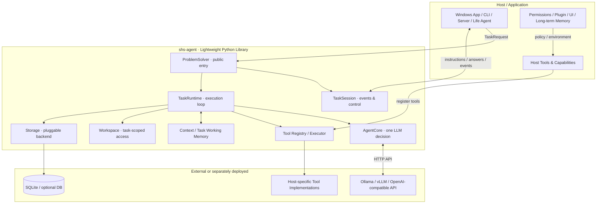
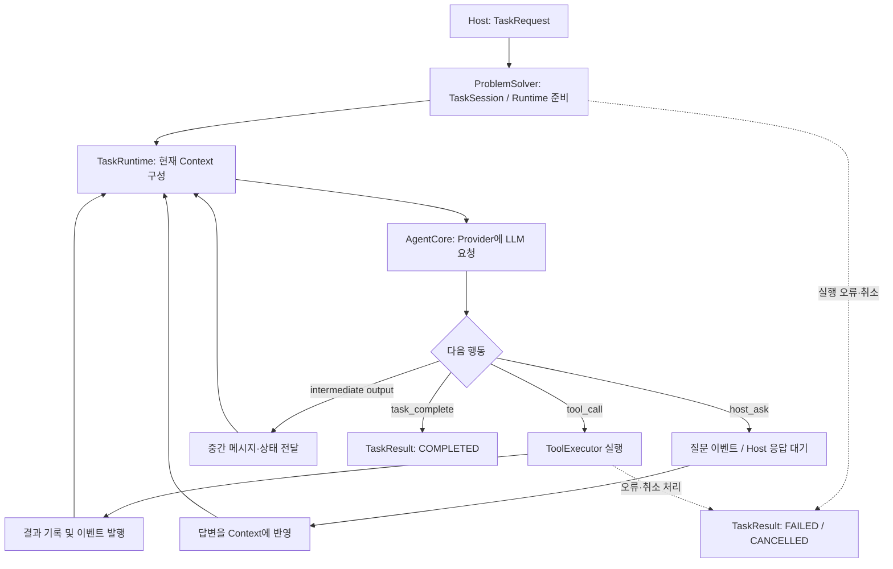

# shs-agent — 목표 아키텍처 및 구현 원칙

> **문서 상태:** 목표 설계 문서 (Target Design, v0.1)  
> **작성일:** 2026-10-17  
> **대상:** `shs-agent` 개발자, 이 라이브러리를 사용하는 Host 개발자, 코드 분석·구현을 수행하는 에이전트
>
> **중요:** 이 문서는 *우리가 만들고자 하는 최종 방향*을 정의한다. 현재 소스 코드의 구현 완료 여부를 보증하지 않는다. 실제 구현 상태는 별도의 조사 보고서에서 코드·테스트 근거로 확인한다.

## 1. 프로젝트 정의

**shs-agent는 외부 LLM과 Host가 제공한 실행 환경·도구를 이용하여, 주어진 Task를 해결하는 독립적이고 경량인 Python 라이브러리다.**

- **범용성:** Windows 코딩 에이전트, CLI, 웹/서버, 다른 자율형 에이전트 등 다양한 Host에서 같은 문제해결 엔진을 재사용한다.
- **경량성:** LLM 가중치를 로드하거나 추론 서버를 운영하지 않는다. GPU·CUDA·PyTorch 등의 무거운 AI 실행 환경이 기본 요구사항이 되어서는 안 된다.
- **분리된 책임:** Host는 *무엇을 할지* 결정하고 환경·권한·사용자 접점을 제공한다. shs-agent는 주어진 작업을 *어떻게 해결할지* 판단하고 실행한다.
- **상호작용:** 긴 작업을 수행하는 중에도 Host가 진행 상황을 관찰하고, 질문에 답하고, 지시를 추가하거나 취소할 수 있어야 한다.
- **교체 가능성:** LLM Provider, 모델, 도구 집합, 작업 공간, 저장소를 가능한 한 독립적으로 선택·연결할 수 있도록 한다.

### 1.1 핵심 사용 사례

1. Windows 코딩 에이전트: 프로젝트를 탐색하고 코드를 수정한 후 테스트한다.
2. 서버/CLI: 주어진 작업을 비대화식으로 해결하고 결과를 돌려준다.
3. 자율형 Life Agent: 상위 에이전트가 필요할 때 구체적인 문제를 shs-agent에 위임한다.
4. 다른 연구용/서비스용 Host: 서로 다른 도구와 환경을 제공해 동일한 문제해결 엔진을 재사용한다.

## 2. 비목표(Non-goals)

shs-agent **Core 자체의 책임이 아닌 것**을 명확히 한다.

- **LLM 추론 엔진:** 모델 학습·파인튜닝·가중치 로딩·GPU 스케줄링·vLLM/Ollama 서버 운영.
- **24시간 자율적인 삶:** 고유한 성격·감정·욕구·자기 목표 생성·생활 루프·다른 자율형 에이전트와의 사회적 관계.
- **Host 고유 UI:** 채팅 화면, Windows 앱 UI, 승인 팝업, 로그인 화면 등.
- **영구 플러그인 생태계 소유:** 플러그인 설치·업데이트·사용자 인증·계정·외부 서비스 권한을 Core가 모두 관리하는 구조.
- **개인화 장기 기억의 소유:** 장기 기억 정책·저장·검색 시스템은 Host 또는 별도 모듈에서 담당한다.
- **모든 플랫폼의 실행 도구 내장:** 브라우저/ADB/PowerShell 등은 필요한 Host가 제공하거나 선택적으로 연동한다.

> Core가 도구를 **등록·호출·결과 처리**하는 것과, Host가 도구의 **실제 구현·배포·권한·실행 환경을 소유**하는 것은 서로 다르다.

## 3. 시스템 책임 경계

| 관심사 | Host / 상위 Runtime | shs-agent |
|---|---|---|
| 목표 설정 | 작업 생성·위임 시점 판단 | 전달받은 Task 해결 |
| 사용자/앱 | UI·외부 이벤트·질문/승인 표시 | 이벤트·질문 생성 및 응답 반영 |
| LLM 선택 | Provider·모델·접속 정보 제공 가능 | 공통 API로 호출하고 결과 해석 |
| 외부 도구 | 실제 기능·플러그인·인증·권한 제공 | Tool 계약·Registry·Executor·호출 루프 |
| 실행 환경 | 접근 허용 범위 및 Host 고유 자원 결정 | Task별 Workspace 활용 |
| 작업 상태 | 진행 이벤트 구독·추가 지시·취소 | TaskSession·Runtime·최종 결과 관리 |
| 기억 | 장기 기억과 저장 정책 소유 | Task Working Memory와 작업 문맥 관리 |
| 저장소 | 저장 위치·Backend 선택 가능 | Task 관련 기록의 저장/조회 추상화 |
| 자율행동 | 목표·성격·생활 루프 | 구현하지 않음 |

**Adapter**는 Host와 엔진 사이의 연결 *인터페이스/계약*을 뜻한다. 별도 서버나 무거운 미들웨어를 반드시 만들어야 한다는 뜻은 아니다.

## 4. 논리적 아키텍처



이 그림은 **책임과 데이터 흐름**을 표시한다. 호출 관계를 파일 단위 구조나 특정 클래스 시그니처로 고정하지 않는다.

### 4.1 핵심 모듈

| 구성 요소 | 단일 책임 / 설계 의도 |
|---|---|
| **ProblemSolver** | Host가 사용하는 최상위 진입점. Task를 시작하고 단순한 `solve()` 사용성을 제공한다. |
| **TaskSession** | 하나의 Task를 나타내는 핸들. 이벤트 스트림 및 Host의 답변·추가 지시·취소를 연결한다. |
| **TaskRuntime** | 핵심 실행 제어자. LLM 호출, 행동 분기, 도구 실행, 반복, 종료, 상태 변화를 조정한다. |
| **AgentCore** | 현재 Context와 도구 명세를 바탕으로 한 번의 LLM 판단을 수행한다. 작업 전체 루프를 독점하지 않는다. |
| **Tool System** | Tool 명세·등록·호출·실행 결과 표준화를 담당한다. 외부 도구 구현의 소유권까지 가져가지 않는다. |
| **Context / Working Memory** | 현재 Task의 메시지, 도구 결과, 중간 상태와 필요한 작업 정보 관리. |
| **Workspace** | Task 작업 경로 및 Host가 허용한 추가 경로(Mount)를 다루는 인터페이스. |
| **Storage** | Task 상태·이벤트·이력 등의 영속화 인터페이스와 구현체를 분리한다. |
| **LLM Provider Adapter** | Ollama, OpenAI API, OpenAI 호환 vLLM 등 호출 방식 차이를 숨긴다. |
| **Planning (planned)** | 현재 Task를 위한 계획·추적·수정. 상위 자율형 에이전트의 목표 생성과 구별한다. |

## 5. Task 실행 계약

### 5.1 기본 실행 흐름



- 일반적인 LLM 텍스트 출력이나 중간 메시지 자체를 **Task 완료로 간주하지 않는다.** 정상 완료는 명시적인 `task_complete` 동작/프로토콜로 확인한다.
- 도구 실행 결과와 Host의 답변은 작업 Context에 반영한 후 다음 판단에 활용한다.
- 오류가 모두 즉시 실패를 뜻하지는 않는다. 재시도/복구 가능 여부와 실행 제한은 Runtime 정책에서 관리하며, 임의의 고정 수치나 복잡한 예외 규칙을 사전 도입하지 않는다.
- 취소·실패·정상 완료는 서로 구분되는 최종 상태로 보고한다.

### 5.2 Host와의 양방향 상호작용

**Solver → Host:** 상태 변화, 중간 메시지, 도구 시작·종료, 질문, 오류, 최종 결과 등의 이벤트.  
**Host → Solver:** 질문 답변, 작업 중 추가 지시, 취소.  
**향후 확장:** 모델 변경, 일시정지/재개 및 실행 복구.

- 작업 중 통신이 막혀서는 안 된다. Host는 Task가 종료되기를 기다리지 않고 이벤트를 소비하고 제어할 수 있어야 한다.
- 추가 지시는 기존 TaskSession에 전달한다. 반드시 새 Task를 시작할 필요가 없다.
- 진행 중인 LLM 요청의 중간 토큰에 지시를 강제로 삽입하지 않는다. 새 지시나 모델 변경은 **다음 적절한 실행 경계**에서 적용하는 방향으로 설계한다.
- `host_ask`는 질문을 식별할 수 있도록 하며, 응답을 해당 질문과 연결한다.
- 취소 요청과 실제 도구 프로세스의 중단 가능성은 다를 수 있다. 도구의 중단·정리는 도구 실행 계약에서 다룬다.

### 5.3 Session 및 동시 실행

- Task마다 독립된 Session과 작업 Context를 갖는다.
- 동일 엔진을 이용해 복수 Task를 실행할 수 있는 구조를 지향한다.
- 다른 Task의 작업 문맥, 도구 설정, Workspace가 우연히 혼합되지 않아야 한다.
- 동시 실행의 구체적 제한·우선순위·자원 정책은 필요한 Host와 Runtime에서 결정한다.

## 6. 경량 실행 및 LLM Provider

### 6.1 필수 조건

- 설치 시 GPU, CUDA, PyTorch, Transformers, 로컬 모델 가중치를 요구하지 않는다.
- Ollama/vLLM을 **shs-agent가 실행되는 장치에 설치하지 않아도** 원격 서버 주소로 사용할 수 있어야 한다.
- `ProblemSolver` 생성과 Provider/모델 선택을 불필요하게 결합하지 않는다. 작업마다 모델을 선택할 수 있어야 한다.
- HTTP 비동기 호출과 최소한의 공통 인터페이스를 우선한다.
- 선택적 SDK·DB Driver·무거운 Host 도구는 별도 선택 설치(Extras/Adapter 등)로 분리할 수 있다.

### 6.2 목표 Provider 형태

| Provider | 연결 예시 | 설명 |
|---|---|---|
| Ollama | `http://192.168.0.10:11434` | 같은 PC 또는 원격 Ollama 서버 |
| vLLM | `http://192.168.0.20:8000/v1` | OpenAI 호환 API 서버 |
| OpenAI | OpenAI API endpoint | API Key 기반 외부 호출 |
| 기타 | 추가 Adapter | 엔진 루프 변경 없이 확장 |

Provider마다 모델 조회 기능과 옵션 지원 범위가 다를 수 있다. 가능한 기능은 공통 인터페이스로 노출하되, 지원하지 않는 옵션을 일률적으로 강제하지 않는다.

## 7. Tool과 Workspace

### 7.1 Tool 계약

최소한 다음 개념을 분리한다.

1. **Tool Definition:** 이름, 설명, 입력 스키마 등 모델에게 제공하는 호출 계약.
2. **Tool Registry:** 현재 Task가 사용할 수 있는 도구 집합.
3. **Tool Executor:** 실제 호출, 결과/오류 정규화, 실행 제어.
4. **Tool Implementation:** 파일, 터미널, 브라우저, 외부 API 등 실제 기능. 일부 기본 도구 외에는 Host가 제공할 수 있다.

Core에는 범용 파일 읽기·쓰기·수정·삭제 등 **필요 최소한의 기본 도구**를 제공할 수 있다. PowerShell, ADB, Playwright, 외부 플러그인은 Host가 필요에 따라 제공한다.

**도구의 명세가 등록되었다는 사실만으로 실행 권한이 부여되는 것은 아니다.** 실제 권한·사용자 승인·인증·실행 범위는 Host와 도구 실행 경계가 함께 지켜야 한다.

### 7.2 Workspace 계약

- Task별 기본 작업 공간을 설정한다.
- 필요한 경우 Host가 승인한 경로를 읽기 전용 또는 읽기/쓰기 Mount로 제공할 수 있다.
- 경로 및 파일 도구는 부여된 권한을 지켜야 한다.
- **단순히 프로세스의 현재 작업 디렉터리(`cwd`)를 설정하는 것은 보안 격리나 샌드박스가 아니다.** OS 프로세스·외부 도구에 대한 별도 격리가 필요하면 Host 측에서 제공한다.

## 8. Memory, Storage 및 자율형 에이전트와의 관계

### 8.1 Task Working Memory

shs-agent는 현재 Task 해결을 위한 문맥을 소유한다. 예: 대화, 도구 결과, 조사한 파일 내용, 중간 판단과 작업 상태.

장시간 작업에 필요한 요약·조회·Context 압축은 이 범주에 속하는 확장 기능이다.

### 8.2 장기 기억 및 MindMap

**MindMap은 shs-agent Core에 통합하지 않는다.**

MindMap은 제목·짧은 설명·연결 정보 등을 통해 장기 기억을 탐색하는 별도의 모듈로 개발한다. Host가 장기 기억을 소유하고, 필요하면 검색/조회 도구로 shs-agent에 연결한다.

### 8.3 Storage

- Task 상태, 메시지/이벤트, 실행 이력 등 **작업 관련 데이터**의 영속화 계층이다.
- 기본 경량 Backend로 SQLite를 지향한다.
- PostgreSQL/MySQL 등은 추상화 인터페이스를 통해 선택적으로 지원할 수 있다.
- 저장소가 존재한다는 사실을 개인 장기 기억 기능과 혼동하지 않는다.
- 저장 정책, 복구 보장, DB 스키마의 세부 형태는 구현 조사 및 요구사항 검토 후 확정한다.

### 8.4 미래 Life Agent / Sub-agent

- **Life Agent:** 별도의 상위 Runtime. 자기 목표, 지속적인 행동, 성격/신념 등은 이쪽에서 관리하고 필요할 때 shs-agent를 호출한다.
- **Sub-agent (후속 기능):** 하나의 문제해결 작업을 분할·위임하는 실행 메커니즘이다. 독립된 인격/장기 목표를 지닌 Life Agent와 다르다.
- 반복 횟수, 중첩 깊이 등의 한계는 `AgentCore` 단일 판단 함수가 아니라 실행을 관리하는 계층에서 다룬다.

## 9. 목표 공개 API 예시 — Windows 코딩 에이전트

> **설계 예시이며 현재 라이브러리에서 실행 가능한 코드라는 뜻이 아니다.** 최종 클래스명·인자명·이벤트 스키마는 현재 소스 조사 후 확정한다.

```python
from shs_agent import ProblemSolver, ModelConfig, Workspace
from shs_agent.tools import builtin_file_tools

# Windows 앱(Host)이 구현한 별도 도구라고 가정
from windows_host_tools import powershell_tool

solver = ProblemSolver()  # 엔진 생성 시 로컬 LLM 실행 불필요

# Windows 앱에서 작업 시작
session = await solver.start(
    task="로그인 오류를 수정하고 테스트까지 실행해줘.",
    model=ModelConfig(
        provider="ollama",
        base_url="http://192.168.0.10:11434",
        model="qwen3.5:9b",
    ),
    workspace=Workspace(root=r"C:\Projects\MyApp"),
    tools=[*builtin_file_tools(), powershell_tool],
)

# UI는 session.events()를 다른 비동기 작업에서 구독하여 표시
await session.send_instruction("기존 API는 변경하지 마.")
await session.answer(question_id="<수신한 질문 ID>", text="두 번째 방법으로 진행해.")
await session.cancel()  # 사용자가 취소를 요청한 경우

# 후속 확장: 다음 LLM 호출부터 모델 변경
# await session.set_model(other_model)
```

단순히 결과만 필요한 Host에는 다음과 같은 Convenience API를 목표로 한다.

```python
result = await solver.solve(
    "프로젝트 구조를 분석해줘.",
    model=model,
    workspace=workspace,
    tools=tools,
)
print(result.output)
```

> 이 예시의 `powershell_tool`은 Host가 제공하는 실행 기능이다. 해당 도구의 사용자 승인 및 실행 경계는 Host가 명시적으로 관리한다.

## 10. 단계별 구현 목표 (순서 제안)

1. **현재 구현 조사:** 실제 파일·클래스·호출 흐름·테스트와 이 목표 문서의 차이를 객관적으로 기록한다.
2. **핵심 경계 정리:** `ProblemSolver / TaskSession / TaskRuntime / AgentCore` 책임과 공개 계약을 명확하게 한다.
3. **최소 문제해결 루프 검증:** LLM 판단 → 도구 실행 → 결과 반영 → 명시적 완료가 작동하도록 한다.
4. **상호작용 검증:** Host 이벤트, 추가 지시, 질문·응답, 취소, 동시 Task 독립성을 검증한다.
5. **환경 교체 가능성 검증:** Ollama/vLLM/OpenAI API, Task별 도구, Workspace, Storage를 교체하며 동일 Core를 사용한다.
6. **후속 확장:** 실행 중 모델 변경, Pause/Resume, 중단 후 복구, Planning, 필요한 범위의 Sub-agent를 설계·구현한다.

단계를 계획 없이 모두 한 번에 구현하거나, 근거 없는 정책·유효시간·제한값을 먼저 추가하지 않는다. 필요한 실행 정책은 실제 동작과 사용 사례를 기준으로 검토한다.

## 11. 최소 수용 기준 (Acceptance Criteria)

다음 조건을 만족하는지 실제 테스트로 확인할 수 있어야 한다.

- [ ] 로컬 GPU/모델 서버 없이 경량 Python 환경에서 라이브러리 임포트·실행 가능
- [ ] 원격 Ollama 또는 OpenAI 호환 서버 주소만 지정하여 모델 호출 가능
- [ ] Host가 서로 다른 도구 집합과 Workspace를 Task별로 제공 가능
- [ ] LLM → 도구 실행 → 결과 재입력 → LLM 재호출 루프 검증
- [ ] 명시적 정상 완료 및 실패/취소 상태가 구분됨
- [ ] 실행 중 Host 이벤트 관찰, 질문 답변, 추가 지시와 취소 가능
- [ ] 동시 Task 사이에 Context와 Workspace 설정이 혼합되지 않음
- [ ] CLI/Windows 코딩 Agent 등 서로 다른 Host에서 엔진을 변경하지 않고 재사용 가능
- [ ] 기본 설치가 GPU·브라우저 자동화 등 무거운 선택적 의존성을 강제하지 않음

> 여기의 체크박스는 **현재 완료 체크리스트가 아니라 향후 검증 기준**이다.

## 12. 현재 확정한 원칙과 아직 정하지 않은 사항

**확정한 방향**

- 경량 범용 Python 라이브러리이며 LLM 추론 서버를 내장하지 않는다.
- Host와 Solver의 책임을 분리하고, TaskRuntime이 LLM↔도구 실행 루프를 관리한다.
- Host는 작업 중 관찰·개입할 수 있으며 정상 완료는 명시적인 완료 프로토콜을 사용한다.
- Task Working Memory는 Core, 개인화 장기 기억/MindMap은 Host 또는 독립 모듈의 책임이다.
- 영구 플러그인·외부 권한·자율적인 Life Loop는 Core에 넣지 않는다.

**현재 문서에서 구현 상세를 고정하지 않는 사항**

- 최종 공개 API 이름 및 정확한 타입/이벤트 스키마
- 비동기 이벤트 전달·저장·구독의 내부 방식
- 실행 중 모델 변경/일시정지/복구의 구체적 보장 범위
- Storage 스키마와 추가 DB Backend 구현 순서
- Planning, Sub-agent의 세부 프로토콜
- 기본 도구의 정확한 목록과 Host별 권한 정책

이 부분들은 **실제 소스 조사 → 설계 검토 → 단계별 구현/테스트** 순서로 결정한다.

---

**한 문장 요약:** `shs-agent`는 *Host가 제공한 목표·도구·환경을 바탕으로 외부 LLM을 호출하면서 Task를 해결하고, 작업 도중 Host와 양방향으로 소통하는 경량 재사용형 문제해결 엔진*이다.
