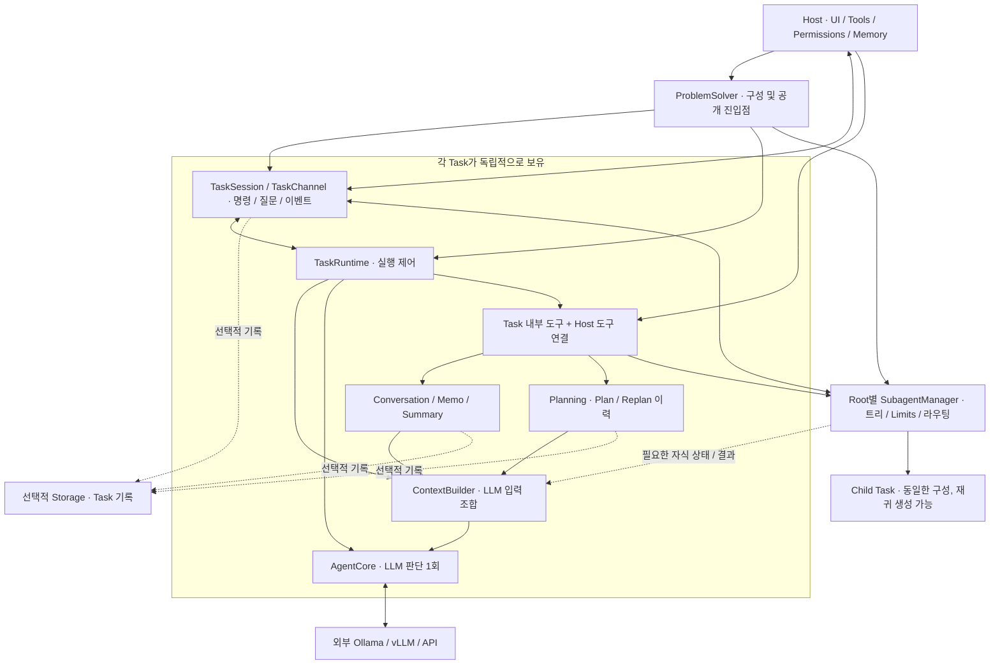
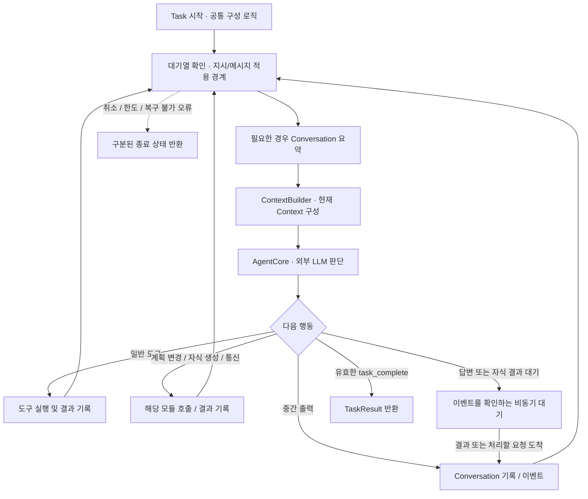
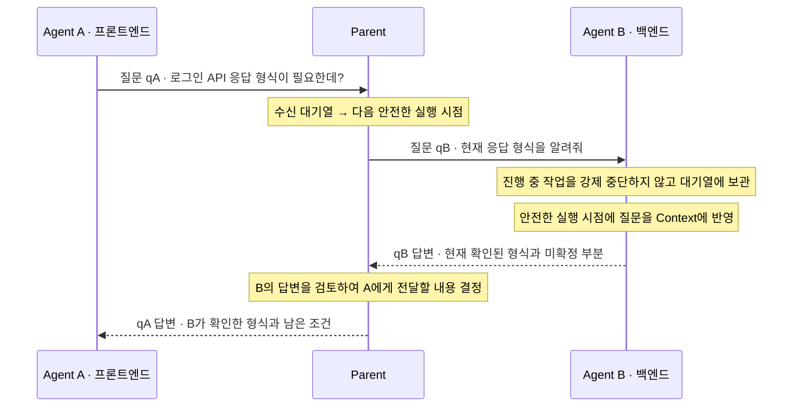

# shs-agent — 목표 아키텍처 및 구현 원칙

> **문서 상태:** 목표 설계 문서 (Target Design, v0.2)  
> **작성일 / 수정일:** 2026-10-17 / 2026-10-17  
> **권장 경로:** `docs/SHS_AGENT_TARGET_ARCHITECTURE.md`  
> **대상:** shs-agent 개발자, Host 개발자, 코드 분석·구현을 수행하는 에이전트
>
> **중요:** 이 문서는 최종 목표와 합의한 설계 방향을 정의한다. 현재 구현 완료 여부를 보증하지 않는다. 실제 구현과 검증 결과는 별도의 구현 보고서에서 확인한다. v0.2는 v0.1과 이후 설계 논의를 반영한 문서 갱신이며 코드 변경 보고서가 아니다.
>
> **이번 갱신의 핵심:** Conversation/Memo 용어 정리, ContextBuilder 분리, Planning/Replanning, 재귀 Sub-agent, 부모↔자식 양방향 통신, 질문의 입력 대기열 전달과 안전한 실행 시점 처리.

## 1. 프로젝트 정의

**shs-agent는 외부 LLM과 Host가 제공한 실행 환경·도구를 이용하여, 주어진 Task를 해결하는 독립적이고 경량인 Python 라이브러리다.**

- **범용성:** Windows 코딩 에이전트, CLI, 웹/서버, 자율형 에이전트 등 다양한 Host가 동일한 엔진을 재사용한다.
- **경량성:** 모델 가중치를 로드하거나 추론 서버를 운영하지 않는다. GPU·CUDA·PyTorch 등의 AI 실행 환경이 기본 요구사항이 되어서는 안 된다.
- **분리된 책임:** Host는 무엇을 할지 결정하고 환경·권한·사용자 접점을 제공한다. shs-agent는 전달받은 작업을 어떻게 해결할지 판단하고 실행한다.
- **상호작용:** 실행 중에도 Host와 소통하며, Sub-agent가 있으면 부모와 자식도 질문·답변·정보·지시를 주고받는다.
- **선택적 협업:** 간단한 Task는 단일 Agent로 해결한다. 필요할 때만 계획을 세우고 작업을 자식에게 위임하며, 상황에 따라 계획을 수정한다.
- **교체 가능성:** Provider, 모델, 도구 집합, 작업 공간, 저장소를 가능한 한 독립적으로 선택·연결한다.

### 1.1 핵심 사용 사례

1. Windows 코딩 에이전트: 프로젝트를 탐색하고 코드를 수정한 후 테스트한다.
2. 서버/CLI: 작업을 비대화식으로 수행하고 결과를 반환한다.
3. 자율형 Life Agent: 상위 에이전트가 필요한 시점에 구체적인 문제를 shs-agent에 위임한다.
4. 병렬 문제해결: 독립적인 영역을 여러 Sub-agent가 조사하고, 부모가 결과를 통합한다.
5. 협력적 문제해결: 자식이 필요한 정보를 부모에게 요청하고, 부모가 다른 자식이나 Host에서 확인하여 답한다.

**부모와 자식은 같은 문제해결 엔진을 사용한다.** Sub-agent는 별도의 인격이나 지속적인 삶을 가진 Life Agent가 아니라, 위임받은 Task를 수행하는 실행 단위다.

## 2. 비목표(Non-goals)

다음은 shs-agent Core 자체의 책임이 아니다.

- 모델 학습·파인튜닝·가중치 로딩·GPU 스케줄링·Ollama/vLLM 서버 운영.
- 성격·감정·욕구·자기 목표 생성·24시간 생활 루프와 자율형 에이전트의 사회적 관계.
- Windows 앱, 채팅 화면, 로그인, 사용자 승인 UI 등 Host 고유 화면.
- 영구 플러그인 설치·업데이트·사용자 인증·외부 계정과 권한의 소유.
- Host의 장기 Memory 저장·선별·검색 정책 및 MindMap 자체의 구현.
- 모든 플랫폼의 실행 도구 내장, 필수 Git worktree·컨테이너·별도 프로세스 운영.
- 모든 Task에 계획·Sub-agent·DB·임베딩 모델을 강제하는 구조.

> 도구를 **등록·호출·결과 처리**하는 것과, 도구의 **실제 구현·권한·인증·실행 환경을 소유**하는 것은 다르다. Sub-agent의 추가 도구 요청이나 Replan으로 이 경계가 사라지지 않는다.

## 3. 용어 및 시스템 책임 경계

### 3.1 용어

| 용어 | 정의 | 범위 / 소유자 |
|---|---|---|
| **Task** | 하나의 목표를 전달받아 해결하는 작업 단위 | shs-agent |
| **Root Task** | Host가 시작한 실행 트리의 최상위 Task | 부모 Agent 없음, 깊이 0 |
| **Sub-agent / Child Task** | 부모가 작업 일부를 위임하여 생성한 Task | 직접 부모를 가지며 재귀 생성 가능 |
| **Conversation** | 현재 Task에 기록된 입력·응답·도구 호출과 결과·Agent 간 송수신 내용의 원본 이력 | Task별 독립 |
| **Memo** | 현재 작업에서 활용할 발견·근거·주의사항 등의 명시적 작업 메모 | Task별 독립 |
| **Summary** | 오래된 Conversation에서 파생된 압축 요약 | 원본 이력을 대체하지 않음 |
| **Context** | 특정 LLM 호출에 실제로 전달하는 메시지 묶음 | ContextBuilder가 구성 |
| **Plan** | 작업 항목·의존성·진행 상태를 구조화한 계획 | 각 Task가 필요할 때 사용 |
| **Replan** | 새로운 정보·실패·제약을 반영해 기존 계획을 수정하는 행위 | 유효한 진행 내용과 결과를 재사용 |
| **Memory** | 여러 Task에 걸쳐 유지되는 장기 기억 | Host 또는 독립 모듈 |
| **Storage** | Task 관련 데이터를 보존·조회하는 저장 수단 | 선택적 Backend |

**Agent 내부의 작업 정보는 Conversation과 Memo라고 부른다. Memory는 Host의 장기 기억에만 사용한다.** 정보를 DB에 오래 보존한다고 해서 Conversation이나 Memo가 자동으로 Host Memory가 되는 것은 아니다.

### 3.2 책임 경계

| 관심사 | Host / 상위 Runtime | shs-agent |
|---|---|---|
| 목표 | 작업 생성·위임 시점 결정 | 주어진 목표의 해결 방법 판단 |
| 사용자/앱 | UI·외부 이벤트·질문/승인 표시 | 이벤트·질문 생성, 답변·지시 반영 |
| LLM | Provider·모델·접속 정보 제공 | 공통 계약으로 외부 추론 호출 |
| 외부 도구 | 구현·인증·권한·실행 자원 제공 | 등록·호출·결과 처리, 위임된 범위 사용 |
| 실행 환경 | 경로·프로세스·자원 접근 범위 결정 | Task별로 전달된 환경 활용 |
| 작업 정보 | 장기 Memory 선별·저장·검색 | Conversation·Memo·Summary·Plan 관리 |
| 협업 | 허용한 범위와 실행 한도 설정 | 자식 생성, 트리 관리, 부모↔자식 통신 |
| 저장 | Backend·위치·보존 정책 선택 | Task 기록의 선택적 저장/조회 연결 |
| 자율행동 | 지속적인 목표·성격·생활 루프 | 구현하지 않음 |

**Adapter**는 연결 인터페이스/계약을 뜻한다. 별도 서버나 무거운 미들웨어가 필수라는 뜻은 아니다.

## 4. 논리적 아키텍처



이 그림은 책임과 데이터 흐름을 표시한다. 클래스 시그니처, import 관계, Storage 호출 위치를 고정하는 도면은 아니다.

### 4.1 핵심 모듈

| 구성요소 | 책임 | 소유하지 않는 것 |
|---|---|---|
| **ProblemSolver** | Root/Child의 공통 구성 로직, `start/solve/create_task` 진입점 | 개별 Task의 반복 상태 |
| **AgentCore** | Provider 호출 1회 및 응답 검증 | 전체 루프, 계획, 자식 생성 수 |
| **TaskRuntime** | 판단·도구·결과 반영·대기·종료와 안전한 적용 경계 조율 | Conversation 저장 구현, 메시지 라우팅 구현 |
| **TaskSession** | Host가 사용하는 작업 핸들 | 구체 Runtime에 대한 직접 의존 |
| **TaskChannel** | 입력 대기열, 요청·답변 연결, 명령 확인, 이벤트 구독 | 질문의 의미에 대한 LLM 판단 |
| **Conversation / Memo** | 현재 Task 기록·조회 및 작업 메모 관리 | Host Memory, LLM 호출 |
| **Compaction** | 요약 대상·경계·요약 결과 반영 | 독립적인 실행 루프 |
| **ContextBuilder** | 각 정보의 읽기용 상태를 조합해 LLM 메시지 구성 | 원본 수정, 요약 추론, Plan 변경, 자식 실행 |
| **Planning** | 계획과 진행 상태·의존성·수정 이력 관리 | 자동 목표 생성, 독립적인 LLM 호출 |
| **SubagentManager** | Root별 트리, 공통 한도, 자식 Session·결과, 메시지 라우팅 | 다른 Root의 상태, Host 권한 생성 |
| **Tool System** | 명세·Registry·Executor와 호출 계약 | 모든 외부 도구의 실제 구현 |
| **Workspace / Storage** | Host 제공 작업 환경 계약 / 선택적 보존·조회 | 장기 Memory 정책, 자동적인 복구 보장 |

### 4.2 목표 디렉터리 구조

```text
src/shs_agent/
├── agent/
│   ├── solver.py                 # Task 구성 및 공개 API
│   ├── core.py                   # LLM 판단 1회
│   ├── types.py                  # Task 타입·TaskMemo·AgentLimits 등
│   ├── _async.py
│   ├── runtime/
│   │   └── runner.py             # 개별 Task 실행 루프
│   ├── session/
│   │   ├── handle.py             # TaskSession
│   │   └── channel.py            # 명령·Agent 메시지·질문·이벤트
│   ├── context/
│   │   ├── state.py              # Task별 Conversation/Memo/Summary 구성
│   │   ├── conversation.py       # 원본 기록·검색·부분 조회
│   │   ├── memo.py               # 작업 Memo 관리
│   │   ├── builder.py            # ContextBuilder
│   │   └── compaction.py         # Conversation 요약
│   ├── planning/
│   │   └── plan.py               # 계획·진행 상태·변경 이력
│   ├── subagent/
│   │   └── manager.py            # 트리·자식 생성·공통 Limits·라우팅
│   ├── tools/
│   │   ├── schemas.py
│   │   └── session_tools.py      # 각 기능을 LLM 도구에 연결
│   └── old/                      # 프로토타입 보관, 새 실행 경로에서 미사용
├── llm/                          # 기존 Provider 계약 재사용
├── tool/                         # 기존 Registry/Executor 재사용
└── storage/                      # 선택적 저장 계층
```

`__init__.py`는 생략했다. 이는 책임을 표현하는 목표 구조이며, 세부 파일은 실제 구현에 맞춰 조정한다. 디렉터리를 나누기 위해 빈 클래스나 중복 추상화를 만들지 않는다. `old/`와 과거 조사 보고서는 역사적 보관본으로 유지하며 새 코드에서 import하거나 일괄 용어 변경하지 않는다. `old/`의 배포 제외도 유지한다.

## 5. Task 실행 계약

### 5.1 기본 실행 흐름



일반적인 LLM 텍스트나 중간 응답만으로 완료하지 않는다. 정상 완료는 명시적인 `task_complete` 프로토콜을 사용한다. 계획 완료 표시나 자식의 완료도 부모 Task의 자동 완료를 뜻하지 않는다.

도구 실패가 곧 전체 Task 실패는 아니다. 오류 관찰을 다음 판단에 전달하여 수정·질문·Replan 여부를 결정할 수 있어야 한다. 정상 완료·실패·취소·한도 도달·미완료의 의미를 혼합하지 않는다.

### 5.2 Host와의 양방향 상호작용

**Solver → Host:** 상태, 중간 출력, 도구 실행, 질문, 계획 변경, 자식 생성·상태·통신, 최종 결과.  
**Host → Solver:** 질문 답변, 추가 지시, 취소 및 제공 가능한 외부 정보.  
**후속 제어:** 실행 중 모델/Provider 변경, Pause/Resume, 실행 복구.

`start()`는 실행을 시작한 Session을 반환하고, Host는 별도의 비동기 흐름에서 이벤트를 관찰하거나 제어한다. `solve()`는 결과를 기다리는 편의 API다. 사용자 질문이 필요한 작업은 `start()`와 질문 처리 경로를 함께 사용한다.

추가 지시는 기존 Task에 전달한다. 진행 중 추론의 내부에 입력을 끼워 넣지 않는다. 기존 지시 변경에 따른 응답 무효화와 새 Agent 질문의 수신은 서로 다른 사건으로 취급한다. 질문이 도착했다는 이유만으로 작업 목표를 변경하거나 현재 응답을 자동 폐기하지 않는다.

### 5.3 독립성 및 협력적 실행

Task마다 Conversation·Memo·Summary·Plan·Session·실행 상태를 분리한다. 명시적으로 공유한 Provider·도구·외부 파일 자원과 Task 내부 상태의 독립성은 별개의 문제다.

취소 요청의 접수와 실제 외부 호출의 종료는 다를 수 있다. 이미 실행한 도구의 부작용을 자동 rollback한다고 가정하지 않는다. Agent 간 질문 수신은 외부 도구 강제 중단 사유로 사용하지 않는다.

## 6. 경량 실행 및 LLM Provider

### 6.1 필수 조건

- 엔진 설치·실행에 GPU, CUDA, PyTorch, Transformers, 모델 가중치를 요구하지 않는다.
- Ollama/vLLM이 엔진과 다른 장치에서 실행되어도 주소와 설정으로 연결할 수 있어야 한다.
- Solver 생성 시 Provider나 모델을 영구 고정하지 않는다. 작업별 선택을 지원한다.
- LLM I/O는 비동기 처리와 가벼운 인터페이스를 우선하고, 기존 sync/async 호출 계약을 재사용한다.
- SDK·DB Driver·무거운 Host 도구는 필요한 경우에만 사용한다. 기본 설치를 최소화하는 목표와 현재 패키징 상태는 별도로 확인한다.
- Sub-agent 생성은 기본적으로 동일 프로세스의 Task 실행을 재사용한다. Agent마다 별도 모델·GPU·서버·OS 프로세스를 띄우도록 요구하지 않는다.

### 6.2 Provider 선택

| Provider | 연결 개념 |
|---|---|
| Ollama | 같은 PC 또는 원격 Ollama 서버 주소 |
| vLLM | Host가 제공한 OpenAI 호환 API 서버 주소 |
| OpenAI | Host가 제공한 API 접속 설정 |
| 기타 | 계약을 구현한 추가 Adapter |

모델 목록과 호출 옵션은 Provider의 지원 범위에 맞게 전달한다. 자식의 모델·도구 설정도 Host가 허용한 범위에서 선택한다. 실행 중 Provider 교체의 상세 API와 적용 확인 이벤트는 후속 설계 대상으로 남긴다.

병렬 Agent 실행은 여러 Task가 동시에 진행 가능하다는 뜻이다. 외부 추론 서버가 모든 요청을 동시에 처리하거나 실행 시간이 반드시 줄어든다는 보장은 아니다.

## 7. Tool과 Workspace

### 7.1 Tool 계약

**Definition / Registry / Executor / Implementation**을 구분한다. `agent/tools/`는 작업 내부 기능을 LLM 도구로 연결하고, `shs_agent/tool/`의 범용 등록·실행 계약을 재사용한다.

필요 최소한의 범용 파일 도구는 선택적으로 제공할 수 있다. PowerShell, ADB, 브라우저, 외부 API, 프로젝트 전용 플러그인은 Host가 제공한다. 도구 명세 등록이나 LLM의 요청 자체가 권한 승인을 뜻하지 않는다.

### 7.2 Sub-agent의 추가 도구 요청

자식은 부모에게 필요한 도구, 필요한 이유, 현재 작업이 막힌 지점을 설명할 수 있어야 한다.

```text
자식의 도구 요청
    → 부모가 필요성과 사용 가능한 범위를 판단
        → 이미 위임 가능한 도구: 허용된 범위에서 자식 연결 검토
        → 부모에게도 없는 도구/권한: 상위 부모 또는 Host에 요청
    → 실제 적용 여부와 제약을 자식에게 응답
```

부모가 도구를 사용할 수 있다는 사실만으로 자식에게 무제한 재위임할 권한까지 생기는 것은 아니다. Host가 허용한 위임 범위 안에서 연결한다. 자연어로 “사용해도 된다”고 답하는 것과 실제 Registry/Executor·권한을 적용하는 것도 구분한다.

도구 집합 변경은 실행 경계에서 스키마·실행 연결의 일관성을 유지해야 한다. 기존 등록 버전 검사 등을 활용하되, 구체적인 갱신 API는 별도로 확정한다. 도구 요청이 거절되면 그 결과를 근거로 Replan하거나 목표 조정을 상의한다.

### 7.3 Workspace와 공유 자원

Host가 Task별 기본 공간과 허용된 추가 경로를 제공한다. 경로·파일 도구는 부여된 접근 범위를 지켜야 한다. `cwd` 설정만으로 보안 격리나 샌드박스를 제공한다고 표현하지 않는다.

Conversation이 독립적이어도 같은 파일을 동시에 수정하면 충돌할 수 있다. 부모가 작업 범위를 조율하고, 필요하면 Host가 별도 경로·worktree·실행 환경을 제공한다. shs-agent Core가 특정 격리 기술이나 새로운 운영 정책을 임의로 강제하지 않는다.

## 8. Conversation, Memo, ContextBuilder 및 Host Memory

### 8.1 Conversation과 Memo

Conversation은 현재 Task의 원본 이력을 보존한다. 요약이나 LLM 입력 길이 제한을 적용하더라도 원본과 LLM에 보여 주는 사본을 구분한다. `conversation_search/read`는 현재 Task에 기록된 내용을 검색·부분 조회하는 도구다. 형제의 Conversation 전체나 Host Memory를 암묵적으로 검색하지 않는다.

Memo는 발견·근거·주의사항을 명시적으로 기록하는 작업 메모다. Plan의 공식적인 작업 목록·진행 상태와 구분한다. 원본 기록에서 모든 메모가 자동 추출되는 것을 전제하지 않으며, 메모의 추측을 검증된 사실로 취급하지 않는다.

| 기존 명칭 | 목표 명칭 |
|---|---|
| `memory_write` | `memo_write` |
| `TaskMemory` | `TaskMemo` |
| `TaskResult.memory` | `TaskResult.memos` |
| Agent 내부의 memory 관련 이벤트·설정·문서 용어 | 의미에 맞는 memo/conversation 명칭 |

실행 코드·테스트·공개 문서의 용어를 함께 정리한다. 과거 보관본은 변경하지 않는다. 구 API 별칭과 전환 기간은 구현 시 명시하며, 별도 Memory 시스템이 있는 것처럼 중복 기능을 만들지 않는다.

### 8.2 ContextBuilder 계약

**ContextBuilder는 각 모듈이 소유한 정보로부터 LLM 입력을 만드는 읽기 전용 조합자다.**

| 입력 | 용도 |
|---|---|
| 최초 Task 지시·Host 추가 지시·제공 Context | 목표와 작업 조건 유지 |
| 최근 Conversation | 최신 실행 흐름과 도구 결과 |
| Summary | 오래된 작업 진행 내용 |
| Memo | 재사용할 작업 메모 |
| 현재 Plan | 필요한 경우 계획·진행 상태·수정 이유 |
| 수신 Agent 메시지·필요한 자식 상태/결과 | 질문 응답과 작업 조율 |

원본 Conversation/Memo/Plan을 수정하지 않고, LLM을 호출하거나 DB를 조회하거나 자식을 생성하지 않는다. 필요한 읽기용 상태는 소유 모듈에서 제공한다. Builder가 반환한 사본 수정이 원본 상태를 바꾸지 않아야 한다.

Host 입력, Agent가 생성한 요약·메모, 도구 결과, 부모·자식의 전달 정보는 출처를 유지한다. 생성 데이터나 전달 메시지를 임의로 system 권한의 지시로 승격하지 않는다. tool call/result 묶음 중간에 질문·지시를 끼워 넣지 않으며, 현재 구현에서 지키는 메시지 역할·원본 보존 계약을 유지한다.

Plan과 Sub-agent가 없는 Task에서도 같은 Builder를 사용한다. 모든 계획 이력·자식 Conversation·송수신 이력을 매번 전체 삽입하는 구조는 피한다. 선택·배치·요약 예산의 세부 기준은 실제 작업을 보고 정한다.

### 8.3 Summary와 과거 조회

Compaction은 요약 대상과 tool 묶음 경계를 결정하고 결과를 반영한다. 요약 추론이 필요하면 Runtime이 Core/Provider를 통해 수행한다. ContextBuilder가 별도 추론을 수행하지 않는다.

```text
Conversation 원본 → Compaction → Summary
        │                           │
        └─ search/read로 재조회      └─ ContextBuilder에 포함
Memo / 현재 Plan / 필요한 수신 정보 ────┘
```

요약과 관련 원본을 다시 연결할 수 있는 참조를 유지하는 방향으로 발전시킨다. 정확한 인덱스·참조 스키마·검색 알고리즘은 미확정이다. Memo 갱신·무효화·검색도 별도의 후속 범위이며 이번 용어 정리만으로 구현되었다고 간주하지 않는다.

Context 압축은 LLM 입력을 줄이는 것과 원본 기록의 RAM 사용량을 줄이는 것이 다르다. 긴 작업에서 디스크 보관이 필요하면 선택적 Storage와 연결하고, 임의의 폐기 기준이나 Vector DB를 기본 요구사항으로 추가하지 않는다.

### 8.4 결과 반환과 Host Memory

TaskResult는 최종 출력·종료 상태와 함께 해당 Task의 Memo를 Host 또는 부모에 반환할 수 있어야 한다. 부모와 자식의 Memo는 출처 Task를 유지한다. 전체 Conversation을 결과에 넣을지 조회 참조를 제공할지는 저장 계약과 함께 정한다.

Host는 결과와 Memo를 검토하여 장기 Memory에 저장·수정·병합하거나 저장하지 않을 수 있다. Agent의 모든 임시 가설·실패 과정이 자동으로 장기 기억이 되는 것은 아니다. 별도의 `memory_proposals` 필드는 아직 확정하지 않는다.

Host Memory는 초기 Context 또는 Host가 제공한 검색·읽기 도구로 접근한다. 예를 들어 `memory_search/read` 또는 `host_memory_search/read`를 사용할 수 있으나 명칭은 Host 계약에 따른다. 자식이 필요한 외부 정보를 부모에게 요청하면 부모는 자신의 도구나 상위 부모·Host를 통해 확인할 수 있다.

**MindMap은 Core에 통합하지 않는다.** 별도의 모듈형 장기 기억 시스템으로 두고 Host가 선택적으로 연결한다. Life Agent도 별도의 상위 Runtime으로 유지한다.

### 8.5 Storage

Storage는 Conversation·Memo·Summary·Plan 변경·Agent 메시지·Task 관계·상태 등의 선택적 보존 수단이다. DB 없이도 단일 Task와 재귀 Sub-agent를 실행할 수 있어야 한다.

SQLite를 경량 기본 Backend 선택지로 지향하고 PostgreSQL/MySQL 등은 교체 가능한 구현으로 둔다. 같은 DB 서버를 사용하더라도 Host Memory와 Task 기록의 책임·범위를 혼합하지 않는다.

기록 저장과 실행 복구는 별개다. Plan과 Conversation을 저장했다는 이유만으로 진행 중 도구, 질문 대기, 자식 트리의 실행 위치까지 복원된다고 보장하지 않는다. 자동 저장, 스키마, 체크포인트, 보존 및 복구 정책은 별도로 설계한다.

## 9. Planning과 Replanning

### 9.1 Planning의 범위

Planning은 선택 기능이다. 계획 없이 Sub-agent를 생성할 수 있고, Sub-agent 없이 계획을 순차 실행할 수도 있다. 각 자식도 자신의 계획을 가질 수 있다.

계획은 작업 설명, 식별 가능한 항목, 진행 상태, 필요한 선행 항목과 담당 자식 참조를 관리한다. 의존성을 기록할 수 있지만, 초기에는 **계획을 만들면 엔진이 자동으로 모든 항목을 스케줄링하는 워크플로 시스템**으로 만들지 않는다. LLM이 계획을 보고 직접 수행하거나 도구로 위임한다.

계획 항목 하나가 반드시 Sub-agent 하나는 아니다. 자식의 실행 완료와 계획 목표 충족도 구분한다. 자식이 완료되면 부모가 결과를 확인하고 해당 계획 항목을 갱신한다.

### 9.2 Replan의 의미

도구 부족, 권한 거절, 환경 제약, 실패한 검증, 새 정보로 인해 기존 방법을 사용할 수 없으면 계획을 수정할 수 있어야 한다.

```text
Plan에 따른 실행
    → 실패/제약/새 정보 관찰
    → Conversation에 근거 기록, 현재 Plan과 함께 LLM에 전달
    → LLM이 판단
        ├─ 기존 단계에서 수정·재시도
        ├─ 부모/자식/Host에 질문 또는 도구 요청
        ├─ 계획 부분 수정 또는 대체 접근으로 Replan
        └─ 목표 변경 협의 또는 실패/미완료 보고
```

Planning 모듈은 직접 LLM을 호출하지 않는다. LLM이 도구로 계획 변경을 요청하고 Planning이 유효한 변경과 이력을 관리한다. 도구 오류 하나마다 무조건 Replan하거나, 새로운 무한 재시도 루프를 만들지 않는다.

### 9.3 변경 시 보존할 것

계획 변경에는 이유와 식별 가능한 변경 버전을 남기는 방향으로 한다. 이미 완료한 유효한 조사·결과·Memo·Conversation은 재사용한다. 새 정보 때문에 기존 완료 결과가 무효해졌다면 그 이유를 남기고 해당 항목만 다시 다룬다.

**Plan 변경은 실행 중인 자식의 자동 취소·재시작·추가 지시 전파를 의미하지 않는다.** 부모가 영향을 판단하여 해당 자식에게 질문·지시를 보내거나 취소·신규 생성을 명시적으로 요청한다. 이미 발생한 파일 변경도 자동으로 되돌리지 않는다.

이전 Plan에서 시작한 자식의 늦은 결과는 출처와 당시 작업을 식별할 수 있게 보존한다. 최신 Plan을 자동으로 덮어쓰거나 무조건 폐기하지 않고 부모가 활용 여부를 판단한다.

각 자식은 맡은 목표 안에서 방법을 바꾸고 Replan할 수 있다. 위임된 목표·범위·권한을 바꿔야 한다면 부모와 상의한다. Root의 목표 변경이나 추가 권한은 Host와 조율한다.

### 9.4 환경 제약 예시

빌드 실행이 불가능한 환경이라면, Agent는 이미 끝낸 구조 조사를 버리지 않고 원인을 확인한다. 필요한 실행 도구나 환경을 요청하거나, 허용된 대체 방법을 검토할 수 있다. 다만 정적 분석만 수행하고도 빌드·테스트를 통과했다고 보고해서는 안 된다. 원래 목표를 충족하지 못한 부분은 부모 또는 Host에 구분하여 전달한다.

## 10. 재귀 Sub-agent와 실행 트리

### 10.1 동일 엔진의 재사용

자식도 TaskSession·TaskRuntime·AgentCore·Conversation·Memo·Summary·ContextBuilder를 독립적으로 가진다. Plan은 필요할 때 사용하고, 한도 내에서 다시 자식을 생성한다.

```text
Root Task                         depth = 0
├── Agent A                       depth = 1
│   ├── Agent A-1                 depth = 2
│   └── Agent A-2                 depth = 2
└── Agent B                       depth = 1
    └── Agent B-1                 depth = 2
```

직접 부모를 기준으로 통신·위임한다. A는 Root의 자식인 동시에 A-1/A-2의 부모다. Root만 Host를 상위 요청 창구로 사용하며, 자식은 기본적으로 부모에게 외부 정보와 조율을 요청한다.

### 10.2 Root별 공통 관리자

SubagentManager는 **Root Task마다 하나의 실행 트리 범위**로 둔다. 같은 Solver로 시작한 서로 다른 Root는 트리·생성 한도·메시지 경로를 공유하지 않는다.

트리에는 `task_id`, `parent_task_id`, `root_task_id`, `depth`에 해당하는 관계 정보를 유지한다. 구체 필드명은 계약 정리 시 확정한다.

Solver의 공통 구성 로직으로 자식을 만들되, 기존 Root의 관리자와 한도를 전달한다. 자식 생성 때 새로운 Root 관리자와 예산을 만드는 방식은 사용하지 않는다. 관리자에는 자식 구성 기능을 연결하여 Runtime이 Solver를 직접 재귀 import하는 구조를 피한다.

### 10.3 생성·실행·대기의 분리

`subagent_spawn`은 생성과 실행을 예약한 뒤 자식 식별자를 반환한다. 자식의 작업 완료까지 기다리지 않는다. 여러 spawn 도구가 순차 호출되어도 각각 즉시 반환하면 자식 Task들은 병렬로 진행할 수 있다.

부모는 자기 작업을 계속하거나 필요한 자식의 상태·결과를 조회하고 대기할 수 있다. 대기는 부모만 비동기로 양보하며 다른 Task와 Host 통신을 막지 않는다. 답변·자식 결과 대기는 11절의 수신 요청 처리 계약을 따른다.

### 10.4 AgentLimits

다음은 설정의 의미이며 필드 이름은 목표 예시다. 새 기본값을 이 문서에서 고정하지 않는다.

| 설정 예시 | 범위 | 의미 |
|---|---|---|
| `max_steps` | 개별 Task | 해당 Agent의 판단 반복 한도 |
| `max_tool_calls` | 개별 Task | 해당 Agent의 실제 도구 실행 한도 |
| `max_total_subagents` | Root 전체 트리 | Root를 제외한 모든 자식·자손의 누적 생성 수 |
| `max_subagent_depth` | Root 기준 | Root=0에서 허용하는 최대 자식 깊이 |
| `max_concurrent_subagents` | 후속 검토 | 동시 실행 수. 누적 생성 수와 별도 개념 |

Root가 2개, 그중 한 자식이 3개를 생성하면 누적 수는 5개다. 자식이 완료되었다고 누적 생성 수가 줄어들지는 않는다. 깊이 한도에 도달한 Agent는 자신의 작업을 계속할 수 있지만 더 깊은 자식을 만들 수 없다.

전체 한도는 공통 관리자가 확인하며 자식별로 초기화하지 않는다. 동시에 들어온 생성 요청도 확인과 생성 수 반영이 일관되게 처리되어야 한다. 등록 전 생성 실패의 카운트 처리 등 세부 경계는 구현 시 명시한다.

한도 초과의 생성 요청은 이유를 호출자에게 전달하여 직접 해결하거나 Replan할 수 있게 하는 방향으로 한다. 전체 Task를 어떤 상태로 종료할지는 별개의 판단이다.

동시 실행 제한을 추가한다면 부모가 자식을 기다리며 슬롯을 모두 차지하여 자식이 시작하지 못하는 구조를 피해야 한다. 대기 중인 Agent를 활성 실행 수에 어떻게 포함할지 등은 아직 확정하지 않는다. 이 제한들의 관리는 AgentCore가 아닌 실행 관리 계층의 책임이다.

### 10.5 Context와 결과 전달

부모는 위임할 작업과 필요한 배경·도구 범위·모델 설정을 전달한다. 부모 Conversation 전체를 자식에게 자동 복사하지 않는다. 자식의 결과도 상태·출력·필요한 Memo·조회 참조를 중심으로 받으며, 전체 Conversation을 부모 Context에 자동 합치지 않는다.

상세 기록 접근은 명시적인 조회로 다룬다. 결과와 Memo는 생성 Task의 출처를 유지하고, 다른 Agent의 판단을 검증된 사실처럼 표시하지 않는다.

## 11. Agent Communication — 부모↔자식 양방향 대화

### 11.1 통신 관계와 메시지 의미

직접 부모와 자식은 양방향으로 질문하고 답할 수 있다. 형제 사이 정보 교환은 기본적으로 부모가 중재한다. 형제 간 직접 채널이나 모든 Agent의 전체 Conversation 공유를 기본 구조에 넣지 않는다.

| 메시지 의미 | 동작 |
|---|---|
| **Request / Question** | 상대의 답변을 기대하는 질문·정보·도구 요청 |
| **Reply** | 특정 요청에 대한 답변. 요청과 연결됨 |
| **Notify / Information** | 진행 상황·발견·제약 전달. 반드시 응답을 요구하지 않음 |
| **Instruction** | 상대가 맡은 작업의 수행 방법·범위에 관한 추가 지시 |

질문과 지시는 다르다. “현재 API 형식은 무엇인가?”라는 질문을 작업 목표 변경으로 처리하지 않는다. 자식의 정보·도구 요청도 Host의 권한 승인과 구분한다.

실행 상태 같은 구조적 정보는 관리자가 조회할 수 있다. 분석 내용이나 아직 판단 중인 사항처럼 의미 있는 답변이 필요하면 해당 Agent에 질문한다. 부모는 알고 있는 답을 바로 전달하거나 도구·다른 자식·자신의 부모·Host를 통해 확인한다.

### 11.2 질문 전송과 답변 대기의 분리

질문 전송은 접수 후 요청 식별자를 반환하고, 응답이 필요한 시점에 별도로 기다릴 수 있어야 한다. 자식→부모와 부모→자식 모두 같은 의미를 사용한다.

| 도구 이름 예시 | 의미 |
|---|---|
| `parent_ask` | 직접 부모에 질문을 보내고 request_id 반환 |
| `subagent_ask` | 직접 자식에 질문을 보내고 request_id 반환 |
| `agent_reply` | 수신한 요청 ID를 지정해 답변 |
| `agent_wait_reply` | 답변 또는 처리할 수신 요청을 기다림 |
| `parent_notify` / `subagent_send` | 부모 알림 / 자식 정보·지시 전달 |
| `subagent_status` / `subagent_wait` | 자식 상태 조회 / 결과 또는 수신 요청 대기 |
| `subagent_spawn` / `subagent_cancel` | 자식 실행 예약 / 취소 요청 |

도구명과 인자 스키마는 예시다. 별도의 전송 시스템을 도구마다 구현하지 않고 공통 Channel과 라우팅을 재사용한다. 이름에 `ask`가 있더라도 완료까지 블로킹하는 도구로 정의하지 않는다.

### 11.3 부모가 형제의 정보를 중재하는 예시



`qA`와 `qB`는 서로 다른 요청이다. 부모는 두 요청의 관계를 추적하여 B의 답변을 A의 원래 질문에 연결한다. 단순히 동일 요청 ID를 재사용해 답변 수신자를 혼동하지 않는다. B의 미확정 정보를 부모가 확정 사실로 바꾸어 전달하지 않는다.

### 11.4 합의된 처리 방식: 대기열 → 안전한 실행 시점

**B가 작업 중 질문을 받으면 B의 입력 대기열에 넣고, 다음 안전한 실행 시점에 확인한다. 진행 중인 LLM 요청이나 외부 도구를 질문 수신만으로 강제 중단하지 않는다.**

1. 라우팅 계층이 송신자·수신 Task와 관계를 확인하고 수신 Channel에 메시지를 접수한다.
2. Runtime은 진행 중 호출의 결과와 tool call/result 관계를 정상적으로 정리한다.
3. 다음 안전한 경계에서 수신 메시지를 Conversation에 기록하고 다음 판단에 사용할 상태로 반영한다.
4. ContextBuilder가 출처와 요청 ID를 유지한 메시지를 다음 LLM 입력에 포함한다.
5. Agent는 답변하거나, 추가 조사·질문 후 해당 요청에 응답한다.

여기서 안전한 경계는 **기록과 실행 상태가 일관된 채 다음 판단을 시작할 수 있는 지점**이다. 완료되지 않은 tool 묶음 중간에 질문을 삽입하지 않는다. 구체적인 체크 지점은 현재 Runtime 계약에 맞춰 구현한다.

질문 접수는 즉시 답변이나 즉시 확인을 보장하지 않는다. 긴 외부 호출 중에는 확인이 늦어질 수 있다. 질문 때문에 그 호출을 강제 취소하는 대신, Host 또는 부모가 별도의 명시적 취소·조율 기능을 사용할 수 있게 한다.

### 11.5 대기 중 수신 요청 처리

다음 상태를 방지해야 한다.

```text
부모: A 완료 대기
A: 부모 답변 대기
→ 부모가 A 질문을 처리하지 못하면 서로 계속 기다림
```

`subagent_wait`와 `agent_wait_reply`는 완료/답변뿐 아니라 **자신이 처리해야 할 새 요청과 취소·제어 신호**도 확인하는 협력적 대기로 만든다. 새 요청이 있으면 대기 도구가 그 이유를 반환하고, Runtime이 메시지 경계를 정리한 뒤 LLM 판단을 재개할 수 있어야 한다.

대기에서 나왔다는 이유로 원래 요청을 취소하거나, 자식이 완료된 것처럼 처리하지 않는다. 요청 ID와 미해결 상태를 유지하고 새 질문에 답한 뒤 다시 기다릴 수 있게 한다. 대기 중 들어온 요청을 하나의 외부 호출처럼 끝없이 기다리는 구조는 사용하지 않는다.

이는 실행 대기 때문에 질문을 처리하지 못하는 교착을 방지하기 위한 계약이다. 서로 모두 모르는 정보의 답변만 기다리는 등 의미적인 순환 의존까지 자동 해결한다는 보장은 아니다. 그런 상황은 부모가 조율하거나 Replan해야 한다.

Host 질문 대기를 유지하면서 Agent 질문도 처리하는 세부 API, 동시 요청의 공정성·우선순위·timeout은 후속 설계에서 정한다. 질문 도착만으로 기존 Host 질문을 자동 취소하는 정책은 도입하지 않는다.

### 11.6 공통 메시지 계약과 책임

구체 타입은 미확정이지만, 전송에는 메시지 ID, 송신 Task, 수신 Task, 종류, 내용, 답변 연결용 요청 ID가 필요하다. 수신자가 보낸 요청으로 위장하거나 다른 Task의 답변에 임의 연결되지 않도록 라우팅이 실제 호출 Task를 기준으로 연결한다.

| 계층 | 역할 |
|---|---|
| SubagentManager | 부모-자식 관계 확인, 대상 라우팅, 구조적 상태 조회 |
| TaskChannel | 접수·입력 대기열·요청/답변 연결·이벤트 |
| TaskRuntime | 적용 경계, 대기 해제 후 판단 재개, 명령과 질문 구분 |
| Conversation | 실제 송수신된 내용과 출처 기록 |
| ContextBuilder | 처리에 필요한 수신 내용의 LLM 입력 구성 |

질문 접수, Agent가 문맥으로 확인한 시점, 실제 답변을 구분한다. 상대 Conversation 전체를 공유하지 않는다. 종료된 Task, 닫힌 요청, 중복·늦은 답변도 기존 ID/명령 계약과 일관되게 다룰 필요가 있으나 구체 상태·오류 스키마는 아직 고정하지 않는다.

### 11.7 Host 관찰

Host는 Root와 자식의 관계, 계획 변경, 질문·응답, 실행 상태를 식별할 수 있어야 한다. 특정 자식의 Session에 답변·지시·취소를 전달하는 기존 제어 개념을 재사용한다.

Task별 이벤트 식별을 유지하며, 트리 통합 이벤트가 필요하면 별도 집계 계약을 정한다. 자식 질문을 부모 질문으로 위장하거나 서로 다른 Session의 sequence를 하나의 순서로 오해하게 만들지 않는다. UI는 이벤트 소비와 사용자 답변 입력을 분리한다.

## 12. 목표 공개 API와 통합 사용 예시

> 아래는 목표 사용 형태를 설명하는 코드다. 현재 구현 보고서의 `provider/model/registry/executor` 분리 방식을 참고하되, Sub-agent Limits와 `memos` 등 추가 항목은 아직 구현되었다고 가정하지 않는다. 예제는 이번 문서 갱신에서 실행하지 않았다.

### 12.1 Windows 코딩 Host

```python
from shs_agent import AgentLimits, ProblemSolver, TaskRequest
from shs_agent.tool import ToolExecutor

async def start_coding_task(provider, model, registry, host_limits):
    # provider: Host가 설정한 외부 LLM 연결
    # registry: 프로젝트 경로와 실행 권한을 Host가 연결한 도구 집합
    # host_limits: 사용자/Host가 선택한 한도. 아래 값은 기본값을 정의하지 않는다.
    limits = AgentLimits(
        max_steps=host_limits.max_steps,
        max_tool_calls=host_limits.max_tool_calls,
        max_total_subagents=host_limits.max_total_subagents,  # 목표 필드
        max_subagent_depth=host_limits.max_subagent_depth,  # 목표 필드
    )

    solver = ProblemSolver()
    return await solver.start(
        task=TaskRequest(
            instruction="로그인 오류를 조사하고 수정한 뒤 검증해줘.",
            context=("프론트엔드와 백엔드의 기존 API 계약을 유지한다.",),
        ),
        provider=provider,
        model=model,
        registry=registry,
        executor=ToolExecutor(registry),
        limits=limits,
    )
```

Host가 Agent별 클래스를 미리 만들 필요는 없다. 부모 LLM이 필요에 따라 내부 생성 도구를 호출한다. Sub-agent를 사용하지 않아도 같은 `start()`와 `solve()`를 사용한다. 구체 Workspace 주입과 기본 파일 도구 API는 별도로 확정한다.

### 12.2 이벤트·결과·장기 Memory의 분리

```python
# Host의 서로 다른 비동기 처리 경로에서 사용하는 개념 예시
async def observe(session, render_event):
    async for event in session.events():
        render_event(event)  # 질문 UI는 표시만 하고, 답변 입력은 별도로 처리

async def collect_result(session, host_memory_manager):
    result = await session.result()
    # Host 고유 처리 함수 예시. shs-agent의 API가 아니다.
    await host_memory_manager.review_task_result(
        output=result.output,
        memos=result.memos,  # 목표 명칭
    )
    return result
```

Host는 결과를 반드시 Memory에 저장할 의무가 없다. 단순 실행은 `await solver.solve(task=..., provider=..., model=...)` 형태를 사용한다. 실행 중 Provider 교체나 Pause/Resume이 이 예제에 포함되어 있다고 해석하지 않는다.

## 13. 단계별 구현 목표

현재 정식 Agent 구조를 확장 기준으로 삼는다. 프로토타입으로 되돌리거나 전체 엔진을 다시 만드는 작업과 혼동하지 않는다. 각 단계는 기존 동작 검증을 유지하면서 진행한다.

| 단계 | 구현 범위 | 확인할 핵심 |
|---|---|---|
| 1 | Conversation/Memo 명칭 정리, ContextBuilder 분리 | 원본·검색·요약·반환 유지, Builder의 입력 불변성 |
| 2 | 선택적 Planning과 Replan 관리 | 계획 없이도 실행, 변경 근거와 유효한 결과 보존 |
| 3 | 공통 Task 생성 재사용, 한 단계 Sub-agent | spawn 즉시 반환, 자식 병렬 진행과 독립 상태 |
| 4 | 부모↔자식 통신 및 대기 통합 | A→부모→B→부모→A, 안전한 경계, 대기 중 질문 처리 |
| 5 | 재귀 생성과 트리 전체 AgentLimits | 자손의 한도 공유, 독립 Root 분리 |
| 6 | 도구 요청·실제 연결·Host 관찰 | 권한 경계, 변경 적용 확인, 자식 식별과 제어 |
| 7 | 전체 시나리오와 실제 Provider 검증 | 통신·Replan·도구·명시적 완료의 종단간 동작 |

Storage 자동 저장·복구, Workspace 세부 구현, 실행 중 Provider 변경, Pause/Resume, 토큰 streaming, Memo 고급 관리, Host Memory/MindMap은 각각 범위를 나누어 후속 구현한다.

단계를 한 번에 모두 구현하거나, 근거 없는 기본 timeout·자동 취소·유효시간·재시도 정책을 먼저 추가하지 않는다. 사용자와 합의한 동작과 실제 코드에 필요한 범위를 우선한다.

## 14. 수용 기준 (Acceptance Criteria)

> 아래는 목표 검증 기준이다. 현재 통과 여부를 표시한 체크리스트가 아니다. Fake 기반 테스트와 실제 외부 Provider 검증은 별도로 기록한다.

### 14.1 기존 실행 및 경량성

- [ ] 로컬 GPU·모델 서버 없이 import·객체 생성·Fake Task 실행 가능.
- [ ] 원격 Provider와 Host 도구를 이용한 LLM↔Tool 반복 및 명시적 완료 검증.
- [ ] Host 질문·추가 지시·취소·이벤트 구독과 복수 Task 독립성 유지.
- [ ] 도구 오류·한도·실패·취소를 정상 완료와 구분.
- [ ] SDK·DB·무거운 도구의 선택적 사용, old의 미사용·배포 제외 확인.

### 14.2 Conversation / Memo / ContextBuilder

- [ ] Agent 내부 명칭은 Conversation/Memo, Host 장기 기억은 Memory로 일관됨.
- [ ] 원본과 LLM view 분리, 검색·부분 읽기로 보존된 내용을 다시 조회 가능.
- [ ] Memo의 다음 판단 재사용과 TaskResult 반환, 출처 Task 유지.
- [ ] Builder가 원본을 변경하거나 LLM·도구를 직접 호출하지 않음.
- [ ] 요약·메모·Agent 메시지의 역할과 tool call/result 경계 유지.
- [ ] Plan/Sub-agent가 없어도 동일한 기본 실행이 가능.

### 14.3 Planning / Replanning

- [ ] 계획 작성·갱신과 실제 자식 실행이 분리됨.
- [ ] 환경·도구 제약을 받아 LLM이 계획 수정 여부를 판단할 수 있음.
- [ ] 변경 이유를 남기고 유효한 완료 결과·Conversation·Memo를 보존.
- [ ] Replan이 자식의 자동 취소·재시작·권한 확대를 유발하지 않음.
- [ ] 이전 계획의 늦은 결과를 구분하고 검토 가능.

### 14.4 Sub-agent / Limits

- [ ] 두 자식이 모두 실행에 진입한 뒤 각각 진행 가능함을 제어 가능한 Fake로 확인.
- [ ] 자식이 같은 엔진으로 다시 자식을 생성하고 독립 Context를 유지.
- [ ] 모든 자손이 Root의 생성 수·깊이 한도를 공유하며 동시 요청에도 일관됨.
- [ ] 서로 다른 Root의 한도·트리·메시지가 섞이지 않음.
- [ ] 부모에 자식 결과를 반환하되 전체 Conversation을 자동 병합하지 않음.

### 14.5 Agent Communication

- [ ] A→부모→B→부모→A 질문·답변이 서로 다른 요청 ID로 정확하게 연결됨.
- [ ] B의 LLM/도구 실행 중 질문을 접수하고 강제 중단 없이 다음 안전한 경계에서 반영.
- [ ] 일반 질문 수신을 추가 지시로 오인하여 기존 응답·계획·Host 질문을 자동 무효화하지 않음.
- [ ] 부모가 자식 완료를 기다릴 때 자식의 질문을 처리할 수 있음.
- [ ] 답변 대기 중 새 요청을 처리한 뒤 원래 요청을 계속 기다릴 수 있음.
- [ ] 작업 상태 조회와 LLM의 의미 있는 답변, 접수와 응답을 구분.
- [ ] 추가 도구 요청의 자연어 답변과 실제 허용·적용 여부를 구분.
- [ ] Host가 질문의 원래 Task·요청 ID를 식별하여 올바른 Session으로 답변 가능.

## 15. 확정한 방향과 남은 결정

### 15.1 확정한 방향

경량 라이브러리, 외부 추론, Host의 환경·권한·Memory 소유라는 원칙을 유지한다. 각 Task는 Conversation·Memo를 관리하고, ContextBuilder는 LLM 입력만 조합한다. Planning과 Sub-agent는 선택적이며 서로 독립적으로 사용할 수 있다.

Sub-agent는 같은 실행 엔진을 재사용하여 재귀적으로 작업을 나눈다. 전체 생성 수와 깊이는 AgentLimits와 Root별 관리자가 관리한다. 부모↔자식은 질문·답변·정보·지시를 주고받으며 형제 간 조율은 부모가 중재한다.

**수신 질문은 입력 대기열에 넣고 다음 안전한 실행 시점에 처리한다.** 질문 전송과 대기는 분리하며, 대기 중에도 처리할 요청이 들어오면 판단을 재개할 수 있어야 한다. 실행 중인 외부 호출을 질문 수신만으로 강제 중단하지 않는다.

각 Agent는 제약에 따라 Replan할 수 있지만 위임 목표와 Host 권한을 임의로 바꾸지 않는다. 계획 변경과 실제 자식 실행 제어는 별개다.

### 15.2 아직 고정하지 않는 사항

| 미확정 사항 | 결정할 범위 |
|---|---|
| 부모가 완료하려는데 자식이 실행 중 | 명시적 정리 요구, 대기, 남은 자식 관리 방식 |
| 부모/Root 취소와 자손 | 취소 전파 범위, 정리 대기, 남은 요청 종료 의미 |
| 부모에게 새 지시 도착 | 자식 전파 범위와 부모의 명시적 조율 방식 |
| 여러 질문의 동시 처리 | 우선순위·공정성·timeout·닫힌/늦은 답변 상태 |
| Host 질문 대기와 Agent 질문 병행 | 원래 질문 유지 및 새 요청 처리의 구체 API |
| 실행·도구·모델 설정 | 자식별 설정 상속, 동적 도구 적용, Provider 교체 계약 |
| 한도 | 새 필드의 기본값, 동시 실행 제한, 생성 실패 카운트, 전체 호출 예산 필요성 |
| Plan·메시지·결과 모델 | 정확한 필드·도구명·이벤트·참조 스키마와 구 API 호환 |
| 저장·복구·긴 작업 | 원본 보존 위치, 이벤트 누적, 결과 조회, DB 스키마와 복구 보장 |
| Context 고급 기능 | 요약 참조, Memo 갱신/검색, 토큰 예산과 실패 시 처리 |

Root 취소 시 자손에게 취소를 전달하는 방식 등은 논의된 제안일 뿐, 위 세부 정책을 모두 확정한 것은 아니다. 구현자가 자동 취소·자동 재시작·새 유효시간을 임의로 추가하지 않는다. 필요한 결정은 사용 사례와 실행 근거를 제시하고 별도로 합의한다.

## 16. 변경 이력 및 구현 문서와의 관계

| 버전 | 날짜 | 변경 내용 |
|---|---|---|
| v0.1 | 2026-10-17 | 경량 범용 라이브러리, Host 경계, 기본 Task 루프, Provider·Tool·Workspace·Storage 목표 |
| v0.2 | 2026-10-17 | Conversation/Memo와 Host Memory 분리, ContextBuilder, Planning/Replanning, 재귀 Sub-agent와 Limits, 양방향 질문 및 안전한 대기열 처리, 검증 기준과 미확정 정책 갱신 |

이 문서는 첨부된 v0.1 목표 문서와 이후 설계 대화를 바탕으로 갱신했다. 공개 API의 현재 구조와 확장 출발점은 별도로 제공된 「shs-agent Agent 모듈 정식 구현 보고서」를 참고했다. 원본 코드 재검토나 테스트 실행 결과를 새로 주장하지 않는다.

목표 설계는 이 파일에, 실제 디렉터리·API·테스트·미구현 항목은 구현 보고서에 기록한다. 목표 문서의 항목을 구현 완료 목록으로 복사하지 않는다. 구현 완료 시 어떤 계약이 실제로 검증되었는지 별도로 연결한다.

---

**한 문장 요약:** shs-agent는 *Host의 목표·도구·환경을 바탕으로 외부 LLM을 활용하고, Task별 Conversation·Memo와 선택적 Plan을 관리하며, 필요하면 재귀 Sub-agent와 양방향으로 협력하고 계획을 수정하여 문제를 해결하는 경량 Python 라이브러리*다.
