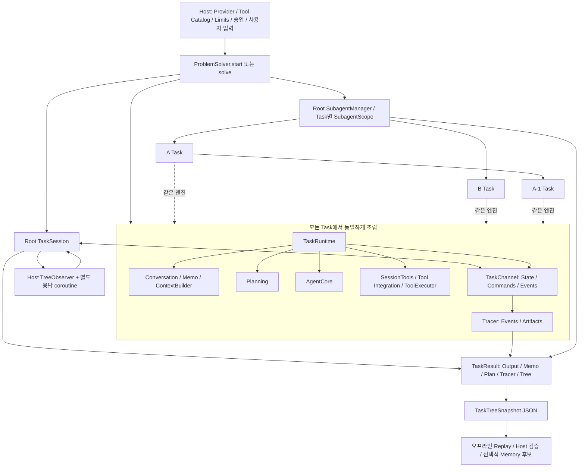

# 8단계: 전체 실행 통합과 Host 계약 검증

작성일: 2026-10-18 KST. 기존 7단계의 실행 엔진을 그대로 사용해 외부 Host의 전체 사용 흐름을 연결했다.
공개 API 추가나 `src/` 변경은 없으며 새 Runtime·Scheduler·결과 타입도 만들지 않았다.

## 1. 작업 전 확인과 범위

목표 아키텍처, 1–7단계 보고서와 State/Tracer 보완 보고서, 7단계 실제 Ollama 비교 보고서를 확인했다.
Solver·Session·Runtime·Core, 상태·Context·Planning, 재귀 Manager/Scope·Communication,
ToolRegistry/Executor·SessionTools/Integration, Tracer/Tree와 기존 예제·배포 검사 코드를 대조했다.

작업 전 `.venv/Scripts/python.exe -m unittest discover -s tests -v`는 **228개 통과, 28.946초**였다.
기본 `python`은 지원 범위 밖인 3.10이며 미설치 소스를 찾지 못했다. 저장소의 Python 3.12.9 환경으로
전환했다. Windows sandbox에서는 최소 `asyncio.run()`도 `socket._fallback_socketpair → accept`에서
정지함을 faulthandler로 확인했다. 기존 보고서와 같은 환경 제약이며, 승인된 sandbox 외부 실행에서
오프라인 테스트를 수행했다. 엔진의 이벤트 루프 구현을 바꾸지 않았다.

기존 미커밋 변경을 기반으로 작업했으며 목표 아키텍처·과거 보고서·old/_deprecated 코드를 보존했다.
이번 작업에서 commit/push는 하지 않았다. 이전 Ollama의 0/4 업무 실패를 수정하거나 과거 결과를 고치지 않았다.

## 2. 변경 파일과 책임

| 파일 | 책임 |
|---|---|
| `examples/full_workflow_host.py` | 공개 API로 Root 시작, 전체 Tree 관찰, 별도 Host 응답, 지시/취소, 검증·JSON 저장·Memory 후보 |
| `examples/workflow_support.py` | 작은 합성 fixture, 실제 Host handler/catalog/profile, ToolCall을 반환하는 Fake Provider, 제어 Gate |
| `examples/replay_task_tree.py` | 저장 Tree만 읽어 관계·상태·출력·Memo·Plan·통신·실행 기록 표시 |
| `examples/ollama_workflow_host.py` | 이미 설치된 모델로 1회 실행하는 작은 opt-in 실제 집계 실험 |
| `tests/test_full_workflow.py` | 12개 통합 테스트: 정상/제어/실패/관찰/배포 가능한 독립 Replay |
| `tests/verify_distribution.py` | wheel/sdist 코드·테스트·예제·문서 바이트 검사, 격리 import·전체 suite·CLI 실행 |
| `pyproject.toml`, `MANIFEST.in` | 예제와 문서를 배포 데이터에 포함, 기존 폐기 코드 제외 유지 |
| `README.md`, `docs/HOST_USAGE.md` | 실제 공개 API 사용법과 비차단 Host 패턴, 배포 사용법 |
| 이 보고서, `ollama_report.md` | Fake로 확인한 계약과 실제 모델 관찰·제약 구분 |

`TaskResult`는 기존 타입 그대로다. Host의 summary dict는 업무 평가·수집 메타데이터이며 새로운 엔진 결과
모델이 아니다. 예제의 `TreeObserver`도 Session을 구독하는 Host helper이며 라이브러리 내부 메시지 버스가 아니다.

## 3. 실제 전체 구조



Root와 자손은 `ProblemSolver._assemble_task()`의 기존 공통 조립 경로를 사용한다. 실행 제어는
TaskRuntime, 1회 판단은 AgentCore, 도구 호출은 SessionTools/ToolExecutor, 실제 handler는 Host 소유다.
Manager는 Root 전체 관계·누적 예산·Session·결과를 보존하고 각 Agent scope는 직접 자식만 관리한다.
새 정책이나 별도 스케줄링 계층은 없다.

## 4. 공개 사용 흐름과 실행 방법

`ProblemSolver(provider).start(task, model=..., limits=..., subagents=..., host_tools=...)`로 Root를 시작한다.
Host는 Session의 `events/state/artifact/answer/send_instruction/cancel/result`를 사용한다.
단순 작업은 `solve()`가 결과까지 기다린다. dormant Session은 `create_task(request=TaskRequest(...))`로 만든다.
Provider·모델·옵션·profile 권한·단일 Task와 재귀 실행 차이는 [Host 사용법](../../HOST_USAGE.md)에 정리했다.

```powershell
.\.venv\Scripts\python.exe examples/full_workflow_host.py --review-memory
.\.venv\Scripts\python.exe examples/replay_task_tree.py build/full_workflow_demo/task_tree.json
.\.venv\Scripts\python.exe examples/full_workflow_host.py --control instruction --output-dir build/phase8_instruction
.\.venv\Scripts\python.exe examples/full_workflow_host.py --control cancel --output-dir build/phase8_cancel
```

Python 패키지가 설치되어 있으면 다른 폴더/프로젝트에서도 실행할 수 있다. wheel에도 관련 예제와 문서를
`share/shs-agent/`에 포함했다. Fake 기본 실행은 표준 라이브러리 외에 외부 서버·SDK·DB·모델을 요구하지 않는다.
기존 SQLAlchemy 설치 의존성 선언은 유지하되 경량 import 경로에서는 로드하지 않는다.

## 5. 대표 정상 시나리오

Root가 Plan을 만들고 A/B를 생성한다. A는 A-1을 생성한다. A-1의 집계 기준 질문을
A → Root → B로 중재하고 B는 실제 `policy_read` handler에서 읽은 정산 상태·통화 기준으로 답한다.
각 단계는 실제 Request ID와 관련 ID를 사용한다. Host 질문은 Root의 실제 question_id에 별도로 답한다.

A-1은 `customer_lookup`을 요청하고 A와 Root가 실제 `tool_forward`로 전달한다. Host가 거부하면 A-1은
`plan_revise`로 익명 거래 조회로 계획을 바꾼다. 이어 `ledger_read` 요청을 같은 경로로 전달하고 Host가 승인한다.
다음 안전한 경계에서 적용된 도구가 다음 LLM 스키마에 나타난 뒤 실제 handler가 원본 행을 반환한다.

Fake Provider는 그 도구 결과와 B의 답변으로 정산 완료 거래 3건·2,500원을 계산한다. Memo와 Plan을 정리하고
부모에게 알린 뒤 완료한다. A와 Root는 `subagent_wait`/`subagent_result`로 결과를 회수하고 마지막
`task_complete`로 종료한다. Fake는 Runtime에 응답·Tree를 직접 주입하거나 실행 함수를 교체하지 않는다.
Task ID·요청·Tool 결과·Plan·종료·Tracer는 모두 실제 라이브러리에서 생성된다.

Host oracle은 출력 필드와 값, 실제 조회 성공, 엔진 완료를 확인한다. 최초 Context에는 정답을 주지 않는다.
`business_review`는 TaskStatus와 별개다. 틀린 output을 검토하는 테스트에서 completed와 원본 Tracer를
그대로 보존하며 Memory 후보를 비운다.

## 6. 실시간 전체 Tree와 순서 계약

현재 공개 API로 충분하여 라이브러리 구독 API를 추가하지 않았다. `TreeObserver`는 시작 시
`root.subagents.snapshot()`을 읽고 각 Task의 prefix를 수집한다. 이어 그 Snapshot의 cursor를 사용해
`session.events(after_sequence=...)`로 이어받는다. `subagent_created`를 받을 때 새 자손도 같은 방식으로
등록하고 Task ID별 한 번만 등록한다. 과거 생성 이벤트도 처리하므로 이미 끝난 자식도 포함한다.
`asyncio.TaskGroup`은 처리 도중 추가된 모든 watcher가 끝날 때까지 기다린다.

각 기록에는 Task/Parent/Root ID, depth, TaskState/AgentState, model, 현재 Plan 참조, operation,
Event Type/Sequence, Artifact ID가 들어간다. 상태를 포함한 실제 이벤트로 사건 시점의 상태를 복원하고,
현재 state()를 과거 사건에 잘못 붙이지 않는다. 상세는 공개 `artifact()`로 읽고 같은 Task의 references 및
다른 Task의 task_refs를 해결한다. 터미널에는 주요 호출·Plan·질문/답변·자식·승인 이벤트를 표시한다.

`receipt_index`는 Host가 수집해 JSONL에 저장한 순서다. Task 내부 Sequence나 병렬 사건 간 인과관계와
혼동하지 않는다. `historical`은 prefix로 받은 사건 표시이며 발생 시각이 아니다. 인과관계는 Task ID,
LLM Call ID, Tool Call ID, Request ID 및 Artifact 참조로 추적한다.

동일 실행에서 Live의 Task별 모든 Event가 최종 Trace와 일치하고, **각 Event cursor의 상태** 및 수집한
모든 Artifact가 JSON 왕복 결과와 일치하는지 비교한다. 비교 시 JSON 배열/tuple 표현만 정규화하고 내용·순서·
ID를 수정하지 않는다. 생성 중 Snapshot, 중도 관찰, 관찰 전에 끝난 자식, 전체 종료 뒤 관찰도 테스트했다.

## 7. Host 응답·제어와 도구 상태

`TreeObserver`는 입력을 기다리지 않는다. `host_decisions`가 별도 Queue를 소비하며 고정 데모 정책으로
답변과 승인을 보낸다. 특정 자손 제어는 별도 coroutine이다. Host 답변을 Gate로 지연한 테스트에서도
자식 종료 이벤트가 계속 수집됐다. 대화형 stdin은 구현하지 않았으며 실제 Host는 별도 입력 경로를 연결한다.

`answer()`는 enqueue receipt이므로 성공 답변으로 단정하지 않는다. summary에는 `answer_queued`를 기록하고
최종 이벤트에서 `command_applied`를 확인한다. 닫힌 질문에 대한 늦은 답변은 `command_rejected`, 종료된
Session에 새 답변은 예외다. Agent 간 질문은 자체 `request_id`와 `agent_reply`로 처리한다.

지시 예제는 A-1의 실제 ledger handler를 Gate에서 멈춘 상태에서 지시를 접수한다. 현재 handler 결과를
보존하고 배치가 끝난 후 지시를 적용한다. A-1의 Plan이 변경되고 결과는 T1만 포함한 1,200원이 된다.
다른 Task에는 instruction 명령이 생기지 않는다. 취소 예제는 같은 경계에서 A-1만 취소한다. handler 결과와
cancelled trace를 보존하고 부모는 결과를 회수한다. Root completed와 업무 수용 실패를 별도로 확인한다.

요청 상태는 requested / awaiting_host / approved / applied / denied / apply_failed / closed를 구분한다.
정상 통합에서 앞의 다섯 상태를 확인하며, apply_failed·적용 전 취소·전체 배치의 스키마 유지 등은
기존 `test_tool_integration` 회귀 테스트도 유지한다. Host 결정은 원래 요청 Task/ID에만 전달하고,
`approved` 직후 아직 도구가 적용되지 않았음을 확인한다. `tool_access_applied`와 다음 LLM 실제 요청
스키마, handler의 성공 결과까지 검증한다. Root/A/B에는 ledger 도구가 노출되지 않는다.

추가 재귀 취소 테스트에서는 Host 승인 대기 중 Root를 취소하고, 원래 요청이 closed로 닫히는 것과
종료 후의 승인·거부가 모두 거부되는 것을 검증했다. 실행 중인 통신 요청도 pending으로 남지 않았다.

## 8. 최종 결과와 저장 자료

Root 결과에는 기존 `status`, `stop_reason`, `output`, `memos`, `plan`, `messages`, `tracer`, `tree`가 있다.
자손 결과는 `result.tree.result(task_id)`에서 상태·출력·Memo·최종 Plan을 읽는다. Tree의 traces에는 각
Task의 LLM 공통 요청/응답, 기존 adapter가 제공하는 SDK 관측, Tool 인자·원본 결과·LLM 표시 결과,
통신·승인/거부/적용·Plan 이력·최종 Context가 보존된다.

```python
result = await root.result()
tree_json = result.tree.to_json(indent=2)
restored = TaskTreeSnapshot.from_json(tree_json)
for task_id, trace in restored.traces.items():
    print(trace.state(), restored.result(task_id))
```

`replay_task_tree.py`는 이 자료만 읽는다. `--details`는 전체 Artifact도 표시한다. 새 격리 Python 프로세스에서
Session/Provider/Registry/Manager 없이 재구성하는 테스트가 있다. 실시간 구독이 전혀 없는 재귀 `solve()`도
완전한 Tree를 반환한다. Replay는 실행 재개나 LLM/Tool 재실행이 아니다.

`complete`는 종료된 로그이고 업무 성공이 아니다. 실패/취소 시에도 Tree와 상세가 보존된다.
`details_complete`는 recording_scope 내의 상세 수집 완전성이다. HTTP 원문·비공개 추론을 복구하지 않는다.
단일 Task는 `tree=None`이고 `tracer`로 읽는다. Root 전체 Tree는 Sub-agent 기능을 활성화한 경로에 제공된다.

## 9. Host Memory 경계

기본 실행은 장기 Memory 후보도 자동 생성하지 않는다. `--review-memory`를 지정했을 때만 Host 수용 결과를
확인한 뒤 최종 집계와 원래 ledger tool-result의 Task/Artifact 참조를 후보로 추출한다. Memo·Plan·자식 결과·
원본 Tool 결과는 이미 Tree에서 검토할 수 있다. 후보는 향후 Host가 저장 여부를 결정할 자료이며 자동 저장,
Vector DB·임베딩·MindMap·Memory Manager는 없다. 미검증 추론이나 임시 정보를 확정 사실로 저장하지 않는다.

## 10. 검증 결과

| 검증 | 결과 / 근거 |
|---|---|
| 변경 전 전체 unittest | 228개 통과, 28.946초 · `build/phase8-baseline.log` |
| 추가 통합 테스트 | 12개 통과, 전체 회귀에 포함 · `build/phase8-regression.log` |
| 전체 회귀 | 기존 228개 + 신규 12개 = 240개 통과 · `build/phase8-regression.log` |
| 기본 Fake Host | completed + 업무 수용, 실제 policy/ledger handler 실행, 4개 Task |
| 지시 / 취소 / 실패 | Gate로 안전 경계·대상 격리·재귀 정리·결과 회수 검증 |
| Live / Replay | Task별 전 이벤트·각 cursor 상태·상세 참조·관계 일치, 미구독 실행 복원 |
| wheel / sdist | 각각 240개 통과, 예제·문서 검사 및 격리 Fake/Replay CLI 통과 · `build/phase8-distribution.log` |
| 실제 Ollama | gemma4:e4b 1회 작은 집계 수용, 자세한 범위는 별도 보고서 |

신규 테스트는 Task 생성과 재귀 조립도 Provider의 실제 ToolCall을 사용한다. 동시성은 `asyncio.Event` Gate로
진입·해제 시점을 확인하며 실행 시간이나 임의 sleep으로 주장하지 않는다. 테스트 watchdog은 검증 hang 감지용이며
엔진 시간 제한·자동 취소 정책이 아니다. 기존 회귀는 추가 인자 오류, 승인 적용 실패, closed 요청, LLM 중 지시,
Schema 배치 경계, 한도·불완전 종료 등도 포함한다.

배포 검증 명령은 `uv build --offline`과 `.venv/Scripts/python.exe tests/verify_distribution.py`다.
wheel/sdist의 모든 현재 소스, sdist 테스트, 포함 예제·문서의 바이트를 검사한다. `-I -S`에서 checkout에 의존하지
않고 각각 전체 suite를 실행한다. wheel 예제는 wheel 데이터에서 추출한 사본으로 실행하며 동일한 테스트가
저장소 예제로 몰래 대체되지 않도록 import 위치도 확인한다. 각 배포물에서 Fake CLI와 Replay CLI를 실행한다.
torch/ollama/openai/sqlalchemy 및 폐기 코드를 경량 import가 로드하지 않는지도 확인한다.
최종 로그: `build/phase8-distribution.log`.

실제 Ollama는 **전체 Fake 시나리오와 다른 작은 작업**이다. 단 한 모델의 한 번 성공을 일반 문제해결 능력이나
모든 기능의 실제 모델 검증으로 일반화하지 않는다. [실제 실행 보고서](ollama_report.md)에 observed와
not_observed, 모델 인자 오류를 보존했다. 이전 7단계 결제 사고의 업무 실패 0/4 결과와 혼합하지 않는다.

## 11. 완료와 후속 항목

구현·테스트로 확인: 기존 공통 엔진의 정상 전체 실행, depth 2 재귀·부모 중재 통신·Planning/Replanning,
Host 질문·승인/거부·실제 도구 적용/호출, 특정 자손 지시/취소, 비정상 종료의 재귀 회수, 전체 결과·상세 Tracer,
Live/JSON 재구성 일치, 독립 Replay, 단일 Task/비활성 기능 회귀, Host 수용 평가와 Memory 후보 경계.

실제 모델에서 확인: 작은 거래 집계의 Host 답변, Plan 생성, 깊이 1 자식, 실제 handler 조회, 결과 회수와
정답, Live/Tree 일치. 이번 실제 실행에서 미관찰: 깊이 2, Agent 간 질의, 동적 거부/승인/적용, Replan,
실행 중 지시·취소·실패 복구. 해당 엔진 경로는 Fake 테스트와 구분한다.

후속: 긴 Context 예산·conversation_search 중첩, 모델별 인자 오류 안내·Ollama 빈 응답 조사, Host가 결정할
재시도/모델 변경 정책. Token Streaming, Pause/Resume, 자동 Storage/Checkpoint, 실제 Workspace/Git 격리,
플러그인 자동 설치, 장기 Memory, GUI, 분산 실행/새 Scheduler는 이번 범위 밖이다.

공개 API의 follow-up 후보는 예제에 있는 관찰 helper를 라이브러리로 승격할 필요성, 큰 상세 Trace의 복사 비용,
Tool 상태/질문 표시의 가독성이다. 현재 동작을 완성하기 위한 대규모 리팩터링이나 새 실행 정책은 도입하지 않았다.
